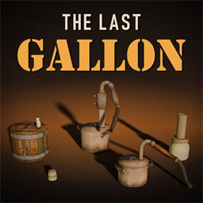

# The Last Gallon



A mod for Project Zomboid **Build 42.22.2**. Fuel ages, takes up water and
gathers dirt; engines start harder, lose power and wear on poor fuel; you
can ferment, distil and dry your own ethanol and convert a generator or a
car to run on it, or make biodiesel from wood and cooking oil for diesel
engines. The current version is 0.3.2, of 2026-11-11
([CHANGELOG.md](CHANGELOG.md)). The specification it was built from is
[The_Last_Gallon_Implementation_Plan.md](The_Last_Gallon_Implementation_Plan.md).

This README is for developers and does not ship in the package. Players
install from the zip as [docs/player-guide.md](docs/player-guide.md)
describes.

## What is tested

* The domain layer and the authority logic run on the game's own Lua VM
  (`tools/run-tests.ps1`).
* In game, unattended, on this computer:
  * single player through the player's menus: the fuel adapters, start
    gates, stalls, poor fuel's effects on engines, the ethanol loop from
    crafting the machines to a converted generator and car running on the
    ethanol, the biodiesel chain from logs and oil to a can, the diesel
    generator, diesel vehicles and diesel pumps, every recipe made through
    the crafting window, a death and a new survivor in the same world,
    saves and reloads;
  * a dedicated server with two players on this computer: the same paths,
    carrying the vessel, a carrier's death and the machines' timers; the
    biodiesel machines' loads, the diesel generator, a diesel vehicle and a
    diesel pump with one player.
* The zip from `tools/package.ps1` is installed into a fresh game folder
  and played (`tools/rehearse-install.ps1`).

Not tested: a real network, and the pathways other than ethanol and
biodiesel.
[docs/release-checklist.md](docs/release-checklist.md) lists every release
gate and what is still open. Publishing to the Workshop is a manual step;
no script here uploads anything.

## Licence

CC BY-NC-SA 4.0, except the supplied machine models, the carry animations
and the diesel generator's two pictures, which are made from the game's
art ([LICENSE.md](LICENSE.md), [NOTICE.md](NOTICE.md)).

## Repository layout

| Path | Contents |
| --- | --- |
| `Contents/mods/TheLastGallon/` | Runtime package (`42/mod.info`, poster and icon; `common/media/...`) |
| `tests/` | Domain tests, fixtures, the in-game harness mods (dev only) |
| `tools/` | Test runner, harness launchers, dev environment, art tools, packaging |
| `docs/` | Environment, capabilities, decisions, matrices, balance, guides, test results and evidence |
| `art-src/` | Supplied models as delivered, with their provenance; the Workshop preview |

## Documents

| Document | What it holds |
| --- | --- |
| [docs/player-guide.md](docs/player-guide.md) | How to play with the mod; ships in the zip |
| [docs/support-matrix.md](docs/support-matrix.md) | What works on which paths, vehicles and servers; ships in the zip |
| [docs/migrations.md](docs/migrations.md) | Save data, upgrades and removal; ships in the zip |
| [docs/release-checklist.md](docs/release-checklist.md) | The release gates, their status, and every harness command |
| [docs/test-results.md](docs/test-results.md) | Every test run with its results; evidence in `docs/evidence/` |
| [docs/decisions.md](docs/decisions.md) | Design decisions (`D-0xx`) and their amendments |
| [docs/engine-capabilities.md](docs/engine-capabilities.md) | What the game engine does, from its bytecode and Lua, and what was seen in game |
| [docs/environment.md](docs/environment.md) | The pinned game build, the tools, the dev cache and the dedicated server |
| [docs/performance.md](docs/performance.md) | What the mod costs, measured, and its budgets |
| [docs/balance.md](docs/balance.md) | Gameplay numbers and their reasons |
| [docs/contracts.md](docs/contracts.md) | Rules for contributors |
| [docs/asset-requirements.md](docs/asset-requirements.md) | Every model, image and sound the mod needs; `docs/asset-audit.csv` audits them |
| [docs/security-audit-2026-11-05.md](docs/security-audit-2026-11-05.md) | The security audit of 0.1.0 (in Italian) |

## Commands

PowerShell, from this folder:

```powershell
tools\run-tests.ps1                                      # domain suite on Kahlua
tools\run-tests.ps1 -Entry tests/support/compile_check.lua
tools\check-translations.ps1
tools\setup-devenv.ps1                                   # deploy to the isolated dev cache
tools\run-sp-harness.ps1                                 # single player, unattended (unlocked desktop, no input, ~15 min); -Mode for the other cases
tools\run-mp-harness.ps1 -Clients 2                      # dedicated server and two clients on this computer, unattended; -Only for the other cases
tools\make-preview.ps1                                   # Workshop preview, mod list poster and icon (Blender)
tools\package.ps1                                        # build dist/ (never uploads)
tools\rehearse-install.ps1                               # install the zip in a fresh cache and play it (~20 min)
tools\rehearse-install.ps1 -Scenario existing            # the zip added to a save played without it (~30 min)
```

[docs/release-checklist.md](docs/release-checklist.md) lists every harness
mode with what it covers, and how long it takes where that was measured;
the results are in [docs/test-results.md](docs/test-results.md).

## Never point a cache at this folder

The game does not load mods from `<game>/mods`, where this repository
lives. On its first launch with a fresh cache directory (one without
`options.ini`), the game copies `<game>/mods`, this repository included,
into that cache. With the cache inside this folder, on 2026-10-30, it
copied the repository into itself until Windows path limits stopped it.
`tools/setup-devenv.ps1` keeps the dev cache outside `<game>/mods` and
writes `options.ini` before any launch; see
[docs/environment.md](docs/environment.md).
