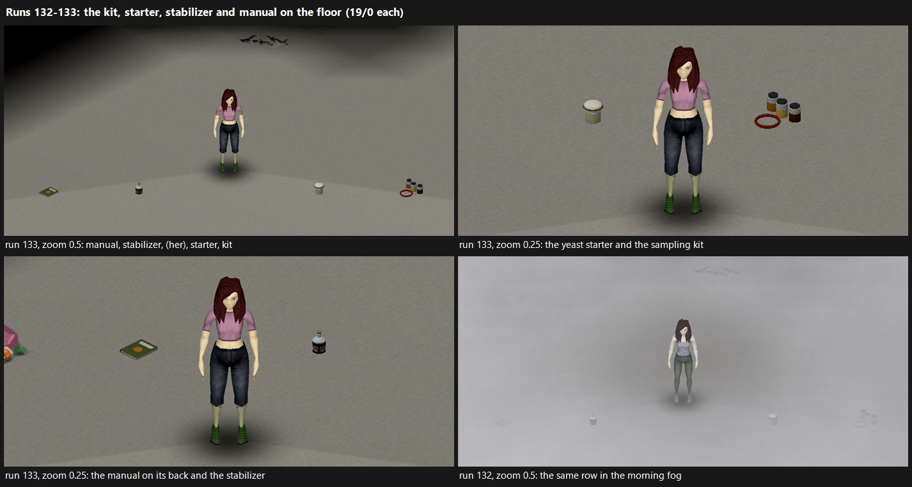
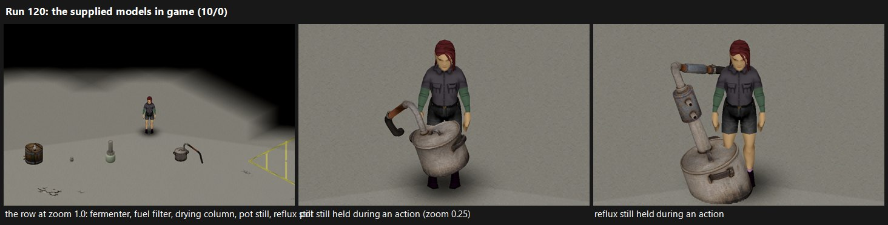
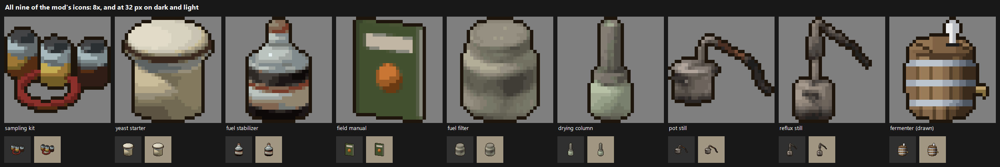

# Asset requirements

Every 3D model, 2D image and sound the full mod needs, keyed to the ids in
the code (`TLG/Content/*.lua`, `media/scripts/TLG_*.txt`), with its tier and
status. The "Audit" column gives the row of `asset-audit.csv`, which holds
every entry of this list since 2026-11-02 and each row's status
(`validationStatus`).

The list was compiled 2026-11-02 against commit `9cd85ce` on Project Zomboid
42.21.0 and rechecked at `96d5e2c`: the commits between touch no script,
icon, model, sound or asset gate. Vanilla names below were checked in the
installed 42.21 files (scripts and texture packs); apart from the former
stand-ins seen in run 66, none was checked rendering in game.

Tiers: **A** the shipped ethanol loop (needed for release gates 9 and 13),
**B** biodiesel, wood gas, biogas and propane (domain only, not wired),
**C** electricity, further vehicle conversions and stations.

## State of the shipped assets (tier A)

* **Models.** Five original world models ship, each an FBX and its texture
  generated with Tripo Studio under a commercial Tripo licence the user
  holds: the fermentation vessel's (`TLG.Fermenter`, supplied on 2026-11-02;
  `art-src/fermenter/PROVENANCE.md`), and since 2026-11-03 the pot still's,
  the reflux still's, the drying column's and the fuel filter cartridge's
  (`TLG.PotStill`, `TLG.RefluxStill`, `TLG.DryingColumn`, `TLG.FuelFilter`;
  `art-src/potstill`, `refluxstill`, `dryingcolumn` and `fuelfilter`;
  RT-SP runs 120–122). Four more are the mod's own, built by
  `tools/make-prop-models.ps1` from the simple shapes of their icons: the
  sampling kit's, the yeast starter's, the stabilizer's and the field
  manual's (`TLG.FuelSampleKit`, `TLG.YeastStarter`, `TLG.FuelStabilizer`,
  `TLG.ManualFuelSystems`; D-029). Every item stands on the floor as its own
  model since 2026-11-03, and no item uses a vanilla model. The import
  test's model lives in the dev-only harness mod.
* **Icons.** Every item's icon is the mod's own. The vessel's is drawn by
  `tools/make-icons.ps1` to match its model. Since 2026-11-03 the others are
  rendered by `tools/make-model-icons.ps1`: the two stills', the drying
  column's and the filter cartridge's from their models (runs 125–126), the
  sampling kit's, the yeast starter's, the stabilizer's and the field
  manual's from simple shapes built for them
  (`tools/blender/pz_icon_props.py`, run 129).
* **Held models.** Since 2026-11-02 the vessel is carried in both arms as
  its own model (`TLG.FermenterHeld`), through a carry pose made from two
  Mixamo clips (`art-src/carry/`, D-025). The other machines have no hand
  model (section 1 explains why).
* **Sound.** One sound is used: `VehicleAddFuelFromCanister`, by the TLG
  pour. Conversion work, a timed action of several hours, is silent.
  Sampling, treatments, the machine menu, draining a generator and pouring
  into a station run as instant requests with no action, animation or
  sound. A running machine makes no sound.
* **Audit.** `asset-audit.csv` has 57 rows. It had 25 (unchanged since
  `c8e7295`, 2026-10-30) and lacked the ash pit, the wood retort (it pointed
  at the still), the three TLG generators, the heat loop, the propane bulk
  tank, the IBC tank, by-product items, conversion badges and release art.
  On 2026-11-02 it grew to 56 rows (A21–A29, I05–I14, S02–S09 and R01–R04
  added, all NOT RUN or NOT STARTED then); A30, the vessel's carry
  animation, is the 57th.
* **Release gates.** Release gates 9 and 13 are PARTIAL on this.
  `tools/package.ps1` copies `art-src/preview.png` into the package and
  warns when it is missing.

Before their own art, the items used vanilla stand-ins that collided or
misled. The names exist in 42.21 (`models_items.txt`; `Item_*` entries in
`UI.pack`/`UI2.pack`), and how they render was first looked at on 2026-11-02
(run 66, `engine-capabilities.md` G13). Until their own icons (2026-11-03),
the sampling kit and yeast starter shared the jar icon, the filter cartridge
and drying column the respirator-filter icon (`AirFilters` is vanilla's
`RespiratorFilters` icon), and the pot still and reflux still the pot icon,
so in the inventory they could not be told apart; the field manual's icon
was the smithing magazine cover. On the floor the stills could not be told
apart either until their own models (both were the cooking pot), the drying
column was a car's fuel tank (`SmallGasTank` = `WorldItems/NormalGasTank1`),
and the fermentation vessel was a water-cooler bottle (`WaterTank`). The
four small items with no supplied model had no `WorldStaticModel` until
2026-11-03.

## Decisions to take before commissioning

None of the three is taken (2026-11-02). They are the user's to take; the
audit marks the rows that wait on them.

1. **Item or world object.** D-015 makes machines inventory items placed
   on the floor, so their art is a 3D item model (mesh and texture), not a
   tile sprite. Vanilla's hand press, barrels and composter are entity tile
   sprites and cannot be an item's world model (the audit named them for
   A05, A06 and A10 until 2026-11-02). The audit names the `FlaxPress` item
   model for A05 and no vanilla model for A06 and A10: none exists in the
   42.21 model scripts. The stationary gasifier (est. 2×2), the digesters
   (900 kg), gas holder, bulk tanks, solar array, wind turbine and
   waterwheel are not things a player carries. If they become world objects
   (B42 entities or tiles), their art becomes isometric sprites with a tile
   definition instead of models: a different deliverable.
2. **Budget.** Spec §22 plans about 6–10 new world models for the full
   package. The code defines 27 machine ids (4 of them vanilla items) and 3
   storage vessels that need art, and the spec adds 4 pieces not in code
   (controller, charging point, blending station, signage). Either models
   come in shared families (one drum and tank kit with lids, taps, stirrer,
   firebox and condenser parts for the fermentation vessel, retort,
   leacher, reactor, wash tank and digesters; the vanilla generator mesh
   retextured for the diesel and CHP sets; one panel kit for both solar
   ids), or the budget changes.
3. **Vehicle parts wait on G11.** Vehicle visuals are NOT RUN: no runtime
   format is known for a mounted gasifier, propane cradle or EV battery box
   until one mount is imported and tested (spec §21).

## Formats (checked in the 42.21 files)

| Kind | File | Script |
| --- | --- | --- |
| Inventory icon | PNG, 32×32 (vanilla `media/textures/**/Item_*.png` are 32×32), named `Item_<Name>.png` | item `Icon = <Name>` |
| Model | `.fbx` or `.x` mesh and a PNG texture (`tools/package.ps1` allows `.fbx`, `.x`, `.png`) | `model X { mesh = WorldItems/…, texture = …, scale = … }` (vanilla `WaterTank` 0.14, `CookingPotGround` 0.4); item `WorldStaticModel` (floor) and `StaticModel` (in hand) |
| Sound | `.ogg` under `media/sound/` (the package allowlist has no `.wav`); world loops mono and seamless | `sound X { category = Object, clip { file = media/sound/…, distanceMax = N, } }` as vanilla `sounds_zombie_voice_tutorial.txt`; a `loop` field appears in 32 vanilla clips. No FMOD bank needed |
| Workshop preview | `preview.png`, exactly 256×256, at most 1000 KB (`Translate/EN/UI.json:1004-1006`) | `package.ps1` copies `art-src/preview.png` |

Verified in game for two original item models, a text `.x` mesh (RT-SP
runs 64–67) and the vessel's supplied FBX (runs 68–69)
(`engine-capabilities.md` G13):

* Files inside the mod: the mesh in `media/models_X/<folder>/`, the
  texture in `media/textures/<folder>/` (the one the model script's
  `texture` names; the mesh file's own texture name is not used), the
  icon as `media/textures/Item_<Name>.png`.
* Author in metres, Y up, the origin at the centre of the base, and set
  `undoCoreScale = true` for about true size beside a character: at scale
  1.0 the model drew 1.5 times larger.
* The texture's V runs down (row 0 at the top). Fully transparent texels
  are cut out and back faces are drawn; partial alpha draws translucent.
  Items cast no ground shadow.
* At a turn of 0 the mesh's +X faces east and +Z north; turns run
  clockwise seen from above and survive a save.
* An FBX is drawn at its vertices times its model node's own scaling,
  times `scale`, times 1.5; its `UnitScaleFactor` is ignored. A Blender
  export in metres with no node scaling, 1.0 tall, stands 0.75 m tall at
  `scale = 0.5`, and its UVs need no flip.
* In the hand: an idle character draws a held weapon, and any other item
  only through a hand pose (`primaryAnimMask`). During an action the
  item's `StaticModel` is drawn at `Bip01_Prop1` with that model script's
  attachment block; without one, the vessel's supplied model hangs on its
  side there (run 74). An attachment offset moves a model 1.5 m per unit
  whatever its scale (runs 86–87). The game's poses are one-armed; a
  two-armed carry needs a clip of its own, retargeted onto the game's
  skeleton by `tools/blender/pz_arms.py` (runs 88–96).
* A player's held item hangs from the right hand and the arms from the
  chest (`IsoPlayer.onAnimPlayerCreated` reparents them), so a carried
  item turns with the chest. The standing clip keeps the pose on walking,
  running, sprinting and sneaking (run 108). With it, running and
  sprinting tilt the vessel with the lean (run 117), and crouched the
  vessel tipped into the torso. Two crouched clips keyed for the game's
  crouch walk and crouch idle keep it upright (A30, runs 110–113). A clip
  keyed for another body pose must hold that pose in its other bones too
  (`pz_arms.py --body`).
* The game runs a looping hand clip at the body clip's time fraction
  (BC `AnimLayer.findSyncTrack`), so a hand clip can follow a gait whose
  chest moves through the stride. The sprint clip is as long as the
  game's `Bob_Sprint` and keyed against each of its keys
  (`pz_arms.py --sync`); it keeps the vessel upright and steady (A30,
  runs 116–117). Running has no clip of its own yet.
* In multiplayer (RT-MP launch 145), the five small items' floor models
  drew in their colours on both clients' screens, and another player's
  screen drew the vessel's carry pose at each gait (standing, walking,
  running, sprinting, sneaking, crouched). The rest of this list was
  verified in single player.

## 1. 3D models

### A. Shipped ethanol loop

| Audit | Code id | Model | Status |
| --- | --- | --- | --- |
| A04 | `TLG.FermenterVessel` (`fermenter_barrel`, 160 L) | `TLG.Fermenter`, supplied, since 2026-11-02; carried in both arms as `TLG.FermenterHeld` through the carry pose (A30) | done; the editable sources missing |
| A03 | `TLG.PotStill` (`pot_still`, 60 L, firebox) | `TLG.PotStill`, supplied, since 2026-11-03: a lidded pot with a swan neck and hose, 1.05 m wide; no hand model | done, though it shows no firebox or condenser; the editable sources missing |
| A03 | `TLG.RefluxStill` (`reflux_still`, 120 L, firebox) | `TLG.RefluxStill`, supplied, since 2026-11-03: a boiler under a column with a condenser box, 1.35 m tall; it reads apart from the pot still | done, though it shows no firebox; the editable sources missing |
| I04 | `TLG.DryingColumn` (`drying_column`, 40 L) | `TLG.DryingColumn`, supplied, since 2026-11-03: a pipe column standing in its receiver jar, 0.82 m tall | done; the editable sources missing |
| A29 | `TLG.FuelSampleKit` | `TLG.FuelSampleKit`, the mod's own, since 2026-11-03 (D-029): three sample jars with a hose coiled in front, 0.34 m across | done |
| A29 | `TLG.FuelStabilizer` | `TLG.FuelStabilizer`, the mod's own, since 2026-11-03: a corked bottle of tar, 0.17 m tall | done |
| A29 | `TLG.FuelFilter` | `TLG.FuelFilter`, supplied, since 2026-11-03: a canister 0.15 m tall | done |
| A29 | `TLG.ManualFuelSystems` | `TLG.ManualFuelSystems`, the mod's own, since 2026-11-03: the field manual on its back, 0.24 m long; the manual spawns in loot since 2026-11-02 (runs 101–103, D-026), so a player can drop it on a floor | done |
| A29 | `TLG.YeastStarter` | `TLG.YeastStarter`, the mod's own, since 2026-11-03: a jar of culture under a tied cloth, 0.16 m tall | done |

Runs 121–122; the captions call the vessel "fermenter" and the filter
cartridge "fuel filter".

A machine's in-hand model can reuse its floor mesh through a second `model`
entry, as the vessel's does for its carry pose. One held in a single hand
is drawn only during an action, at true size: the stills covered the
character (runs 120–121), so they have none.

Run 120: the middle and right panels. The left panel shows the five models
on the floor; its caption runs into the middle one's.

### B. Biodiesel, wood gas, biogas, propane

| Audit | Code id | Needed | Note |
| --- | --- | --- | --- |
| A05 | `oil_press` | Screw press | the `FlaxPress` model (`WorldItems/Flax_Press`) of vanilla `Base.OilPress` (`items/normal.txt:11144`, a 0.2 kg tool) can stand in; scale unchecked, possibly too small for a machine |
| A21 | `wood_retort` | Sealed drum on a firebox, condenser pipe, tar tap | |
| A22 | `ash_pit` | Metal ash bin or pit | as a world object it could be a fire tile instead |
| A06 | `lye_leacher` | Leaching barrel with a tap over a boiling pan, firebox | |
| A06 | `biodiesel_reactor` | Heated drum with stirrer, firebox | |
| A06 | `biodiesel_wash_tank` | Cone-bottom settling tank with drain valve, small firebox | |
| A08 | `gasifier_stationary` | Hopper, firebox, cyclone, cooler, filter; cold, warming and running looks | est. 2×2 (decision 1) |
| A09 | `gasifier_vehicle` | Mounted unit for `Base.CarNormal`, `Base.SmallCar`, `Base.PickUpTruck`, `Base.StepVan` | blocked on G11 |
| A10 | `biogas_digester` | 900 kg tank with gas outlet | |
| A10 | `biogas_digester_heated` | The digester with firebox and heat coil | |
| A11 | storage `gas_holder` (20 Nm³) | Floating-drum holder or gas bag | |
| A23 | storage `propane_bulk` (380 Nm³) | Residential bulk tank | no named bulk-tank tile in the 42.21 tile definitions (the only propane entry is the small moveable `Base.PropaneTank`; unnamed map props were not searched): make one or drop the bulk tank |
| A24 | storage `tank_ibc` (1000 L) | Caged IBC tote | steel drums (`drum_steel`) are vanilla world drums already |
| A15 | conversion `gas_generator` | Mixer and regulator on the generator (today only `badge = "gas"`) | optional |
| A15 | propane vehicle cradle | Cylinder cradle per chassis | no conversion defined in code; blocked on G11 |

### C. Electricity, further conversions, stations

| Audit | Code id | Needed | Note |
| --- | --- | --- | --- |
| A12 | `battery_bank` | Rack of six car batteries with controller and inverter | |
| A13 | controller/inverter (not in code) | Cabinet with faceplate and indicators | |
| A14 | charging point (not in code) | Post with connector | |
| A17 | `solar_panel` (0.25 kW) | Panel on a frame | |
| A17 | `solar_array` (1.5 kW) | Several panels | larger than a tile (decision 1) |
| A18 | `wind_turbine_small` | Mast and rotor, rotor animated | |
| A19 | `hydro_wheel` | Undershot waterwheel, animated | |
| A25 | `generator_flex_5kw` | Nothing: the vanilla generator | optional badge decal |
| A26 | `generator_diesel_6kw` | Diesel genset | no diesel set in vanilla; a retextured vanilla generator could do |
| A27 | `generator_gas_chp` | Gas engine with heat exchanger | |
| A28 | `heat_loop` | Pipe and radiator piece | optional |
| A16 | EV conversion (not in code) | Battery box and motor per chassis | blocked on G11 |
| A07 | transfer/blending station (not in code) | Pump with hoses and drums | vanilla `FuelPump` entity is a candidate if it becomes a world object |
| A20 | restored station | Sign objects | pumps stay vanilla; textures in section 2 |

Vanilla, nothing to make: car batteries 1–3, `Base.CarBatteryCharger`,
`Base.PropaneTank`, the four generators, fuel cans, pumps, feedstocks.

## 2. 2D

### A. Shipped ethanol loop

Icons, 32×32:

| Audit | Item | Icon | Status |
| --- | --- | --- | --- |
| A01 | `TLG.FuelSampleKit` | `TLG_FuelSampleKit` since 2026-11-03: three jars of fuel and a rubber hose, rendered from shapes built for it (`tools/blender/pz_icon_props.py`) | done |
| I05 | `TLG.YeastStarter` | `TLG_YeastStarter` since 2026-11-03: a jar of culture under a tied cloth | done |
| I02 | `TLG.FuelFilter` | `TLG_FuelFilter` since 2026-11-03, rendered from its model (`tools/make-model-icons.ps1`) | done |
| I06 | `TLG.DryingColumn` | `TLG_DryingColumn` since 2026-11-03, rendered from its model | done |
| I07 | `TLG.PotStill` | `TLG_PotStill` since 2026-11-03, rendered from its model | done |
| I08 | `TLG.RefluxStill` | `TLG_RefluxStill` since 2026-11-03, rendered from its model | done |
| I09 | `TLG.FermenterVessel` | `TLG_Fermenter` since 2026-11-02 (`tools/make-icons.ps1`) | done |
| I01 | `TLG.FuelStabilizer` | `TLG_FuelStabilizer` since 2026-11-03: a corked bottle of tar with a label | done |
| I03 | `TLG.ManualFuelSystems` | `TLG_ManualFuelSystems` since 2026-11-03: an olive field manual | done; its floor model is built from the same shapes (A29) |

The sheet labels the filter cartridge "fuel filter" and the vessel's icon
"fermenter (drawn)": drawn by `tools/make-icons.ps1`, where the other eight
are rendered.

UI symbols (A02). Spec §16 asks for text and symbols, not colour alone.
The UI is text in context menus and rich-text dialogs, so showing symbols
also needs code (for example `<IMAGE:…>` in those dialogs, or option
icons). The translation keys already name every state:

| Group | Symbols | Keys |
| --- | --- | --- |
| Fuel condition | good, weathered, poor, unsuitable, unknown, empty (6) | `IGUI_TLG_Grade_*`, `IGUI_TLG_ConditionUnknown` |
| Contamination | water, phase separated, sediment, microbial (4) | `IGUI_TLG_Reason_*` |
| Treatment | stabilized, sealed, open (3) | `IGUI_TLG_TreatDone_*` |
| Engine fit | compatible, not compatible, marginal, cold start, gelling (5) | `IGUI_TLG_Compatible`, `IGUI_TLG_NotCompatible`, `IGUI_TLG_Reason_*` |
| Machine state | ready, processing, paused, output ready, faulted, maintenance, spoiled (7) | `IGUI_TLG_MachineState_*` |
| Pause reason | no heat, too cold, too hot, output full, not placed (5) | `IGUI_TLG_Pause_*` |
| Conversion badge | flex, gas (2) | `badge` in `Conversions.lua`, a string with no image |

That is 32, inside the spec's 25–40.

Release art (audit R01–R04):

| Asset | For | Note |
| --- | --- | --- |
| `preview.png`, 256×256 | Workshop upload (required) | taken from `art-src/preview.png`, made by `tools/make-preview.ps1` from the mod's own models (D-033) |
| poster | in-game mod list (`poster=` in `mod.info`) | `42/poster.png`, the preview; loaded by the game from the installed zip (run 190) |
| mod icon | in-game mod list (`icon=` in `mod.info`) | `42/icon.png`, the vessel's inventory icon; loaded likewise (run 190) |
| Workshop banner and screenshots | Workshop page | spec §22; not made (R04) |

### B and C

* An icon for every machine that ships as an item. B: oil press, wood
  retort, ash pit, lye leacher, reactor, wash tank, stationary gasifier,
  gasifier kit, two digesters, gas holder (11). C: battery bank,
  controller, charging point, two solar ids, wind turbine, waterwheel,
  diesel and CHP generators (9). Audit I10, I11.
* B: icons for by-products vanilla lacks: wood ash, lye, wood tar, dry wood
  chips (4; audit I12). Press cake and digestate may reuse vanilla items:
  `Base.AnimalFeedBag` (icon `AnimalFeed`), and `Base.Fertilizer` (icon
  `TZ_IndieStoneNPK`) or `Base.CompostBag` (icon `Compost`); stillage and
  spent lime are thrown away today and need nothing.
* Badges: wood gas, biodiesel (B); EV (C). Audit I13.
* C: energy symbols for battery charge, generating, demand and priority,
  unmet demand (about 4; audit I14).
* C: station signage textures (A20): products (gasoline, diesel, ethanol
  blend, biodiesel) and status (open, empty, out of order).
* A texture set for every model in section 1.

## 3. Sounds

Sound playback and zombie attraction are separate (spec §22): a machine
loop adds world noise only through code that decides to.

### A. Shipped ethanol loop

| Action | Now | Vanilla candidate (42.21) | Original |
| --- | --- | --- | --- |
| Pour into a vehicle or generator | `VehicleAddFuelFromCanister` | — | — |
| Collect ethanol into a can | none (instant) | `TransferLiquid` | — |
| Load mash, load wash, dry with quicklime | none (instant) | `TransferLiquid`, `PourWaterIntoObject` | — |
| Feed the firebox | none (instant) | `CampfireAddFuel`, `MetalDrumAddLogs` | — |
| Sample, stabilize, filter, drain water, seal, open, clean | none (instant) | `OpenBottle`, `TransferLiquid`, `PourLiquidOnGround` | — |
| Drain a generator into a can, pour into a station | none (instant) | `TransferLiquid`, `CanisterAddFuelSiphon` | — |
| Conversion work (hours) | none | `RepairWithWrench`, `Screwdriver`, `GeneratorRepair` | — |
| Fermentation vessel running | none | nothing bubbles in vanilla | airlock bubbling loop |
| Pot or reflux still running | none | `BoilingFood` over `CampfireRunning` | optional: boil with condenser trickle |
| Drying column running | none | — | silence is fine |
| Batch finished, batch spoiled | none | — | two optional cues |
| Engine refusing or stalling on bad fuel | the game's own | — | — |

The instant entries need timed actions (code) before a sound can play over
them. Audit: S01 the pour, S02 the instant actions, S03 conversion work, S04
the vessel's loop, S05 the stills, S06 the batch cues.

### B and C

Vanilla covers generators (`GeneratorLoop`, `GeneratorStarting`,
`GeneratorStopping`, `GeneratorFailedToStart`, `GeneratorBackfire`), gas
burners (`PropaneBarbecueRunning`), cylinder swaps (`BBQPropaneTankInsert`,
`BBQPropaneTankRemove`), charging (`CarBatteryChargerRunning`), switches
(`LightSwitch`, `KnobSwitch`), outages (`WorldEventElectricityShutdown`),
welding (`CraftWelding`, `BlowTorch`) and wind and water ambience
(`WindowWind`, `WaterDrip`, `WaterTowerAmbience`). Audit S07.

Originals, where vanilla has nothing close (audit S08, S09):

* B (about 10): oil press loop; reactor stirring loop; retort loop;
  gasifier running loop, start-up (lighting, blower, flare), shutdown and
  venting, clogged-filter cue; gas valve and leak hiss; digester bubbling;
  gas holder creak (optional).
* C (about 9): inverter hum and relay click; wind turbine rotor;
  waterwheel; EV motor loop, start and stop; charging point plug and unplug,
  charge hum.

With section A's 1–4 that is 20–23 files, at or just above the spec's
12–20; the gas holder creak, relay click and separate EV start and stop are
the first to cut.

## Totals

| Tier | New 3D models | Icons | UI symbols | Original sounds | Release art |
| --- | --- | --- | --- | --- | --- |
| A | 9, all made: 5 supplied, 4 the mod's own | 9, all made: the vessel's drawn, 8 rendered | 32 | 1–4, plus 7 actions on vanilla sounds | preview (required), poster and icon made; banner and screenshots not made |
| B | 15 (2 blocked on G11, 1 optional) | 15 | 2 badges | about 10 | — |
| C | 13 (1 blocked on G11, 1 optional) | 9 | about 5 | about 9 | — |

Not needed (spec §20, §22): new maps, character models or animations
(vanilla ones cover every action), new cars, helicopter assets, separate
can models per blend, custom fluid shaders. Particle effects are optional
(spec: usually 0–3, prefer vanilla smoke and steam).
