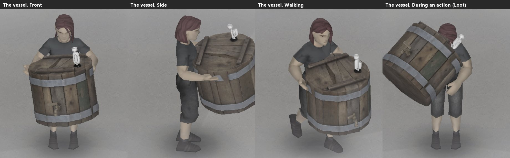
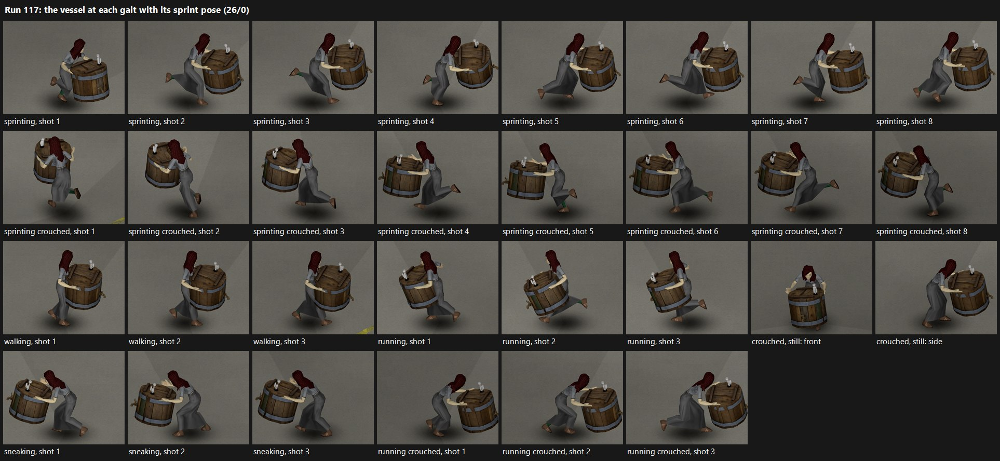
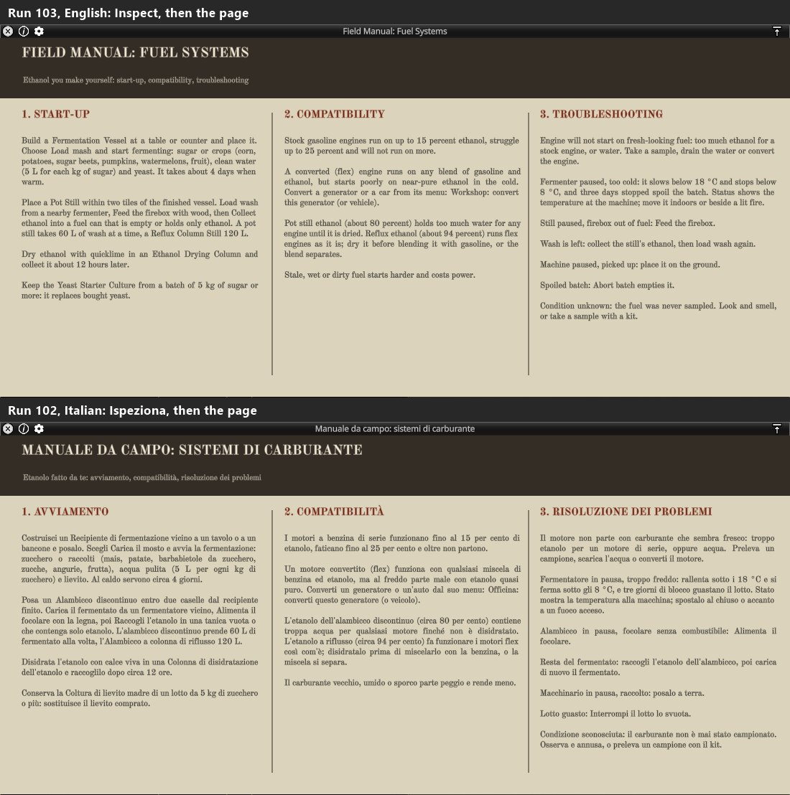
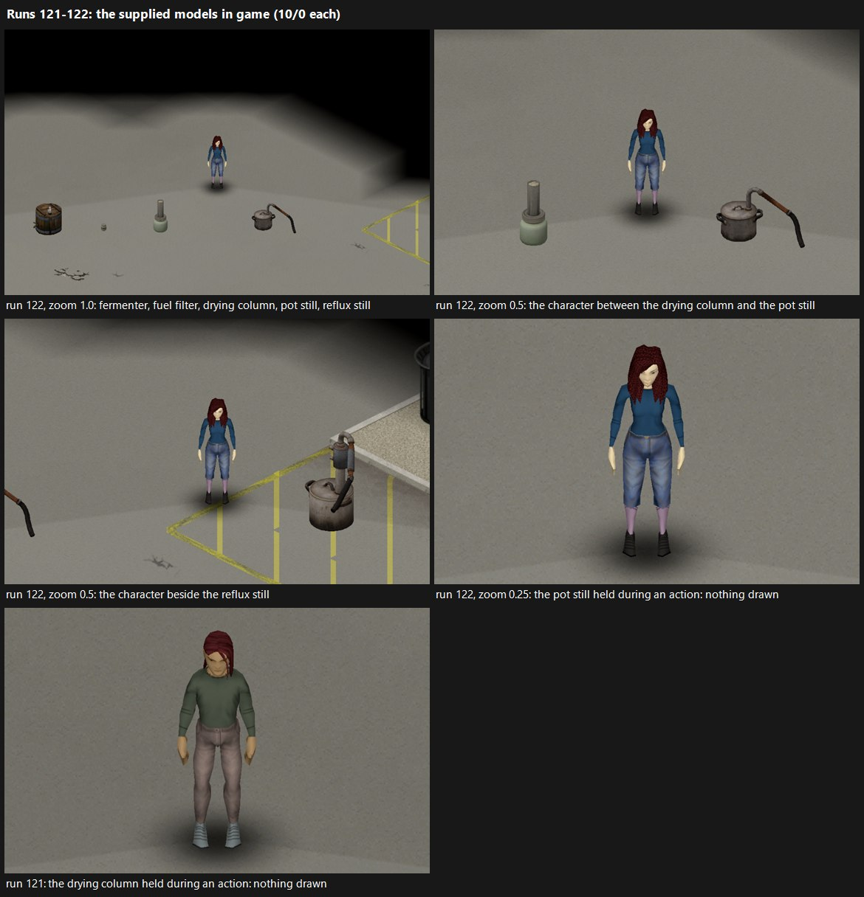
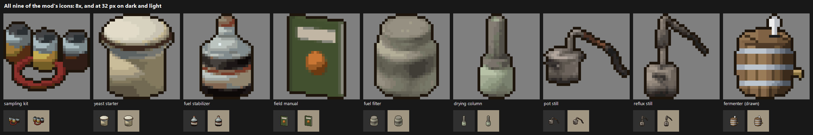
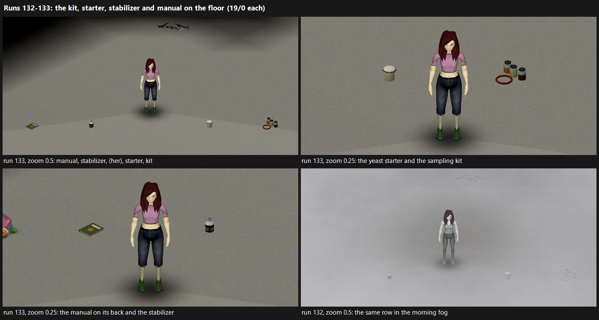

# Architecture decisions

Each entry gives the decision, its reason, the evidence and the consequences.
An amended entry opens with its current rule; the decision as first taken and
its amendments follow in date order. Superseded decisions stay listed with
their replacement.

## D-001 Pin one build (42.21.0)
* Decision: support exactly 42.21.0 (`4a0e9546ec`). `mod.info` uses
  `versionMin=42.21` and no `versionMax`; on other builds the mod logs a
  warning (and the UI shows it) instead of refusing to load.
* Reason: the specification forbids advertising generic B42 compatibility;
  a hard `versionMax` would block development the day the game updates.
* Evidence: `environment.md`.

## D-002 Repository and package layout
* Decision: the repository root is `<game>/mods/TheLastGallon` (chosen by
  the user). The runtime package is `Contents/mods/TheLastGallon/{42,common}`
  (Workshop layout). Development experiments live in a separate mod,
  `tests/ingame/TheLastGallonHarness`, that is never packaged.
* Reason: the spec keeps tests, tools and art sources out of the package.
* Evidence: BC `getAllModFoldersAux` / `getModVersionDirName` (G01).

## D-003 Domain tests on the game's Kahlua VM
* Decision: `tools/kahlua-runner` (reflection only, JDK 17 `--release 17`) runs
  Lua on `se.krka.kahlua` from `projectzomboid.jar` with the shipped
  `stdlib.lua`, launched by the game's Java 25.
* Reason: no standalone Lua is installed and the shipped VM is the real target
  dialect (Kahlua quirks would be missed by PUC Lua).

## D-004 Isolated dev cache outside `<game>/mods`, mirror deployment
* Decision: `%LOCALAPPDATA%\TheLastGallon\devcache`, `options.ini`
  pre-created, mods deployed with `robocopy /MIR`, no junctions.
* Reason: incident of 2026-10-30 (`environment.md`): first-run
  `copyPasteFolders("mods")` copied the repository into itself through a
  junction.

## D-005 Lua subset rules
* No `next`, `math.random`, `table.unpack`, `goto`, bit operations; floored
  modulo through `TLG.Num.mod`; no recursion deeper than a few hundred frames;
  deterministic iteration through `TLG.Tables.sortedKeys`; no structured error
  values (functions return `{ok=false, reason=...}` tables).
* Evidence: runtime probes (engine-capabilities, "Lua runtime").

## D-006 Quantity, composition and consumption ownership per adapter
* Current rule (amended 2026-11-02): the ownership below holds. Untracked
  inflow mixes in when it is found, at that moment's baseline, and changes
  are measured against the record as last written (amendment).

| Adapter | Quantity owner | Composition owner | Consumption owner | Sidecar store |
| --- | --- | --- | --- | --- |
| Item fluid container | native `FluidContainer` | native fluids (TLG fluids for alternatives and contaminants) | native (any vanilla use) | item modData `tlg` |
| Vehicle tank | native part content amount | TLG sidecar | native engine | part modData `tlg` |
| Generator | native `IsoGenerator.fuel` | TLG sidecar | native burn | object modData `tlg`; item modData while carried |
| Station reservoir | TLG reservoir record (litres) | TLG | TLG dispensing (managed pumps) | global ModData `TLG_Sites` |
| Mod machines/tanks | TLG | TLG | TLG | object modData / global ModData |

* TLG never subtracts fuel that a native owner consumes. Changes TLG did not
  initiate are reconciled: a decrease removes all components proportionally;
  an increase of unknown origin is mixed in as "untracked inflow" with the
  pessimistic world-baseline condition (never fresh). Diagnostics are logged.
* Reason: spec §8 (one consumption owner, reconciliation, no fresh fuel from
  unknown changes).
* Amendment (2026-11-02): untracked inflow mixes in when it is found. The
  changes are measured against the record as last written, never against
  the record aged since: aging turns fuel into water that native fluids
  never show, which would read as inflow. What left goes first, from the
  record as written. The record is then advanced to the read and the
  inflow mixes in there, at that moment's baseline (`Tx.reconcile`'s `at`,
  in all four adapters). It used to mix in at the last write, and the
  caller's advance then aged it a second time over the time it went
  unseen. A can topped up with 3 L while the mod was away for a game day
  read 0.049706 instead of 0.044565, 11.5 % more degraded (RT-SP run 54).
  Verified RT-SP run 55 (5/0 on return): the same scenario read the rule
  exactly, 0.313571525, where the old order gives 0.319523279.

## D-007 Native fluids for alternative fuels and contaminants
* Current rule (amended 2026-11-02): the fluids below. Every write of a
  native container's record also sets its fluids to the record's
  composition where a component differs by more than 1e-5 L, the litres
  unchanged (amendment).
* Decision: script fluids `TLG_Ethanol`, `TLG_Diesel`, `TLG_Biodiesel` (and,
  for contamination, `TLG_FuelWater`, `TLG_FuelSediment`) in category `Fuel`
  with a Fuel blend whitelist.
* Reason: native item containers then carry composition through every native
  transfer, including code paths TLG cannot hook; only chemical condition
  needs a sidecar. Vanilla `Water` cannot blend with `Petrol` (RT-DS), so water
  contamination needs its own fuel-category fluid.
* Consequence: vanilla refuel menus only accept containers that contain
  `Petrol`; TLG adds its own menu entries for other fuels (G03).
* Amendment (2026-11-02): every write of a native container's record sets
  its fluids to the record's composition where any component differs by
  more than 1e-5 L, the litres unchanged (`Containers.commit`). That covers
  a pour the mod follows (both cans), a first look (D-024), siphoning and
  pump-to-can; the mod's own transfers, treatments and machines already
  did it. Aging turns fuel into water. Written to the record alone, that
  water was dropped by the next read, which takes the fluids as they are,
  so an opened can never kept what it took up past its next vanilla pour
  (an opened can of ethanol lost 0.0075 L over 60 days in a test with a
  faked game). The tolerance sits below the read's 1e-4 L, which would
  drop what it skips, and above the float precision of native amounts.
* Writing the fluids (BC 42.21 `FluidContainer`): the game drops a fluid
  under 1e-4 L. Within 0.001 L of capacity a container reads as full, and
  `addFluid` refuses a new fluid (`adjustSpecificFluidAmount` has no such
  check). `Native.writeComposition` therefore holds the largest fluid
  already there low while new ones go in, smallest first, then sets it.
  A component under 2e-4 L goes to the largest, in the record and in the
  fluids alike (`Native.holdable`), so the litres are kept; the record
  keeps no condition for a fuel folded away (normalized). RT-SP run 57
  found the refusal: a full 10 L petrol can, its petrol lowered by
  1.1e-4 L for a look's water, refused the water and lost those litres
  (run 58 measured it). The same trap was there for a can filled to the
  brim at a clean station, whose last trace of water could be refused.
  Verified RT-SP run 59 (8/0, 300 days on the mod clock). An opened can
  of ethanol kept 0.080075 L of water through a vanilla pour and the
  next read, and a further pour carried water in proportion. A look put
  4.726e-4 L of water into a full petrol can, its 10 L unchanged. A full
  can took a new fluid.

## D-008 Degradation as a mixable concentration with closed-form aging
* Decision: each fuel component carries `deg`, a degradation-product index
  that mixes linearly by volume. Aging follows
  `d(deg)/dt = k(t) * (1 + a * deg)`, integrated in closed form over the
  cumulative driver `K = ∫k dt` (piecewise-constant daily environment).
* Reason: linear mixing makes "a small fresh addition cannot reset a large
  degraded reserve" hold by construction; closed form makes one large advance
  equal to many small ones up to floating-point error (spec §7, §15).
* Consequence: suitability is a separate mapping from `deg` to grades and
  consumer effects (tunable independently of campaign speed).

## D-009 World clock
* Decision: canonical time = `getGameTime():getWorldAgeHours()` (hours since
  world start, double). Calendar/season derived from the world start date.
* Evidence: BC `GameTime.getWorldAgeHours()`; RT-DS shows it frozen on an
  empty paused server, so unloaded catch-up is driven by elapsed world time,
  never wall-clock time.

## D-010 Station dispensing for managed pumps
* Decision: a pump becomes "managed" when TLG initialises its site. Managed
  pumps dispense through TLG actions with one unit convention (reservoir in
  litres); `pipedFuelAmount` mirrors the reservoir for vanilla UI. Vanilla
  `ISTakeFuel`/`ISRefuelFromGasPump` are intercepted for managed pumps.
* Reason: vanilla paths disagree on units (1 L vs 1.25 L per unit) and
  `ISTakeFuel:complete()` duplicates the final increment (G06, SRC).
* Status: implemented in `TLG/Integration/Stations.lua`. Both vanilla paths
  are settled after the fact: the pump is set to reservoir − litres
  delivered and the can's fluids to the reservoir blend, with the fractional
  remainder kept. Verified RT-SP 2026-10-31: 10 L into a can = −10 units,
  59 L into a car = −59 units, composition and degradation carried.

## D-011 Electrical priorities only where control exists
* Decision: dispatch priorities apply to TLG-owned consumers (chargers,
  machines). Vanilla appliances draw from a vanilla generator in aggregate and
  are shown as "uncontrolled load".
* Reason: no per-appliance control found (G10); the spec forbids showing a
  priority that cannot act.

## D-012 Multiplayer authority protocol
* Decision: clients send `sendClientCommand("TLG", command, args)` with
  `requestId`, object references and expected revisions; the server validates,
  advances participants to a common time, checks revisions/compatibility,
  bounds quantities, commits, increments revisions and replies with
  `sendServerCommand`. A bounded per-player request ledger makes retries
  idempotent. In SP the same handler runs locally.
* Reason: spec §14. Pure validation/commit logic lives in `TLG/Authority`
  and is unit-tested; the network transport is an adapter (G07 NOT RUN).

## D-013 Generator sidecar carried through pickup/placement
* Decision: wrap `ISTakeGenerator.complete` (object → item modData), every
  Lua path that drops a generator item (item → object) and
  `IsoGenerator.new` (Lua placement paths). Java converts a dropped
  generator item in `IsoGridSquare.AddWorldInventoryItem` (BC). The drop
  paths are:
  * `ISDropWorldItemAction.complete` (place/drop);
  * `ISUnequipAction.complete` (added 2026-11-02): the menus unequip a
    carried generator before another generator or heavy item is taken or a
    weapon equipped, and the unequip drops a heavy item at the feet itself;
  * the global `forceDropHeavyItems` (17 vanilla callers): a carried
    generator is dropped at the character's feet when a vehicle is entered,
    an animal handled, a trap set, and inside the takes;
  * `ISTransferAction:transferItem` to the floor container (inventory
    drag).

  After the drop the sidecar goes to the generator within one square that
  has no sidecar and has the item's `generatorFullType` and the item's fuel.
  Device identity and conversion projects (`tlgDeviceId`, `tlgEngineId`,
  `tlgConv`) travel the same way.
* Evidence: SRC `ISTakeGenerator.lua:41-53`, `ISDropWorldItemAction.lua:81`,
  `ISEquipWeaponAction.lua:75-98`, `ISTransferAction.lua:95-112`;
  BC `setInfoFromItem` (copies condition and `modData.fuel`, sets
  `modData.generatorFullType`, nothing else), `IsoGridSquare.AddWorldInventoryItem`.
* Limitation: a drop performed by Java alone (no Lua caller) is not seen; the
  generator then reads as untracked fuel at the pessimistic baseline (D-006).
* Status: verified RT-SP 2026-10-31 on `Base.Generator`: pickup, drop
  action, `forceDropHeavyItems` (taking a second generator while carrying
  one, the action queued directly), drag to the floor and
  `IsoGenerator.new` all carry the record. The menus' unequip was missed
  until 2026-11-02. In run 83 a generator put down by a bat equipped from
  the inventory menu lost its record. With the `ISUnequipAction` wrap, run
  85 (8/0) kept both records: one put down by taking a second generator
  from the world menu, and one put down by equipping the bat.

## D-015 Production machines are placeable items
* Current rule (amended 2026-11-06): the fermentation vessel, the stills
  and the drying column are inventory items placed on the ground. The
  process record lives in item modData (`tlgProc`) and travels with the
  item; a batch works only while its machine is placed.
  * The mod follows the moves the game's Lua makes: the world menu's
    **Grab**, transfers to and from the floor, the place action, and the
    take and drops of a heavy item (`ISEquipHeavyItem`, `ISUnequipAction`,
    `forceDropHeavyItems`). A pickup brings the batch to that moment and
    marks it carried; a put-down starts it again from that moment (runs
    27, 45, 79 and 81).
  * A move no Lua sees, such as the world menu's **Grab** in multiplayer,
    is found at the next access or put-down. The batch then counts up to
    `seen`, the last time the authority found the machine placed (runs 27
    and 155).
  * A carried machine answers **Status** only (run 46).
  * The vessel is a heavy item carried in both hands; on a dedicated
    server the mod takes it off the floor itself (D-030).
  * The authority also follows the hands (`Machines.onHands`): a machine
    with a record that leaves both hands and lands on the ground within
    300 ticks is put down from the tick it lands. A vessel dropped at its
    carrier's death works from the death, in single player (run 202,
    through `Machines.onDeath`) and on a dedicated server (run 210).
* Decision: fermenter, stills and drying column are inventory items placed on
  the ground; the process record lives in item modData (`tlgProc`) and
  processing only advances while placed. B42 `entity` world objects were
  considered but their build/placement path is unverified at runtime.
* Reason: item modData travels with pickup (spec "picking up a processing
  machine"), vanilla placement/pickup need no new code, and vanilla models
  serve as placeholders (asset target: zero bespoke models for the first
  playable).
* Consequence: picking a running machine up pauses it on next access without
  crediting the carried time (conservative). A placed fermenter, reflux still
  and drying column each ran a batch in game and kept their records across
  save and reload (RT-SP 2026-10-31, runs 7 and 12). On the game clock a
  fermenter whose chunk was unloaded for 24 game hours caught up exactly on
  the next access (runs 13–14).
* As first built (2026-11-01), this rule did not hold (RT-SP run 26, 3 FAIL).
  The adapter saw a move only at the next access, so it could not tell
  placed hours from carried ones:
  * an access while carried paused the batch from the previous access,
    dropping the hours it stood placed before the pickup;
  * the first access after it was put down started it from that access,
    dropping the hours since;
  * with no access while carried, the carried hours counted as if it had
    stood at its new place.

  The record itself travelled with the item through both pickup paths and
  both put-down paths of the run.
* Fix (2026-11-01): the adapter wraps the moves the game's Lua makes: the
  world menu's **Grab**, every transfer to or from the floor, and the place
  action. A pickup brings the batch to that moment at its site, then marks
  it carried. Putting it down starts it again from that moment and lists it
  for the hourly reading at once. The record keeps the site's tile and the
  last time the authority found the machine placed (`seen`, stamped at
  every access, hourly reading and ten-minute note). A move no Lua sees (in
  multiplayer the server grabs in a Java item transaction) is found at the
  next access or put-down: the batch counts up to `seen`, at most ten
  minutes short while the area is loaded, and not past it.

  Verified RT-SP run 27 (34/0): fermenters picked up with the **Grab** and
  the loot window and put down with the place action and **Drop** did the
  work of their placed hours exactly. One lifted with the grab's own calls
  outside its Lua (standing in for multiplayer) was credited up to 0.10 h
  before the grab. Verified on the stills and the drying column in RT-SP
  run 45 (41/0). A pot still picked up while distilling, a reflux still
  while heating up (grabbed unseen) and a drying column were carried two
  hours and put down again. Each then finished its remaining stage hours
  with exactly the wood and spirit of its definitions: no wood burned and
  no paused hours counted while carried. The unseen grab lost the 0.15 h
  since the last note. A move in multiplayer itself is NOT RUN.
* Amendment (2026-11-01): a carried machine answers **Status** only. Until
  then the authority refused loading a carried machine but took Feed the
  firebox, Collect, Pause, Resume and Abort batch, which the menu hides
  while it is carried (found reading the handlers after run 45). A Resume
  sent for a carried machine made the batch count from that moment. Put
  back on the tile it came from, the machine then counted its carried
  hours as work and burned wood for them (shown against the old handler:
  4 h of work for 2 h placed). All five now return `not_placed`. Verified
  by `tests/authority/test_machine_commands.lua` and RT-SP run 46 (46/0):
  the five, sent as requests for a carried pot still and drying column,
  were refused and the records left untouched.
* Across a save (2026-11-01, RT-SP run 48, 29/0 and 24/0): a pot still, a
  reflux still grabbed unseen and a drying column were saved and exited to
  the menu while carried, and the save was continued. Their records came
  back from the inventory exactly as saved: still marked carried, or, for
  the unseen one, unchanged. After another carried hour and the put-downs,
  each finished at its due time with exactly its wood and spirit.
* Amendment (2026-11-02): the fermentation vessel is carried in both hands
  (the user's request). It is scripted as vanilla's heavy items are
  (`Tags = base:heavyitem`, `RequiresEquippedBothHands = true`, as
  `Base.LargeMeteorite` and the anvils; BC
  `InventoryItem.isForceDropHeavyItem`). A double-click or drag in the
  loot window takes it into both hands (`ISEquipHeavyItem`), one heavy
  item at a time. It goes down at the character's feet when another heavy
  item is taken or a weapon equipped from the menus, which unequip the
  hands first (`ISUnequipAction` drops a heavy item itself, SRC
  `ISUnequipAction.lua:134`). It also goes down there when a vehicle is
  entered, an animal handled or a trap set (`forceDropHeavyItems`).
  `Machines.install` follows all three (`ISEquipHeavyItem`,
  `ISUnequipAction`, `forceDropHeavyItems`), as it follows **Grab**,
  transfers and the place action.

  42.21 leaves a heavy item's world object on the square when
  `ISEquipHeavyItem` takes it off the floor in single player (vanilla's
  meteorite too, RT-SP run 78: `sendRemoveItemFromContainer` acts only in
  multiplayer), so the item would be carried and still standing. For the
  mod's machines the hook then takes the world object off as the floor
  transfer does (`ISTransferAction.lua:131-158`); vanilla's own heavy
  items are left as vanilla leaves them. The loot window's **Grab** button
  stays a plain transfer into the inventory: vanilla does not check it
  for heavy items. An idle character draws no carried item but a weapon,
  vanilla's heavy items included (runs 73–75), so the carry has no pose
  (until D-025).

  Verified by `tests/integration/test_machine_sites.lua` and RT-SP runs
  79 (39/0: a running vessel taken the double-click way, carried an hour
  and dropped by `forceDropHeavyItems`, its carried hour not counted) and
  81 (43/0: taken again, carried half an hour and put down by taking a
  meteorite the double-click way, which unequipped it at the feet; it
  resumed at once and its carried half hour did not count). Until run 81
  the mod followed only `forceDropHeavyItems`, which the menus' take
  reaches with the hands already empty (found by reading
  `equipHeavyItem`).
* In multiplayer (2026-11-03, RT-MP run 155): the world menu's **Grab** of
  a running vessel is the move no Lua sees, as foreseen. The record still
  said `Processing` after it. The first **Status** while it was carried
  paused it, credited up to the last time it was found placed, and nothing
  more counted while carried. The inventory's **Drop** was seen: the batch
  ran again at once where the vessel landed.
* When its carrier dies (2026-11-05, RT-SP runs 198–199): the game drops
  the carried vessel at the body's feet, and no Lua hook sees that drop.
  As with any put-down the mod does not see, the batch stayed paused
  until the mod next found the vessel placed, at a **Status** or a take
  (0.04 game h lost in run 199). A successor coming back days later would
  have lost those days of fermenting.
* Amendment (2026-11-06): the mod listens for the death (`Machines.onDeath`
  on `Events.OnPlayerDeath`, on the authority; the user asked for it, "Yes,
  fix it"):
  * a machine still in the dying character's hands is watched for 300
    ticks until it lands, then put down from that moment;
  * one that went into the body stays carried;
  * one already at the feet when the event comes, its record still
    saying carried, is put down at the death. This is what 42.21 does in
    single player: run 202's log reads "0 machine(s) in the hands, 1
    already at the feet".

  Run 202 (18/0): the dropped fermenter worked 0.0356 h over the 0.0356
  game h from the death, as the placed one did. The watch branch is
  covered by `tests/integration/test_machine_sites.lua` only.
* On a dedicated server (2026-11-06, RT-MP run 209) the hook did nothing.
  A client's player died carrying a running vessel, and the vessel fell on
  the floor where the player died. Neither `OnPlayerDeath` nor
  `OnCharacterDeath` fired in the server's Lua. The record stayed carried;
  a **Status** about 1.3 game h later restarted the batch from then, and
  the hours between were lost, as before the hook. The game's code says
  why (BC 42.21, engine capabilities): `IsoPlayer.OnDeath` returns at once
  on a server, and the server drops the dead player's hand items in Java
  (`IsoGameCharacter.die` → `dropHeldItems` → `AddWorldInventoryItem`).
* Amendment (2026-11-06): the mod follows the hands on the authority
  (`Machines.onHands`; the user asked for it, "Fix it here"). Every drop
  empties the hands through `setPrimaryHandItem` and
  `setSecondaryHandItem`, which fire `OnEquipPrimary` and
  `OnEquipSecondary` wherever they run, a server included:
  * a machine with a record that enters a hand is remembered with its
    holder;
  * one that has left both hands is looked at every tick until it lies on
    the ground (at most 300 ticks), then put down from that tick. One that
    never lands (unequipped into the inventory) stays carried;
  * a drop a hook sees (`forceDropHeavyItems`, the menus' unequip, a
    transfer) is put down by that hook. The watch then finds the record no
    longer carried, at that tile, and writes nothing;
  * every ten game minutes the hands of the characters in the game are
    looked at again (`Machines.censusHands`). A player who joined or
    continued holding a machine is remembered: the game's load sets the
    hands with no event. One who left the server is forgotten.

  The same covers a climb's drop (over a wall, through a window, on a
  sheet rope): `dropHeavyItems` in single player, the server's
  `dropHeldItems` for a client. NOT RUN. In single player `OnPlayerDeath`
  still comes first: it fires inside the death, before the next tick, so
  run 202's put-down and its log line are unchanged, and the watch then
  finds nothing to do. Covered by `tests/integration/test_machine_sites.lua`
  (the server's drop in 42.21's order, a machine in one hand, an unequip
  into the inventory, a hook's own drop written once, a client, the
  ten-minute look).

  RT-MP run 210 (A 5/0, B 6/0) repeated run 209's case. The server's mod
  held the vessel as in A's hands from the take: the equip events reach
  the server's Lua. A died at 10661,10644, and the vessel landed there.
  The server put it down from 4.1684, 0.0533 game h after B's probe right
  before the death. That is when A died, two seconds (120 ticks) after the
  probe. The vessel was on the hourly list at once and worked from then:
  0.958 h of work by B's read, 1.29 game h after that probe. `OnTick` fires
  on the server (300 ticks in 78.8 s at its start), which the watch needs.

## D-016 UI feedback through rich-text dialogs
* Decision: inspection and machine results are shown in `ISModalRichText`
  dialogs built from translated keys; unknown condition has its own wording.
* Reason: readable without relying on colour or tiny world labels (spec §16).

## D-014 Gas fuels are not liquids
* Decision: gases use normal cubic metres (Nm³); propane is displayed in kg
  (2.01 kg/Nm³). Vanilla `Base.PropaneTank` is a drainable with 5000 uses and
  no fluid container (RT-DS); the propane adapter maps uses ↔ Nm³.
* Reason: spec §5 forbids interchangeable liquid litres for gases.

## D-017 Station water: mostly clean, a few contaminated stations
* Decision: station reservoirs start with 0–0.15 % water at about 9 in 10
  sites and 0.2–0.4 % at about 1 in 10 (`WorldInit.STATION_WATER`), instead
  of a uniform 0–0.4 %. Sediment is unchanged (0–0.1 %).
* Reason: with the uniform draw about half of all stations exceeded the
  stock car's 0.2 % free-water tolerance from day one, halving start chance
  before any progression route (ethanol, conversions, treatment) is
  reachable (RT-SP 2026-10-31, `startFactor=0.5` at the Gas2Go pump). The
  user chose the middle ground: keep a few bad stations to discover, let
  ageing drive the decline.
* Consequences: deterministic per world seed and pump position (domain test:
  404 of 4000 grid sites contaminated); existing reservoir records keep their
  water; no schema change.

## D-018 Conversion work is a timed action at the device
* Decision: **Work on it** queues the timed action `ISTLGConversionWork`. The
  character walks to the engine area or next to the generator, joins the
  project (which forfeits any unreported gap) and reports every 15 minutes
  of world time while staying in reach (4 tiles from a vehicle, 2.5 tiles
  from a generator). Leaving stops the action with a final report. The menu
  no longer offers **Report progress** or **Stop working**. The authority
  passes a 1 h worker timeout with every request
  (`ConversionDevices.WORKER_TIMEOUT_HOURS`), so a report after a longer gap
  credits at most 1 h and ends the assignment.
* Reason: **Report progress** credited all the time since the previous report
  (up to 12 h) as long as the player stood in reach at that moment, so a
  player could start the work, leave and collect the hours later; the domain
  assumed an hourly adapter report that nothing sent. Found reading the code
  on 2026-10-31; the user asked to require the player to stay.
* Consequences: the domain default timeout stays 12 h
  (`Project.WORKER_TIMEOUT_HOURS`) for callers that pass none, because its
  tests use multi-hour single reports; the in-game handlers always pass 1 h.
  A modified client sending bare reports gains at most 1 h per visit and has
  to be in reach when it reports. The action shows no progress bar:
  `setJobDelta` on an open-ended action makes vanilla's queue drop it as
  stalled (BC `BaseAction`, found in run 11); **Project status** shows the
  stage reached. Verified RT-SP (2026-10-31): a bare report after 3 h credited
  1 h; leaving reach stopped the action through `isValid()`; time away was
  not credited (run 9); from the menu, the walk to the engine area, a
  refused start and the ending on a missing tool (run 12).

## D-019 Where each TLG recipe is crafted
* Decision: every TLG craft recipe carries vanilla's place tags:
  * the fermentation vessel `AnySurfaceCraft;Carpentry` (as vanilla
    `MakeOilPress`);
  * the pot still and drying column `AnySurfaceCraft` (as the screwdriver
    assemblies in `recipes_electrical`/`recipes_radio`);
  * the reflux still `InHandCraft;Welding` (as `MakeMetalSheet`);
  * the sampling kit and filter `InHandCraft`;
  * the stabilizer `InHandCraft;Cooking`.

  `AnySurfaceCraft` needs a table or counter within two tiles. Pot and jar
  inputs say `mode:destroy`.
* Reason: the crafting window and the inventory "craft" menu only list
  recipes with one of the two place tags (SRC `ISHandcraftWindow.lua:53`,
  BC `CraftRecipeManager.getUniqueRecipeItems`); the recipes loaded but none
  could be crafted. Container inputs are kept unless `mode:destroy`, so the
  crafts handed the pot and jars back (RT-SP run 11).
* Consequence: verified RT-SP 2026-10-31 (run 12) for the four machine
  recipes through the inventory craft menu; the sampling kit, filter and
  stabilizer are listed but were not crafted in game. (All seven recipes
  were crafted through the crafting window in runs 192–193, 2026-11-04.)

## D-020 The recorded day temperature is the mean of the air, weather included
* Superseded in part by D-021: a placed machine now takes the temperature
  of where it stands, so the sentence on placement under Consequences no
  longer holds.
* Decision: every game hour the authority records today's temperature and
  humidity as the running mean of `ClimateManager.getTemperature()` and
  `getHumidity()` (`World.recordClimate`, accumulator `climateAcc` in the
  world record). Machines and fuel ageing read these day means through the
  climate model as before.
* Reason: the recorder used `getDayMeanTemperature()`, which is the season
  curve (BC: `currentDay.season.getDayMeanTemperature`), so the day means
  barely moved (0.5–0.6 °C for eleven January days, RT-SP run 15) and no
  cold snap or heat wave ever reached a machine or a tank. The comment said
  "today's mean temperature"; the code did not do that.
* Consequences: fermenters, stills and stored fuel now feel the weather. A
  fermenter stops on days averaging below 0 °C outdoors and spoils after 72
  paused hours (RT-SP run 16: four freezing January days, spoiled 73.2 h
  after loading). Where it stands makes no difference: machine temperature
  comes from the outdoor day mean only (`thermal = "sheltered"`), so in a
  long cold spell the player cannot keep a batch going. Early in a day the
  mean rests on few readings, and an advance made then is not redone: a
  machine read through the day and one caught up after midnight can differ
  slightly for that day (the exact G12 catch-up of runs 13–14 was in July,
  at full rate, where the temperature did not matter). Days recorded before
  the change keep their season values; no migration.

## D-021 A machine's temperature is the air where it stands
* Superseded in part by D-022: a fire's noted fuel now counts while away,
  so the hours away no longer all take the unheated value (Consequences).
* Decision: a placed machine's day temperature is the mean air temperature
  at its tile over the day's hours of the batch. While its area is loaded
  the authority reads the game's own value there every game hour
  (`ClimateManager.getAirTemperatureForSquare`: what a character standing
  there would feel, rooms, grid power and lit fires, fireplaces and
  barbecues included). Hours without a reading take the site's unheated
  value: outdoors the day's mean air temperature, in a room the day's mean
  of the game's room formula, which the climate recorder now logs for the
  ground and upper floors (`r0`, `r1`). The site (in a room or not, floor)
  is recorded on every access. Records without a site keep the
  definition's thermal exposure (`sheltered`). Fuel containers and tanks
  keep their storage profiles.
* Reason: after D-020 the weather reached the machines and nothing the
  player did could keep a batch going through a cold spell, while the
  status said "too cold here". The game already computes a temperature per
  tile for its characters; using it makes rooms, the grid and fires matter
  the way a player expects.
* The game's formula (BC 42.21):
  * outdoors, `getTemperature()` (a tile gets no wind chill);
  * in a room (`IsoGridSquare.isInARoom()`, map rooms and player-built
    rooms), 22 °C while `IsoWorld.isHydroPowerOn()`; otherwise
    T + (22 − T) × (0.4 + 0.2 × lagged daylight) on the ground floor, 0.85
    of that pull above it, mirrored above 22 °C;
  * then the hottest heat source within its radius R in clear line of
    sight raises it to T + (1 − d/R) × (T_source + clamp(T − 30, −7, 7) − T)
    (outdoor sources clamp to −15..5): `IsoFire` 35 °C with its light
    radius, `IsoFireplace` 35 °C, `IsoBarbecue` 25 °C with radius 3.
* Consequences: an unheated ground-floor room pulls the outdoor air
  0.4–0.6 of the way to 22 °C with the daylight, 0.435 on January days, so
  a fermenter there stops below about −3 °C outdoor day mean in January
  and slows below about 15 °C. Outdoors it slows below 18 °C and stops
  below 8 °C. With the grid on, or warmed by a fire, it can run at full
  rate. In three January runs a room alone was not enough (4.5–11.4 °C at
  the machine; the batch spoiled each time) and a warmed tile was. Heat
  counts only while the area is loaded: hours away take the unheated
  value (until D-022). The day mean averages its hours, so a few warm
  hours lift the whole day (the batch has a day's thermal mass). The hour
  in progress takes the previous hour's reading; otherwise a warmed
  machine paused after every midnight (run 17). A moved machine counts
  where it stood up to the pickup and at its new place from the put-down
  (D-015). Within the current day the value moves as readings arrive (as
  in D-020).
* Verified RT-SP 2026-10-31 runs 17–19: the room formula matched the
  game's own room value exactly over 94–96 hours per run. In run 19 the
  readings filed, the day temperatures reported and the hourly work
  matched the harness exactly. Run 21 (2026-11-01) did the same beside a
  fireplace of the map, tended with logs: the heat formula matched every
  tile around it at four fuel levels and the machine's air every hour,
  and the batch finished in January (20.7 °C or more at 2.24 tiles from
  the fire). A 12 hour absence cost it about 17 hours: the hours away took
  the unheated room value, and the fire, which burns its fuel during an
  absence all the same (vanilla), was out on the return.

## D-022 A fire left burning keeps warming a machine while its fuel lasts
* Decision: every ten game minutes the authority notes, for each loaded,
  placed machine with a batch running, the fire that gives its tile its
  air. That is the fire on the same floor within 18 tiles whose heat by
  the game's formula is the air read there (the one with most fuel if
  several match): a lit fireplace, barbecue or campfire a player built.
  * Fireplace: any `IsoFireplace` (fireplace, wood stove, the map's
    campfire tiles, brazier, barrel oven).
  * Barbecue: `IsoBarbecue`.
  * Campfire a player built: an `SCampfireSystem` campfire, the permanent
    `IsoFire` it keeps lit, its fuel read from the "Campfire" object's mod
    data.

  The note holds the fire's fuel, its offset and whether its tile is in a
  room. Notes are kept per hour, the hour's last one standing, "none" when
  no fire warms the machine. An hour without a reading (its area was not
  loaded) takes the warmth of the fire in the last note before it, from
  the start of the noted hour until that fuel would have burned out at one
  minute a minute. That warmth is the formula applied to the site's
  unheated day value (D-021's value for unread hours), with the radius at
  the fuel left at the start of each hour (a campfire's
  max(2, R × min(fuel, 360) / 360) truncated, R 10 outdoors and 18
  inside). After that the hour takes the unheated value.
* Reason: vanilla burns a fire's fuel while its area is not loaded. On
  reload `IsoFireplace.update` and `IsoBarbecue.update` use up every
  minute since their saved `lastUpdateTime` in one step (BC 42.21), and
  `SCampfireSystem` takes a minute off every lit campfire per minute
  event, loaded or not (SRC 42.21). In run 21 a fire left with 365 minutes
  was out on the return while the machine had been counted unheated for
  all 12 hours, and the batch lost about 17 hours. Crediting the warmth
  for the minutes the game spends the fuel keeps the two accounts the
  same.
* Consequences: with the default cap of 8 hours of fuel, a fire fed before
  leaving keeps a machine warm for up to 8 hours away; longer absences cool
  it as before. Fuel added after the last note (at most ten minutes old) is
  not counted, so feed the fire a few minutes before you go. Only the fire
  that gave the air at the last note counts: a second fire within reach
  that would outlast it does not take over. Other open fires (an `IsoFire`
  without a campfire has no fuel) and other mods' heat sources never
  count, and the unheated value is the day's, not the hour's. The game
  fires the minute event at most once per tick, so where a tick spans
  more than a game minute (fast speeds) a campfire outlasts its noted
  minutes: the credit can then fall short of the warmth, never exceed it.
  Notes stay on the authority and are not sent to clients.
* Verified RT-SP 2026-11-01 run 23 (21/0), beside run 21's fireplace:
  * the notes the mod took matched the harness's in all 99 hours, and none
    was taken while the area was unloaded;
  * the last note before a 12 hour trip (365 minutes) covered 6.08 hours
    of it;
  * the work over the trip matched the rule fed by the credited day
    temperatures exactly.

  The batch finished after 109.2 game hours (run 21, without the credit
  and in a colder January: 114.3). A barbecue as the noted fire was
  covered by unit tests only until runs 34–35 (below). A `false` note
  survives a save: item mod data saves boolean values (BC
  `KahluaTableImpl.save`). In run 25 a record saved with two "no fire"
  notes came back from save, exit and continue unchanged, and the credit
  then worked as before (a 424 minute note covered 7.07 hours of a trip).
* Campfires (RT-SP 2026-11-01, runs 34–35): run 34 (35/4) found that the
  campfire a player builds was never noted. It is not an `IsoFireplace` but a
  Lua global object (`SCampfireSystem`) whose warmth comes from a
  permanent `IsoFire`: 35 °C, radius the fire's light radius,
  max(2, 10 × min(fuel, 360) / 360) truncated outdoors. A fermenter one
  tile from one got no warmth for the hours away: 0 of the 6.48 hours its
  fuel covered, and the batch stopped for the rest of the day. Fixed as
  described above (commit `7b4f31d`). In run 35 (39/0) its notes matched
  the harness's in all 44 hours, the last before a 12 hour trip (397
  minutes) covered 6.48 hours, and the work over the trip matched the
  rule exactly (3.0312 hours). A charcoal barbecue was noted in all 44
  hours and credited exactly (6.02 hours) in both runs. On a dedicated
  server a barbecue has no heat source at all (BC `IsoBarbecue.update`),
  so there it warms nothing (not run).

## D-023 Abort batch keeps what the batch made
* Current rule (amended 2026-11-01): as decided below, with what a batch
  made counted as the share done of the stages its recipe marks as making
  its result (`makes`); a recipe snapshot that marks none still counts
  every stage (amendment). On a server the menu judges on the record the
  server sends each client (amendment of 2026-11-13).
* Decision: aborting a running or paused batch keeps what it made so far in
  the machine as output to collect, marked stopped early: a fermenter's
  wash, weaker and with its unfermented sugar, for a still; a still's
  spirit; a drying column's ethanol, partly dried. What cannot be kept is
  thrown away and listed: a still's undistilled wash (its converter
  reports it as `rest`) and every byproduct (stillage, spent lime). Kept
  plus thrown away account for the whole batch. A second Abort throws the
  kept output away; Abort also empties a spoiled batch. A finished batch's
  output is collected, not aborted. The menu offers **Pause** while a batch
  works, **Resume** while it is paused by hand, and **Abort batch** while a
  batch runs, was stopped early or has spoiled, judged on the record
  brought to now.
* Reason: until run 31 the handler only reported the partial result, so
  an abort lost the whole batch without a word (4 L of ethanol from a
  drying column in that run). A spoiled fermenter could be neither aborted
  nor loaded again: a dead machine, while the winter design makes spoiling
  routine (runs 16-19 each spoiled one).
* Consequences: a misclicked Abort keeps the output; losing it takes a
  second Abort. A fermenter stopped early holds its wash until a still
  takes it or a second Abort throws it away. An aborted batch hands out no
  starter culture, and not the last finished batch's either (the record's
  byproducts are cleared). Verified RT-SP run 33 (32/0): a pot still took
  a stopped wash, a drying column's ethanol was collected after an abort,
  a spoiled fermenter was emptied and loaded again.
* Amendment (2026-11-01): what a batch made is the share done of the
  stages that make its result, marked `makes` in the recipes. Those are a
  fermenter's fermenting, a still's distilling and a column's drying;
  preparing and heating up make nothing. Every stage used to count, so a
  still aborted an hour into distilling kept 1.61 L of spirit where 1.10 L
  had distilled (RT-SP run 49), and a fermenter's hour of preparing counted
  as 1/97 of its ethanol. A batch whose recipe snapshot marks no stage
  (started before the change) still counts every stage. The recipes of the
  other pathways (biodiesel, biogas, the wood retort and ash pit) mark none
  yet, and their making stages are to be marked with their machines.
  Verified RT-SP run 50 (28/0): a reflux still aborted an hour into
  distilling kept exactly the 1.10 L it had distilled. Run 51 (32/0)
  repeated run 33's controls under the rule, a fermenter's preparing hour
  making no ethanol.
* Amendment (2026-11-13, version 0.4.3): on a server the
  menu's **Pause**, **Resume** and **Abort batch** did not follow the batch
  of a machine on the floor. The menu judges on the client's copy of the
  record, and within a session that copy did not change when the server
  wrote the record: an item's mod data reaches only the client whose
  inventory holds it (`syncItemFields` sends nothing for an item in no
  container), and `transmitModData` on the world object sends that
  object's own mod data (engine-capabilities, RT-MP). RT-MP run 362, on
  0.4.2: a fermenter loaded, paused, resumed and aborted twice through the
  server, its client copy held no record throughout and the menu offered
  none of the three. A client joining, or a chunk loaded again, gets the
  item with its record as of that moment, a copy as stale as it is from
  then on (not run).
  * The authority now also sends each record it writes for a machine no
    character carries to the clients, without the hourly readings and
    fire notes (up to 480 entries each), and each client puts it in its
    copy (D-041). The writes of the hourly readings and the fire notes are
    quiet: they change nothing a menu judges on, and would send every
    running machine's record to every client each game hour. So a record
    goes after each action on the machine, each Status and each move.
  * A multiplayer client judges on the record as last sent, not brought
    to now: without its readings, brought forward it can disagree with
    the server's (in a cold room warmed by a fire, 7.8 stage hours done
    where the server had 9.0; `test_machine_sites.lua`). A batch that
    finished or paused by itself since shows after a Status. Single
    player is unchanged: the menu still brings the record to now.
  * Verified RT-MP runs 363 (7/0, the record sent and brought forward on
    the client) and 364 (7/0, judged as sent): each step chosen through the
    menu, the client's copy equal to the server's state after each, and
    the menu offering Pause and Abort batch while working, Resume and
    Abort batch while paused by hand, Abort batch once stopped early and
    nothing once emptied. RT-MP launches 365–367 did the same for each of
    the nine kinds of machine, a running fermenter carried and put down,
    and one paused while the player left and joined again (D-041); in
    launch 376, with two clients, the other client's menu followed each
    step. Not run: a real network, a machine in a container, the
    performance mode with these sends.

## D-024 A first look records the fuel it looks at
* Current rule (amended 2026-11-02): a first look writes the fuel's record
  (below); in a can or other native container it also sets the fluids to
  that record's composition where they differ, the litres unchanged
  (amendment).
* Decision: **Look and smell** (and a sample with the kit) on fuel the mod
  has not recorded yet writes the fuel's record: the baseline its policy
  gives at that moment, with the id the observation is filed under. Only
  the record is written (each endpoint's `record`), never the fuel
  itself; the look still changes nothing about the fuel. A look at fuel
  already recorded, or one refused (no kit), writes nothing.
* Reason: runs 39–40 found that a look read the baseline and allocated
  an id without writing it, so the observation was filed under an id the
  fuel never got: **What I know about it** said "unknown" right after a
  look, and every later look allocated another id. In a world the mod has
  just joined, nearly all fuel is unrecorded.
* Consequences: a look counts as the first contact for the existing-save
  policy (`docs/migrations.md`), like a pour or refuel. Looking first fixes
  the fuel's condition at that moment; the transition no longer applies
  to it later. Verified RT-SP 2026-11-01 run 41 (17/0, an existing save
  gaining the packaged mod): the look recorded a can that the mod had not
  recorded, and **What I know about it** found the observation under its
  id. The can's condition was exactly the transition rule at the moment of
  the look, and a later pour and a save with reload kept that record. A
  look with the sample kit (the same path past the kit check) and looks at
  vehicles, pumps or generators (no menu sends one) are not run in game.
* Amendment (2026-11-02): in a can or other native container, the record
  a look writes also sets the fluids to its composition where they
  differ (D-007 amendment); the litres stay the same, so the look still
  moves and creates no fuel. The baseline can hold water the fuel took up
  before it was found. Written to the record alone, that water was dropped
  by the next read. Vehicle tanks, pumps and generators keep their
  composition in the record only (D-006) and are unchanged.

## D-025 The fermentation vessel is shown carried in both arms
* Current rule (amended 2026-11-03): pose files of the mod's own draw the
  vessel carried in both arms. The standing pose (the decision below) also
  plays walking and running. A pose while crouched, one while crouched and
  still (second amendment) and one while sprinting, crouched or not (third
  amendment) take over at those gaits. A Lua action that plays its own
  animation and is not about the vessel first puts it down at the
  character's feet (amendment of 2026-11-02). In multiplayer the other
  player's client draws the carry pose at every gait (runs 142–145).
* Decision: the vessel's script names a hold pose of the mod's own
  (`primaryAnimMask = tlgcarryvessel`). Its pose file
  `AnimSets/player/maskingright/tlgcarryvessel.xml` plays the clip
  `anims_X/Bob/Bob_TLG_CarryVessel.x` on both clavicles' subtrees and the
  prop bones. The hand model `TLG.FermenterHeld` is the floor model at
  true size (0.75 m), centred on `Bip01_Prop1` with the hurricane
  lantern's turn. The clip's arms come from two Mixamo "Carrying" clips
  the user supplied (arm spacings 0.45 m and 0.95 m), blended halfway
  and retargeted onto the game's skeleton by `tools/blender/pz_arms.py`.
  The clip also places `Bip01_Prop1` 0.17 file units in front of the
  hands and 0.06 down, with the barrel's tap forward.
* Reason: the user asked for the vessel to be carried with two hands
  (D-015 amendment). A standing character draws a carried non-weapon only
  through a hand pose (BC `ModelManager.addEquippedModelInstance`), and
  the game's poses are one-armed (runs 86–90). A mod's own pose file loads
  and can drive both arms (runs 89–90). Each placement was chosen in game
  with the user. The first clip held a 0.6 m barrel (run 92). The wider
  clip left the hands beside the true-size barrel (run 93). The halfway
  blend held it at its sides (run 94). At 0.17 forward its back cleared
  the chest (run 95).
* Consequences: verified RT-SP run 96 (6/0) with the shipped vessel,
  standing, from the side and walking. An action that plays its own
  animation replaces the pose on that layer. A harness action that drew
  the vessel as its hand model during "Loot" showed the barrel on the
  action's prop bone, tilted up beside the head (see the amendment).
  Placing the vessel plays no animation and keeps the pose. Running,
  sprinting and sneaking keep it too (run 108). Crouched, though, the
  barrel tipped forward and the torso sank into it (see the second
  amendment), and running and sprinting tilt it with the lean (see the
  third). Multiplayer is not run. The clip ships with Mixamo's terms
  recorded (`art-src/carry/PROVENANCE.md`); the source FBX files, which
  hold Mixamo's character, stay out of the repository and the package.

  

  The fourth picture is the harness action described above (see the
  amendment of 2026-11-02).
* Amendment (2026-11-02, run 99): an action that plays its own animation
  first puts the vessel down at the character's feet. The user asked for
  it to be dropped on the ground, as they expected of a generator. Every
  Lua action plays its animation through `ISBaseTimedAction.setActionAnim`,
  which the mod wraps. When the character carries a mod machine that is
  a heavy item and the action is not about that item, `forceDropHeavyItems`
  puts it down. From a multiplayer client, the server's `onDropHeavyItem`
  command does it, as `ISEnterVehicle` asks. The move hooks account the
  put-down. The game keeps a carried generator in both hands through
  such actions, undrawn (run 99, and SRC), so here the vessel differs
  from a generator. Left to the game: the vessel's own unequip (nothing
  is drawn in the arms while it plays, run 99) and the transfers that
  move it. Not covered: animations the game starts without a Lua action
  (doors, shoving, emotes). Multiplayer not run.
* Second amendment (2026-11-03, runs 108–113): crouched, the vessel has
  a pose of its own. The user asked for it after run 108 showed the
  barrel tipping into the crouched torso. Run 110 found why. A player's
  arms hang from `Bip01_Spine1` and the item's bone from the right hand
  (BC `IsoPlayer.onAnimPlayerCreated`), so the vessel turns with the
  chest, which a crouch bends far forward. Two more pose files, with one
  and two conditions more than the standing node, play while crouched
  (`tlgcarryvesselsneak.xml`) and crouched and still
  (`tlgcarryvesselsneakidle.xml`). Their clips are made the same way,
  keyed for the game's `Bob_WalkSneak` and `Bob_IdleSneak`
  (`pz_arms.py --body`). The arms keep their standing directions and the
  vessel stands upright, 0.17 file units in front of the hands and 0.12
  down. Chosen in game from six candidates (runs 111–112): 0.06 down put
  the lid at her chin, 0.16 down put her hands at the rim, and 0.20
  forward brought her face back to the lid. Verified with the gait mode
  (run 113), and again from the package's item tree after the zip of
  `3b3ed77` installed clean (runs 114–115).
* Third amendment (2026-11-03, runs 116–117): sprinting, crouched or not,
  the vessel has a pose of its own. The user asked for it after run 113,
  where sprinting still tilted the barrel. `tlgcarryvesselsprint.xml`
  (the vessel's mask, `isSprinting` and `isMoving` true) outranks the
  standing and crouched nodes. Its clip is made from the same two Mixamo
  clips, but the crouch method does not carry over. The sprint twists
  the chest through each stride, up to 76° from the clip's first frame,
  and the game runs a looping hand clip at the body clip's time fraction
  (BC `AnimLayer.findSyncTrack`). So the clip is as long as the game's
  `Bob_Sprint`, keyed against each of its 21 keys (`pz_arms.py --sync`),
  with the arms in their standing directions and the vessel upright,
  0.17 file units in front of the hands and 0.10 down. Chosen in game
  from four candidates (run 116): keyed for one frame, the barrel swung
  through the stride; keyed per key, it stayed steady. At 0.06 down its
  rim reached the chin; at 0.10 the lid sat below it. Verified with the
  gait mode (run 117), which now also sprints crouched; there the body
  plays the standing sprint. Verified again from the package's item tree
  after the zip of `2e0d80d` installed clean (runs 118–119). Running keeps
  the standing clip; run 117's pictures show the barrel tilting and
  swinging with the run's lean, which run 108's note had missed.

  
* Amendment (2026-11-03, RT-MP runs 142–145): in multiplayer the other
  player's client draws the carry pose at every gait (it holds the
  vessel's `RightHandMask` on the carrier). On a dedicated server the
  vessel cannot be taken off the floor through the loot window: the
  game's `ISEquipHeavyItem.complete` fails there for every heavy item,
  vanilla's meteorite too, also without the mod (run 144). Since D-030 the
  mod takes the vessel off the floor itself on a server (runs 146–147).

## D-026 The field manual is print media found in loot
* Decision: `TLG.ManualFuelSystems` is read as the game reads its
  newspapers and fliers. The item script's `OnCreate`
  (`TLG.Integration.Manual.onCreate`) gives every new manual the mod data
  the game gives its own print media (`printMedia` with id, title, page
  and text keys, and `literatureTitle`). The inventory menu then offers
  **Inspect**, and reading it shows one page in the game's print media
  window: start-up, fuel compatibility and troubleshooting of the
  ethanol loop, in three columns, EN and IT. The window's notebook button
  shows the same text in larger print. The manual is added on
  `OnPreDistributionMerge` to 11 vanilla procedural lists that hold the
  game's mechanics, farming or generator magazines (gas station storage,
  garage and mechanic shelves, farms and homesteads, generator crates,
  blue-collar bookstores, tool stores, libraries). Each takes that
  magazine's weight there; in generator crates it is a third of it.
* Reason: the manual could not be obtained and did nothing when read
  (asset review, 2026-11-02). The spec asks for manuals that explain
  start-up, compatibility and troubleshooting in game, for more than one
  way to learn, and for an attainable way to learn inherited equipment.
  The print media window is the game's own way to show a document (SRC
  `ISReadABook`, BC `RecipeCodeHelper.setPrintMediaInfo`), so the mod adds
  no window of its own. The manual teaches no recipe and gates nothing:
  everything on its page is also in the player guide and the menus.
* Consequences: verified RT-SP runs 101–103. The lists held it after the
  merge. The game's loot roller filled containers with it from seven of
  the lists (137, 154 and 147 manuals in 3500 fills), each one already
  print media. **Inspect** read it and the game recorded it read, in EN
  and IT. A manual made before this change has no page (none could be
  obtained). Its icon and cover are still vanilla placeholders (A29, I03).
  (Since D-028 the manual has its own icon, I03, and since D-029 its own
  floor model, A29.)

  

## D-027 The stills, the drying column and the fuel filter use the supplied models
* Current rule (amended 2026-11-03): the four items stand on the floor as
  the supplied models (below) and have icons rendered from those models
  (amendment).
* Decision: `TLG.PotStill`, `TLG.RefluxStill`, `TLG.DryingColumn` and
  `TLG.FuelFilter` stand on the floor as the models the user supplied on
  2026-11-03 (`TLG_models.txt`; provenance in `art-src/potstill`,
  `refluxstill`, `dryingcolumn` and `fuelfilter`). They ship as the
  fermenter's model does: each FBX byte for byte, each texture saved as
  PNG. Each scale sets a true size from the capacity the machine models:
  * the pot still a 60 L pot (0.7: a 0.44 m pot, 1.05 m wide with its swan
    neck and hose);
  * the reflux still a 120 L boiler under its column (0.9: 1.35 m tall);
  * the drying column a 40 L receiver jar under its column (0.55: 0.82 m
    tall);
  * the filter a 0.15 m canister (0.1).

  None of them has a hand model; the stills' vanilla cooking pot in the
  hand is gone.
* Reason: the user asked for them. The placeholders misled: the two
  stills were the same cooking pot and the drying column a car's fuel
  tank (run 66). The game draws a non-weapon held in one hand only during
  an action, and the stills held then at true size covered the character
  from feet to head (run 120). With no hand model the game draws nothing
  there (run 121), as it does for a carried generator.
* Consequences: verified RT-SP runs 120–122 (10/0 each): the scripts load
  with their own meshes and textures, the items name them, and all four
  drew on the floor beside the fermenter. Next to the character the
  heights came within about 10 % of the planned sizes. Again from the
  package's item tree after the zip of `8c9dd19` installed clean (runs
  123–124), whose save and continue loaded a placed reflux still and
  drying column back (not photographed). Neither still's model shows a
  firebox. The icons were still vanilla placeholders (I02, I06–I08; see
  the amendment), and the editable sources were not supplied. Multiplayer
  is not run. The licence record rests on the user's statement of
  2026-11-02 that they hold a commercial Tripo licence; the models were
  generated the next day.

  
* Amendment (2026-11-03, runs 125–126): the four items have their own
  icons, rendered from their models. The user chose this next, after the
  models. `tools/make-model-icons.ps1` runs `tools/blender/pz_icon.py` on
  each shipped model and texture: an orthographic Eevee render lit from
  the upper left, shrunk to 32×32 with hard edges, reduced to twelve
  colours, with the fermenter icon's dark outline, so they sit beside its
  drawn icon. Each view was chosen by eye at 32 pixels (the reflux still
  from its left side, where its column stands clear of its arm). The two
  stills, and the filter and the drying column, no longer share an icon.
  Seen in game in the equipped-item button (run 126), and again from the
  package's item tree after the zip of `f69a74a` installed clean (runs
  127–128). The fermenter's icon stays the drawn one.

## D-028 Every item has an icon of its own
* Decision: the sampling kit, the yeast starter, the fuel stabilizer and
  the field manual have their own icons, like the other five items. None
  of the four has a model, so `tools/blender/pz_icon_props.py` builds
  simple shapes for each from Blender primitives and renders them through
  the same pipeline as the model icons (`tools/blender/pz_icon.py`; D-027
  amendment): 32×32, twelve colours, the fermenter icon's outline. The kit
  is three small jars of fuel and a red rubber hose (its recipe: 3 jars
  and a hose); the starter a jar of cream culture under a cloth tied with
  string; the stabilizer a corked bottle of black wood tar with a label,
  the one bottle among the jars; the manual an olive field manual with a
  title band and an orange badge. `tools/make-model-icons.ps1` renders all
  eight icons; two renders give the same files.

  

  The last five are the four icons of the D-027 amendment and the
  fermenter's drawn icon.
* Reason: the user asked for them in the asset-requirements session on
  2026-11-03 ("Yes, give them icons. Make icons also for the Fuel Systems
  Manual and Fuel Stabilizer"), relayed by that session. The kit and the
  starter shared vanilla's glass jar, the stabilizer showed bleach and the
  manual a smithing magazine. Three of the four are jars, so each was
  shaped and coloured to read apart at 32 pixels, from each other and
  from the filter and the drying column.
* Consequences: verified RT-SP run 129 (19/0): every one of the eight
  rendered icons loads the mod's own `Item_TLG_<Name>.png`, and each item
  equipped shows it in the equipped-item button. Verified again from the
  package's item tree after the zip of `21feecf` installed clean (runs
  130–131). The shapes are this repository's own, so the icons carry no
  outside asset. The four items' floor models are unchanged (A29): the
  stabilizer, the kit, the starter and the manual still have none. (Since
  D-029 they have their own.)

## D-029 The kit, the starter, the stabilizer and the manual have floor models of their own
* Decision: `TLG.FuelSampleKit`, `TLG.YeastStarter`, `TLG.FuelStabilizer`
  and `TLG.ManualFuelSystems` lie on the floor as models of their own
  (`TLG_models.txt`). `tools/make-prop-models.ps1`
  (`tools/blender/pz_prop_models.py`) makes them from the shapes their
  icons are rendered from (D-028), as each lies on the floor: the kit's
  hose coiled flat in front of its jars instead of tipped towards the
  eye, and the manual on its back. Each is the supplied models' kind of
  FBX (D-027): one mesh with a palette texture of flat colours, and half
  the icons' sides (136 to 972 triangles). Each scale sets a true size:
  the kit 0.34 m across with jars 0.12 m tall (0.225), the starter 0.16 m
  tall (0.108), the stabilizer 0.17 m (0.115), the manual 0.24 by 0.18 m
  (0.16). The icons are unchanged.
* Reason: the user asked for floor models in the asset-requirements
  session on 2026-11-03 ("Add floor models"), relayed by that session.
  They did not say whether these should be new models or the vanilla
  stand-ins the audit named (A29). Own models were made: every other
  model and icon of the mod is its own, and the stand-ins would have put
  the kit and the starter down as the same vanilla jar and the stabilizer
  as a bleach bottle, against their icons. Before, the four had no
  `WorldStaticModel` at all. Asked afterwards in that session whether to
  keep the new models rather than the stand-ins, the user answered "Keep
  the originals" (2026-11-03). They had already marked Keep on each of
  the four's icon and floor model in that session's asset picker.
* Consequences: verified RT-SP runs 132–133 (19/0 each): the scripts
  load with their own meshes and textures, the items name them, and all
  four drew on the floor in their colours (run 133), at the supplied
  models' scale. Again from the package's item tree after the zip of
  `8950b57` installed clean (runs 134–135). The shapes and the build are
  this repository's own, so the models carry no outside asset. A rebuild
  writes the same files but for the time in each FBX's header. Not
  checked: an item dropped by a player (turned at random) or seen after a
  reload; multiplayer.

  

## D-030 On a server the mod takes the fermentation vessel off the floor itself
* Decision: on a dedicated server, when a player takes one of the mod's
  machines off the floor into both hands (the loot window's double-click
  or drag: `ISInventoryPaneContextMenu.equipHeavyItem`, `ISEquipHeavyItem`),
  the server does the work of `ISEquipHeavyItem.complete` itself
  (`Machines.takeOnServer`, called from the hook the mod already has on
  that `complete`). A heavy item in hand goes down first
  (`forceDropHeavyItems`, as that `complete` begins). The world object
  comes off its square as the floor transfer takes it
  (`transmitRemoveItemFromSquare`, `removeWorldObject`), and the item goes
  into the inventory and both hands. The clients are told as that
  `complete` tells them (`sendAddItemToContainer`, `sendEquip`). The batch
  is accounted first (`Machines.pickedUp`), so the item reaches the
  player's client with its carried record. The action is refused
  (`complete` returns false and the server rejects it) when the machine is
  already in another character's inventory, lies on no square, or is
  more than 2.5 tiles away (the reach of the machines' requests). From a
  container (an inventory, a bag, a crate), and in single player, the
  game's own `complete` runs as before. Only the mod's machines are
  handled, and of them only the fermentation vessel is carried in both
  arms. Vanilla's heavy items are left as vanilla leaves them (D-025).
* Reason: the user asked for it on 2026-11-03 ("Yes, make it", to "Shall
  the mod give the vessel its own server-side pickup, working around the
  game's bug?"). In 42.21 no heavy item comes off the floor on a dedicated
  server: RT-MP runs 140–145, and vanilla's meteorite without the mod in
  run 144. So players could not lift the vessel there. The server finds
  the item the loot window named among the square's world objects and
  lists it in a floor container of its own without adding it (BC
  `ContainerID.collectFloorItems`). The item has no container, and
  `complete` fails at its line 63. The client's side of the action (its
  walk, animation and time) stays vanilla's; only the server's `complete`
  is replaced. The refusals are new, because before this the server never
  got that far. When two players take the vessel at once, both actions
  carry the same item object. Given the action that completes second,
  vanilla's `complete` would take the vessel out of the first player's
  inventory while the first still held it, and a later put-down would
  leave a second vessel.
* Consequences: verified by `tests/integration/test_machine_sites.lua`
  (the server's take, the refusals, and the game's `complete` left to
  containers and to vanilla's items) and RT-MP runs 146–147, a dedicated
  server with two clients on this machine. The vessel came off the floor
  into the player's arms. The server held it in that player's inventory
  and both hands with its batch carried, and the client got the carried
  record. Put down, it ran again where it lay. When both players took it
  at once, the second action reached the server and was refused, leaving
  one vessel. Single player is unchanged (RT-SP run 148, 43/0, as run 81).
  Vanilla's meteorite still stays on the floor on a server. A vessel in
  the player's own inventory is still equipped by the game's `complete`
  on a server (run 151), and so is one taken out of a container (a bin,
  run 167). Not checked live: the refusals for a vessel out of reach or
  on no square.

## D-031 Poor fuel costs a running car power and wears car and generator engines
* Decision: the adapters apply the power and wear factors that
  `ConsumerService.evaluate` computes (`TLG/Domain/EngineEffects.lua`, pure;
  rates in `balance.md`). Before, no adapter applied them, though the player
  guide said poor fuel costs power and wears the engine, and the vehicle
  adapter's header said power went through the engine controls.
  * Power, cars: every game minute on the authority, a running car's
    engine power is its own times the power factor, never below half
    (`POWER_FLOOR`). Within a game minute of stopping, or of good fuel, it
    is the car's own again. The only Lua path is
    `BaseVehicle.setEngineFeature(quality, loudness, power)`
    (`VehicleEngine` is not exposed), which stores loudness × 0.37037036
    (BC `VehicleEngine.setFeatures`). So the stored loudness goes back
    divided by that, is read back, and the neighbouring values are tried;
    quality goes back unchanged. `transmitEngine` sends the change to a
    server's clients. The Engine part's modData `tlgPower = { base, applied }`
    keeps the bookkeeping. The reduction is the mod's while the power still
    equals `applied`; any other value was set by the game (a repair, which
    resets the features, BC `VehiclePart.repair`, or an engine swap) and
    becomes the base. So a reduction never compounds, and save and load
    need nothing (the game saves the engine's power, BC `BaseVehicle.save`).
  * Wear, cars: each game minute while running, the litres the tank lost
    since the previous minute, times (wearFactor − 1) times 0.15 ÷
    `CarGasConsumption`, as condition points of the Engine part. The
    fraction is carried in the part's `tlgWear` until whole points come
    off (`setCondition`, `transmitPartCondition`). A rise in the tank (a
    refuel) only moves the reference. Vanilla never wears a car engine for
    running, so this rate is the mod's own. A tank that leaks (vanilla, gas
    tank under 70 %) counts as burned.
  * Wear, generators: per litre burned since the record was last written,
    (wearFactor − 1) × 1.5 ÷ N ÷ (0.15 × `GeneratorFuelConsumption`), N the
    item's `ConditionLowerChanceOneIn`. At wearFactor 2 that equals
    vanilla's own wear at a fridge's load. Lua has no list of the cell's
    generators (`IsoGenerator.AllGenerators` is private), so the wear is
    charged when the mod next handles the generator: a refuel
    (`ISAddFuel.new`, before the tank moves), a pickup, switching it on or
    off, and the mod's commands (the resolver's `read`). Every litre a
    generator burns came in through a refuel the mod sees, so none is
    missed. The record holds the tank's litres as written; the drop since
    then is what burned. The litres already charged against that record
    (its total, revision and time) are noted (`tlgWear`, carried with the
    generator), so none is charged twice. A new record starts again from
    zero, and fuel coming in unseen is not charged. The fuel evaluated is
    the record as written, aged to the charge: a tank run dry still tells
    what it burned.
  * Stalls: the sandbox option **Bad fuel can stall engines**
    (`VehicleStalls`) now covers a running car too. Before, only the start
    gate read it, and cars stalled on bad fuel with the option off. It
    stays a car option: generators do not stall, and their start gate does
    not read it.
* Reason: the user asked on 2026-11-04 ("Fix the 2 problems you found by
  reading the code") after the driving runs (174–176), which found both by
  reading the code.
* Consequences: verified by `tests/domain/test_engine_effects.lua` and
  `tests/integration/test_engine_effects.lua`, and in game by RT-SP run
  179 (`-Mode engine-effects`, 36/0):
  * A car on petrol aged to 2.6 ran at 3406 of its 4000 power (factor
    0.851) from its first game minute, with quality and loudness kept, and
    had its power back two game minutes after stopping.
  * Its engine lost what its 0.778 L owed, at 100 times the rate (a
    fixture): 8 points, 0.670 carried.
  * With the option off, a car on fuel it cannot take ran 5.3 game minutes
    at 2000 without a stall.
  * A generator on petrol aged to 3.0 ran 6 game hours; the next refuel
    charged it the 3 points its 0.012 L owed at 100 times the rate, and
    once only.
  * The cars reached 24 km/h after 0.55 game minutes at full power
    (run 178), 0.63 at 85 % and 0.76 at half (run 179).

  Run 177 found one expectation of the harness wrong (it evaluated the
  generator's fuel before its 6 hours of ageing). The driving mode
  repeated 26/0 with the change (run 178).

  Generator wear shows at the next refuel, move or switch, not as it
  burns. A car saved with its engine running on poor fuel is saved with
  the lowered power; without the mod, only a repair or an engine swap
  restores it (`migrations.md`).

  On a dedicated server (RT-MP run 188, A 22/0, B 9/0), the server lowered
  the power, charged the wear, refused the start, held the floor with
  stalls off, stalled the engine with them on and charged the generator at
  its refuel. Both clients, the driver's and another's, showed the power,
  state and condition the server had. A client's loudness is the server's
  × 0.37 from the first engine packet the game sends (vanilla's own), and
  the mod's changes left it there.

  Not run: driving in multiplayer, flex-converted engines, other chassis.

## D-032 The machines' notes, readings and catch-up do the same work for less
* Decision: four changes to the machines' timers and catch-up
  (`Machines.lua`, `Climate.lua`). Every result stays exactly as before.
  * The ten-minute note first reads every listed machine and the air at
    it. It then scans once for the fires near the machines a heat source
    warms (`Machines.firesNear`), and writes the notes in the same order.
    Each square within reach of any of those machines is visited once. The
    fires are listed in the order one machine's own scan met them (x, then
    y, then the object's index on its square), so `warmingFire` picks the
    same fire when several match: the most fuel, then the first met. A
    single machine's reach is scanned as before.
  * `trimTemps` counts the readings and notes. When a record is a few over
    its limit, it finds the key to keep from in one pass
    (`Tables.kthKey`), and it sorts only when the record is far over. Notes
    one over the limit are left alone: `pruneNotes` keeps the latest note
    below its bound, so a bound at the second note removes nothing. Before,
    both sets were sorted on every reading and note.
  * `Climate:segments` sorts the notes' hours once for all the days it
    averages and passes them to `siteDayMean`, which sorted them for each
    day.
  * The hourly reading and the ten-minute note work on the stored record
    (`stored` in `Machines.lua`) instead of a copy: they change a few fields
    and write it back at once. Everything else still reads a copy
    (`Machines.read`).
* Reason: the user asked on 2026-11-04 ("Yes, fix them") after the
  performance baseline (runs 181–182, `performance.md`) found three pauses.
  32 fermenters beside a fire cost 90 ms every ten game minutes. 32 left
  running unopened for 20 days cost 192–202 ms at every note and hourly
  reading. Catching one of those up, which its menu does on every
  right-click, took 60 ms.
* Consequences: equivalence tests compare the new code with the code
  before the change, ties included, on random records and fires
  (`tests/domain/test_util.lua`, `test_sites.lua`,
  `tests/integration/test_machine_sites.lua`; 218 cases pass). They
  passed under four seeds, and a swapped scan order failed them. The
  offline profile (`tests/support/bench_machine_records.lua`) took a
  480-reading record's trim from 4.6 to 0.2 ms. In game (the performance
  mode) the three findings fell:
  * 32 warmed machines: 90 → 10.2 ms per note;
  * 32 records with 480 readings: 192 → 6.7 ms per note and 202 → 17.6 ms
    per reading;
  * the catch-up: 60 → 4.3 ms; the menu: 59 → 4.9 ms.

  Fresh machines also got cheaper: 32 cost 1.50 → 0.59 ms per note and
  1.55 → 0.55 ms per reading. These are runs 183 (before the notes' saving)
  and 185 (after it). The fireplace mode (run 184, 21/0, as run 23)
  noted the fire in all 98 noted hours with none off. It credited the trip
  away exactly (7.5397 h) and matched the air to 0.00000 °C. Records are
  the same as before, so `migrations.md` has nothing to add. Records the
  notes and readings wrote in place were saved, exited and continued in
  the install rehearsal of the package (run 187,
  `machine_records_persist`). On a dedicated server (RT-MP run 189, 6/0),
  32 running fermenters, four of them beside a campfire the server lit,
  got every hourly reading (96 of 96) and every ten-minute note (576 of
  576) as the air and the campfire give them, and the status catch-up
  credited the fire's warmth. Not run since the change: the open fires
  mode in single player (a campfire and a barbecue; the campfire on a
  server is run 189's), which the equivalence tests cover with their
  stand-ins.

## D-033 Version 0.1.0, licensed CC BY-NC-SA 4.0, with release metadata
* Decision:
  * The mod is licensed under CC BY-NC-SA 4.0 (`LICENSE.md`, at the
    repository root and in the package's `docs/`), © 2026 smaskrate
    (`author=` in `mod.info`). Not covered: the five supplied Tripo models
    with their textures, and the four carry clips made from Mixamo's
    animation. They ship only as part of the mod.
  * Version 0.1.0: `modversion` in `mod.info`, `TLG.VERSION` (`Core.lua`),
    the changelog's heading (2026-11-04) and the player guide's first
    line. The package is `dist/TheLastGallon-0.1.0.zip`.
  * `mod.info`: a one-line description of what ships, holding no `=`
    (every key is matched with `contains`, engine-capabilities G01);
    `category=features`; `poster=poster.png` (the preview) and
    `icon=icon.png` (the vessel's inventory icon), both in `42/`.
  * `workshop.txt`, written by `tools/package.ps1`: the title "The Last
    Gallon"; a description in Steam's BBCode of what ships, how it was
    tested and what this version leaves out; the tags Build 42, Realistic,
    Vehicles and Items (`media/WorkshopTags.txt`); visibility private.
  * The Workshop preview, `art-src/preview.png` (256×256), is made by
    `tools/make-preview.ps1` from the mod's own five machine models
    (fourteen models since 2026-11-11: the nine machines and five small
    items; the user asked for "all the items"). The
    package carries it beside `Contents/`, and it is also the poster.
* Reason: the user asked for the release metadata on 2026-11-04 ("Yes,
  release metadata"). Asked about the licence and the version, they chose
  "CC BY-NC-SA 4.0" and "Bump to 0.1.0 now". Rights to the models and the
  clips come from Tripo's and Adobe's terms (their `PROVENANCE.md`), as
  summarised there; neither terms text was read in full. The mod's
  licence cannot hand on more than those terms give, so it excludes them.
  The version does not mean the gates passed: several are PARTIAL
  (`release-checklist.md`). Publishing stays the user's manual step;
  visibility is private.
* Consequences: the world record's `modVersion` is only logged
  (`World.lua`), so the bump needs no migration. The tools find the zip
  through `modversion`. The package holds 125 files, four more than
  before: the poster, the icon, `docs/LICENSE.md` and `preview.png`
  (127 since the recipes' names were added, runs 191–195). The
  harness checks what the game read from `mod.info`: the version, the
  category, the description, and the poster and icon as textures
  (`g01_client_mod_info`). The zip, installed into a fresh cache, passed
  them all (run 190: phase A 100/0, phase B 14/0). The game read version
  0.1.0, the category and the whole description, and loaded the poster as
  a 256×256 texture and the icon as 32×32 from `42/`. Not done: the
  Workshop banner and screenshots (R04). Not run: the mod list panel
  itself (the checks read what it draws from), and the uploader's own
  checks, since nothing was uploaded.

## D-034 What I know about it: each test's latest result, answered by the authority
* Decision:
  * A player's knowledge of a fuel record keeps the latest observation of
    each test (`{ kit = obs, visual = obs }`, `Inspection.remember`). A new
    result replaces only the same test's last one.
  * A new read-only command, `known`, answers **What I know about it**
    from the authority's player object (`H.known`). It needs the same reach as
    `status` (no ledger).
  * Its reply lists each test, the more precise first (`Inspection.known`,
    `Inspection.ORDER`), with:
    * its observation;
    * its age in game hours;
    * whether the record's revision moved since it.

    It also gives the seal state.
  * The menu shows the reply (`Format.known`): per test, its name and
    "how long ago" (`Format.ago`: just now, minutes, hours, days) above
    its findings; under a test whose fuel changed since, "Since this
    test, fuel was poured in or out or treated, or the container opened
    or closed"; and, for an open container, "The container is open: the
    fuel may have aged or taken up water since, so its actual condition
    may differ".
  * Knowledge saved before (the last observation alone) reads as that
    test's (`Inspection.tests`; `migrations.md`).
* Reason: the user found that **What I know about it** did not show what
  they knew ("Shouldn't it show what I actually know about the smell and kit
  tests? ... which tests have been done and how long ago ... If a
  container is not sealed it should say that the actual results may
  vary"). Confirmed in game before the fix:
  * Run 200: after a kit sample and, two game hours later, a look, the
    menu showed the look alone; the kit's composition was gone. It named
    no test, gave no age, and gave no note after the can was opened or a
    litre poured out. The player guide's "results go stale when the fuel
    changes" was never shown, though `Inspection.knowledge` computed it.
  * Run 203: on a dedicated server the menu said "unknown" after both
    tests. The server wrote the knowledge into its own player object, and
    the client read its own copy, which never had it. The security audit
    of 2026-11-05 had listed this as to be verified.
* Consequences:
  * The revision moves with every write to the record, so opening or
    closing the container counts as a change since a test; the note says
    so. Ageing alone does not move it: an open container's ageing is what
    the open note is for.
  * Run 201 (10/0) and run 204 (on a server, 8/0) show the menu with both
    tests, their ages, the changed and open notes, an old entry read, and
    a new look current again.
  * Run 205: 261 of 261 Italian strings as shipped.
  * Domain tests: `test_treatment_inspection.lua`, `test_sample.lua`.
    Audit cases: `known` refuses out of reach and tells one player nothing
    of another's tests; on a can nobody tested it writes no record.
  * Asked about fuel the mod has not recorded, `known`, like `status`
    before it, gives the record its read builds an id, and that id is
    never written: the world's next id moves by one (Containers endpoint
    read, `persist` true; audit suite, 2026-11-06). Left as it was.
  * The knowledge outlives a save. Run 207 (single player, 7/0 and 9/0):
    saved and exited to the menu after both tests, then continued; the
    knowledge and the can's record (same revision) came back as saved,
    and the menu listed both tests, their ages gone on, with no notes.
    Run 208 (on a server, 11/0): the player left, the server was saved,
    stopped and started again, and the player joined again; the server
    still knew both tests, unchanged, the can sealed.
  * Not run: the knowledge of a pump, vehicle or generator through the
    menu (the Fuel menu is for cans).

## D-035 The game's pour action is followed once per pour
* Decision:
  * The container adapter wraps the game's pour action,
    `ISFluidTransferAction`, which the **Transfer Liquid** window queues
    (`Containers.installPourAction`). While the action's `update` or
    `complete` runs, its own `FluidContainer.Transfer` calls go to the
    game alone. The first of them reads both records and the source's
    fluids.
  * The mod follows the whole pour once: when the action completes, or
    in its `stop` when the player stops it part-way. The parcel is what
    left the source since the first slice, and the records are the ones
    read before it.
  * When either record was written during the pour (another player, on a
    server), the mod does not follow it and logs a warning. The next read
    then finds the poured litres as fuel the mod did not see arrive, at
    the world's baseline.
  * Every other `FluidContainer.Transfer` call is still followed on its
    own.
* Reason: RT-SP run 213. The action pours a slice per update, about
  0.02 L. Followed slice by slice, the mod wrote the target's record and
  fluids after each one, and a component under 0.0002 L
  (`Native.MIN_FLUID`) went to the largest one (`Native.holdable`, D-007).
  So into a target with no water or sediment, each slice's water and
  sediment became petrol: two pours of 3.79 L lost all 0.08 L the source
  held. Fuel with less than about 1 % of either came out clean, without
  the filter or the drain. A lower `Native.MIN_FLUID` would not have
  helped: the game drops a fluid under 0.0001 L, and a slice of fuel with
  0.1 % water carries 0.00002 L.
* Consequences:
  * During a pour the records stay as they were before it, while the
    target's fluids fill. If the action ends without its `complete` or
    `stop` running, the next read finds the poured litres as fuel the mod
    did not see arrive.
  * A pour writes each record once instead of once per slice (190 times
    for 3.79 L), and so sends each can's fields (`syncItemFields`) once.
  * On a server the action's `update` never runs and `complete` pours
    everything in one call (`engine-capabilities.md`, timed actions on a
    server), so a pour there was already followed once. Reasoned from the
    code; not run.
  * Offline tests: `tests/integration/test_pour_action.lua` runs a
    stand-in of the action through the mod's hook: a full pour, a pour
    stopped part-way, a call outside the action, a fluid the mod does not
    track, and a record written during the pour.
  * RT-SP run 215 (40/0): through the window, two pours of 3.79 L each
    carried their 0.03 L of water and 0.01 L of sediment, with the
    ageing, stabilizer and blend; a pour stopped after 80 ticks carried
    the 1.60 L that had left, and no record changed before the stop.

## D-036 Biodiesel is the second pathway: version 0.2.0, the whole chain in one release
* Decision (the owner's four choices, 2026-11-10):
  * Biodiesel is the next pathway to be made playable. Version 0.2.0
    ships the whole chain, from oil and firewood to washed biodiesel.
    Nothing of it is advertised, and the package's "not in this version"
    lines stay, until the full loop has run in game.
  * What burns diesel and biodiesel: a new diesel generator item, and a
    short list of vanilla heavy vehicles declared diesel in new worlds
    only. Existing saves keep their cars as they are.
  * The new machines get shape-built models first (the tooling of D-029);
    the owner may supply models before the release, as for the stills.
  * The work is on the branch `feature/biodiesel`. `main` stays the
    0.1.x line that `tools/package.ps1` zips.
* Decision (how the chain is wired):
  * Methanol, lye and crude biodiesel are never items. A wood retort and
    a lye leacher hand their output to a reactor within two tiles, and
    the reactor hands its crude to a wash tank, as a fermentation vessel
    hands its wash to a still. `machine.collect` refuses those machines
    (`use_next_machine`). Only the washed biodiesel is collected into a
    can.
  * One command loads the chain's machines, `machine.load`. The authority
    picks the recipe from the machine and works out every amount; a
    client names the machine and, at most, the oil or the wash water.
    The three ethanol load commands are unchanged.
  * The reactor's oil sets its batch. Methanol and lye follow in the
    recipe's ratios (0.15 L and 0.0125 kg per litre of oil); when the
    retort or the leacher holds less, less oil is taken. Oil is taken as
    whole items: a part-used bottle counts for the share left in it
    (`Feedstocks.amount`).
  * The six recipes mark the stages that make their result (`makes`,
    D-023).
* Reason:
  * The domain was done and tested (six machines, six recipes, the
    compression-ignition profiles); the game-facing side was missing.
  * Vanilla 42.22.2 has no diesel, methanol or lye, and no fluid for
    cooking oil: `Base.OilVegetable` is a food item (`food.txt:13334`),
    used up by its hunger value. Its generators are items tagged
    `base:generator` with a `WorldObjectSprite` (`normal.txt:4800`).
  * Vanilla already makes cooking oil from seeds: `PressOil` turns 30
    seed paste into one `Base.OilVegetable` with `Base.OilPress`
    (`craftrecipe_handpress.txt`). The reactor takes that oil, so the
    chain runs without the mod's own oil press.
  * Intermediates as items would have needed three more items, their
    models and icons, and a rule for part-used ones, for materials the
    player only carries from one machine to the next.
* Consequences:
  * `TLG.WoodRetort`, `TLG.AshBarrel`, `TLG.LyeLeacher`,
    `TLG.BiodieselReactor` and `TLG.BiodieselWashTank` are known to the
    machine adapter (`Machines.ITEMS`). Each has its item script and
    craft recipe (`TLG_machines.txt`; ingredient ids checked in the
    42.22.2 scripts), a shape-built floor model and icon
    (`tools/blender/pz_icon_props.py`), its menu entries (one load,
    **Feed the firebox** where it has one, and
    **Collect biodiesel into a fuel can** on the wash tank) and its
    English and Italian texts. The game has not loaded any of them yet.
  * The menu's offline tests
    (`tests/integration/test_machine_menu_chain.lua`, 2 cases): each
    chain machine's entries and the request its load sends; the ethanol
    machines' entries unchanged.
  * Offline tests (`tests/authority/test_biodiesel_commands.lua`, 7
    cases): firewood through the retort, and through the ash barrel and
    the leacher; a reactor load in the recipe's ratios; the retort's methanol
    limiting the oil; a part-used bottle; refused loads taking nothing;
    reactor to wash tank over the recipe's hours, ending in washed
    biodiesel of grade good or fair; `machine.load` refused for the
    ethanol machines and for a carried machine.
  * Run in game (RT-SP launches 230–231, 42.22.2, `test-results.md`): the
    five items, models, icons, names and texts as the game loaded them,
    the five recipes listed by the crafting window, and one batch through
    the machine menu from logs, water and cooking oil to 17.07 L of washed
    biodiesel in a jerry can, every hour, firebox kilogram and output as
    the definitions give them. Launch 230 found the can refusing the
    batch's leftover methanol and plant oil: their fluids were category
    Industrial only and now carry Fuel as well (`TLG_fluids.txt`).
  * Run since (2026-11-10): the five recipes crafted in the crafting
    window (launch 249), the Italian strings (launch 250), the loads and
    the collection on a dedicated server (launch 248).
  * NOT RUN in game: a part-used bottle
    of oil (a new bottle gives its 0.9 L: launch 230); lard and olive oil;
    a batch limited by the methanol; the retort emptied (its charcoal);
    (the chain was run again with the supplied models, from the 0.2.0
    package, in launch 253);
    Pause, Resume and Abort on these machines; picking one up; a save;
    cold weather; Italian; multiplayer. All five models were
    photographed whole in launch 232.
  * Amendment (2026-11-10): the owner supplied models and textures for
    the five machines, which replace the shape-built ones (provenance
    in `art-src`, as for D-027); their icons are rendered from them.
    Seen in game in launch 241. The leacher is turned half round where
    it is put down, to show its front (launch 242). The diesel
    generator's sprite and icon are vanilla's red generator turned green,
    at the owner's request (launch 243): the first pictures in the mod
    made from the game's art (`NOTICE.md`, `LICENSE.md`).
* Decision (the owner's second round, 2026-11-10):
  * Diesel vehicles: vanilla heavy vehicles only, from a list shown to
    the owner before it is built. `Base.PickUpTruck` and `Base.StepVan`
    stay petrol and keep their flex-fuel conversions.
    The list shown on 2026-11-10: 42.22.2 has no lorries, buses or
    tractors; its heaviest chassis are the step van (1160), the pickup
    van (1104) and the pickup truck (1030). The owner chose pickup vans,
    radio vans, passenger vans and the ambulance (about 42 variants);
    the SUV, the trade vans and all cars stay petrol. They are diesel
    (`engine_ci_stock`) in worlds started as new games from this
    version on; run in launch 240. Until some pumps give diesel, their
    only fuel is what they are found with and biodiesel.
  * Some station pumps give diesel. This changes the station model (a
    product per pump) and needs its own tests at the pumps.
    Built 2026-11-10: about one pump in four holds diesel (the share
    is my choice), drawn per pump from the world's seed, in worlds
    started as new games from this version on; the pump's record keeps
    what it gives and its menu says it (**Read what this pump gives**).
    Vanilla's pump actions deliver it: the mod writes the can's fluids
    and the tank's record from the pump's. Run in launch 244. A station
    may have no diesel pump, or several.
  * The diesel generator comes from loot only.
    Probed in launch 233: an item of the mod tagged `base:generator`
    becomes a working generator that keeps its type, and the mod gives
    it the diesel profile. It cannot share vanilla's sprite (the
    game names a generator's item from the sprite). The owner chose a
    sprite of its own (2026-11-10): a tile of the mod's own sheet,
    `tlg_generators_01_0`; with it the
    generator keeps its type through pickup and a save (launch 236).
    On `generator_ci_stock` it started on pure biodiesel 6 times in 10;
    the owner decided it takes pure biodiesel without penalty
    (2026-11-10): profile `generator_ci_bio`, run in launch 237.
    Loot: wherever a list offers `Base.Generator` it offers the diesel
    one at half that weight (my choice of weight, not the owner's):
    the crate list `CrateGenerator` and 12 truck beds (launch 239).
  * The mod's own oil press does not ship in 0.2.0: vanilla's gives the
    oil.
* Decision (the chain's machines, five):
  * `TLG.AshBarrel` (`ash_pit`) burns firewood to wood ash,
    `TLG.LyeLeacher` takes the ash of a finished barrel within two tiles
    and clean water (2 L for a kilogram of ash; with less water carried,
    less ash is taken), `TLG.WoodRetort` makes methanol from firewood,
    then the reactor and the wash tank. The owner was told four machines:
    the ash barrel is the fifth, since nothing in vanilla leaves ash.
  * The load that takes a retort's last methanol gives its charcoal to
    the player as `Base.Charcoal`, one for each whole kilogram. Its tar
    and liquor are thrown away.
* Wood needed, from the recipes: a 27 L batch of oil takes 4.05 L of
  methanol (80 kg of firewood through the retort) and 0.34 kg of lye
  (2.25 kg of ash, 150 kg of firewood through the barrel), besides the
  fireboxes. Not balanced against play yet.
* Not decided here: whether a `TLG` item tagged `base:generator` becomes
  a working `IsoGenerator` with its own profile. That needs a run in game
  before the generator is built.

## D-037 Wrong fuel damages engines: version 0.3.0
* Decision (the owner, 2026-11-11): a fuel put into an engine built for
  another must damage it, "and whatever else applicable", flex engines
  and ethanol considered. The owner was shown a matrix of every fuel in
  every engine and chose its order of harm "as real engines": petrol or
  ethanol in a diesel does the most lasting damage, because the engine
  keeps running; diesel in a spark engine mostly stops it. The owner's
  first statement was the reverse (diesel in a petrol engine the worst);
  the matrix said so and offered both.
* What changes: until 0.2.0 any such fuel above a trace made the engine
  incompatible, which refused the start and stalled a running engine,
  and damaged nothing. From 0.3.0 the consumer profiles carry
  `wrongFuel` rules with bands by the fuel's share (`balance.md` has the
  table): the engine runs worse and wears faster, and only the last band
  of some rules refuses the start. Ethanol above a stock petrol engine's
  limit follows the same idea (`accepts.ethanol.over`).
* New mechanisms, beside the start, power and wear factors of D-031:
  engine condition (and, for a car, battery charge) lost at a start the
  wrong fuel refused; exhaust condition for each litre of unburned
  diesel; a chance for each litre that the engine fails outright
  (condition 0). The player is told by a line over the character's head
  when a start damaged the engine and when an engine failed
  (`TLG/Notify.lua`, sent by the authority to the player's client).
* The evaluation has a new result, `harmful`: the engine runs, or tries
  to, on fuel that damages it. The mod's pours refuse such a blend until
  confirmed, as they refuse an incompatible one, and the status text says
  "It runs on this, but the fuel damages the engine" where it said the
  engine could use it.
* What the assistant chose and the owner has not seen:
  * every number of the bands (the matrix's were shown as first
    estimates), and a harsher top band for ethanol in a stock petrol
    engine than the matrix had (hard start and wear × 8 above 60 %): at
    × 4 a stock generator would have run on pure ethanol at little cost
    and the flex conversion would have lost its purpose; and start
    factors of 0.5 and 0.3 for that row, so that a blend does not start
    better just past the limit than just before it (the marginal band
    ends at 0.6);
  * 10 °C as "cold" for that band's no-start, the flex car's own
    threshold;
  * the worst rule decides where two apply, instead of multiplying;
  * a refused start costs 1–2 condition and 2 % battery charge; the
    game's own start code, which the mod's gate ends before, was not
    read for what an attempt costs there;
  * a generator's failure odds follow the hours its litres lasted, not
    the litres (launch 261: at the default `GeneratorFuelConsumption`
    0.1 a litre lasts 67 hours at a fridge's load);
  * a sandbox option, **Wrong fuel damages engines** (default on), which
    brings back the plain block when off.
* Consequences to know:
  * the game's own actions do not check the fuel. **Add Fuel** offers
    petrol cans to every generator and three pumps in four give petrol,
    so they now damage diesel engines without a warning. The mod's pours
    warn;
  * a save from 0.2.0 changes behaviour on load: an engine that refused
    to start on such a blend now starts, or tries to, and is damaged;
  * a generator's wear and failure are charged when the mod next touches
    it (D-031): it can stand at condition 0 only once someone refuels,
    moves or switches it. A failed generator is switched off then; the
    game does not switch on a generator at condition 0 (SRC
    `ISActivateGenerator.isValid`).
* Tests: `tests/domain/test_wrong_fuel.lua` (every band of every rule),
  `tests/integration/test_wrong_fuel_damage.lua` (the adapters), a case
  in `tests/authority/test_transactions.lua` (the pour). In game:
  `tools\run-sp-harness.ps1 -Mode wrong-fuel` (`test-results.md`).
* The harness's gate tests that relied on ethanol blocking a stock
  engine use diesel since this decision (the full run's `G03.gate_diesel`
  and `G04.gate_diesel`, the driving and engine-effects modes' unfit
  blend, the multiplayer fuel and effects cases).

## D-038 The biodiesel machines ask skill levels and a learned recipe: version 0.4.0
* Decision (the owner, 2026-11-11): "add the appropriate skill levels
  required to craft the biodiesel items. Also add a book to learn these
  recipes". The levels were left to the implementation.
* Levels, from the game's own recipes that weld a metal drum or sheet
  metal (42.22.2: `MakeSmallMetalSheet` MetalWelding 4, learned at 6;
  `MakeScrapChopper` 5; the scrap armour 5 and 6, learned two levels
  higher): Wood Retort and Wash Tank MetalWelding 4, Reactor 5 (the
  pressure-tight vessel of the chain), Ash Barrel 2 (no torch; eight of
  the game's torch-free Metalworking recipes ask this perk, 28 ask
  none), Lye Leacher Woodwork 2 as before. Each recipe is learned
  without the book two levels higher (`AutoLearnAny`), as the game's are.
* The book is `TLG.BiodieselHandbook`, a recipe magazine of the game's
  kind (`LearnedRecipes`, vanilla's `onCreateRecipeMagazine`), in the
  Field Manual's eleven loot lists at the manual's weights. Its icon is
  the manual's with its colours turned; on the ground it uses the
  manual's model.
* This qualifies the rule the Field Manual was built under ("other ways
  to learn must stay open", `Integration/Manual.lua`): the handbook
  gates the recipes, and the second way is the skill level. The Field
  Manual still teaches and gates nothing. The ethanol machines are
  unchanged: the owner asked for the biodiesel items.
* Existing saves: no character knows the recipes (`migrations.md`). The
  mod grants nothing on load; the owner was told with the levels.
* Checked: launches 308–312 (`test-results.md`), the last two on a
  dedicated server with a client without `-debug`. Open: the window's
  refusal for four of the five machines, a player who is not an admin,
  an upgrade launch.
* Amended 2026-11-11 (version 0.4.1): with the handbook read, the game
  makes each machine from one level below what its recipe asks, as it
  does for its own recipes read from a magazine (launches 325-338: the
  Ash Barrel at Welding 1, the Wood Retort and the Wash Tank at 3, the
  Reactor at 4; the game's Make Metal Sheet at 3). The owner was shown
  both ways out, rewording the texts or asking one level more, and
  chose the texts ("Do the reword"). The recipes are unchanged. A plain
  player was checked (launches 327-338); the Lye Leacher's window on a
  server and an upgrade launch stay open.

## D-039 Wood gas and propane for generators are the third pathway: version 0.5.0
* Decision (the owner's four choices, 2026-11-12):
  * Wood gas and propane are made playable together in 0.5.0. Both feed
    the `gas_generator` conversion that the domain already has
    (`Content/Conversions.lua`, consumer profile `generator_gas`):
    propane from the game's propane tanks (`Base.PropaneTank`, D-014),
    wood gas from the stationary gasifier (`gasifier_stationary`,
    `Content/WoodGas.lua`) fed with firewood, dry wood chips or charcoal.
  * Generators only. A car on wood gas (`gasifier_vehicle`) waits for a
    later version: its model needs parts attached to a vehicle (G11, not
    run), and no vehicle conversion to wood gas is defined.
  * The gasifier gets a shape-built model first (the tooling of D-029);
    the owner may supply one before the release, as for the stills.
  * Building the gasifier asks a Welding level and a learned recipe, as
    the biodiesel machines do since 0.4.0 (D-038). The level is left to
    the implementation, from the game's own welded recipes.
* Proposed with the choices: the work goes on the branch
  `feature/gas-generators`, and `main` stays the 0.4.x line that
  `tools/package.ps1` zips. Nothing of it is advertised, and the
  package's "Not in this version" line stays, until a generator has run
  in game on each gas (the rule of D-036).
* Found in game (launch 342, `test-results.md`; engine-capabilities,
  G04/G05): the game burns a running generator's fuel in one step each
  game hour; a generator whose fuel is set while it runs keeps running,
  and switches itself off when a step empties it; while its chunk is
  unloaded no Lua runs, and on return the game has burned the hours away
  and the generator is off if its fuel ran out; a propane tank lying on
  the floor is read and drawn through its uses, which the game keeps
  whole (one value tried).
* The design that follows is D-040 (proposed). It replaces the probe's
  way of paying, where the gas was charged after the burn: there a step
  that fell between two top-ups went unpaid, and the litres standing in
  the buffer were never paid at all. In D-040 the buffer is paid as it is
  filled.
* Reason:
  * The domain is done and tested: the conversion and its profile,
    `Gas.Gasifier`, the propane tank's mapping. The game-facing side is
    missing. The two gases share the conversion and the generator's gas
    feed, so one release covers both, and propane needs no new machine.
  * The Workshop page lists wood gas, biogas, propane and electrical
    networks as coming; the plan's next milestone (M7) is wood gas and
    propane.
  * Gate 11 was measured with what 0.2.0 to 0.4.1 added before more
    machines come (launches 340–341).

## D-040 How a generator runs on gas: the design for 0.5.0
Proposed on 2026-11-12; the owner made its three choices the same day
(the last point below). Nothing of it is built. It follows D-039 and the
gas probe (launch 342).

* **The buffer, paid as it is filled.**
  * A gas generator's own fuel holds gas already taken from its source,
    as the petrol litres of the same energy: a petrol litre is 32 MJ, an
    Nm³ of propane 93 MJ and of wood gas 5 MJ (`Content/Fuels.lua`). A
    full propane tank (4.48 Nm³) is worth 13.0 L.
  * The game burns that fuel in its hourly steps (launch 342), also while
    nobody is near, so nothing is charged after a burn. A step between
    two refills, across a save or while away is already paid, and a
    generator picked up carries gas that was paid for (pickup copies the
    fuel, G04/G05).
  * A refill tops the fuel up to the cap of its gas from what the source
    holds, and takes that gas from the source at once. Before each game
    hour the buffer must hold more than one hourly step while the source
    has gas: a step that empties a generator switches it off (launch
    342). The step at the game's default setting is not measured (launch
    342 ran at 10), so no running times are given here.
  * The cap: for propane, the generator's capacity (`getMaxFuel`, 10 L
    for the game's generators). For wood gas, one hourly step and a
    margin that leaves fuel after the step (the owner chose one hour's
    burn; the margin is needed because a step that empties a generator
    switches it off). The domain keeps wood gas as a stream that is
    never stored (`Gas.STREAM_ONLY`, spec §10), but the game takes an
    hour's burn at once, so a generator needs that much of it in hand. A
    wood-gas generator therefore stops within about an hour once its
    gasifier stops or nobody is near.
* **The generator's records.** Its fuel record is a liquid `Supply` in
  litres, which cannot hold gas, and the adapter reads any unseen rise in
  the fuel as its main fuel or petrol (`G.read`). A gas generator gets a
  gas record instead: Nm³ by gas, matching the buffer. The start gate,
  the wear charge (`G.chargeWear`) and What I know read it, and it
  travels with the generator with the other carried keys
  (`G.CARRIED_KEYS`). A gas generator that loses its records (a drop the
  game makes in Java alone, G14) reads its buffer as petrol, at most its
  cap.
* **The generator's own tank takes no liquid.** The mod refuses the
  game's Add fuel (`ISAddFuel`), its own pour and its own drain for a
  gas generator: the buffer is gas, and draining it into a can would
  turn it into petrol.
* **Removing the conversion** gives back the propane tank as Remove the
  propane tank does (below), vents what is left in the buffer (the fuel
  set to 0), and returns the parts as `Project.remove` gives them.
* **Propane.**
  * The tank goes into the generator, as into the game's propane
    barbecue (the owner's choice): Connect a propane tank takes
    one tank with uses left from the inventory or the floor beside the
    generator, puts its uses in the gas record and removes the item.
    Remove the propane tank first puts the propane the buffer has not
    burned back into the tank, in whole uses, then gives the tank back;
    the generator then runs only on any other gas left in its buffer. A
    tank taken back straight after connecting is therefore as full as it
    went in, less a use. One tank at a time.
  * Refills take whole uses, since the game keeps whole uses; the rest
    carries to the next refill.
  * Not tested: giving back a tank item with a given number of uses
    (launch 342 wrote uses only to a tank lying on the floor).
* **Wood gas.**
  * The gasifier (`gasifier_stationary`) is a machine item placed within
    two tiles of a gas generator, as the biodiesel machines hand their
    products on (D-036). It has a shape-built model (A08) and icon, and
    its recipe asks a Welding level and is learned from a new Wood Gas
    Handbook (the owner's choice), found where the Biodiesel Handbook is,
    or by a higher level (D-038).
  * Its menu: Load the hopper with logs, firewood, planks, twigs or
    charcoal from the inventory (`Feedstocks.lua`; dry wood chips have no
    item), Light, Put out, Service (the filter's tar and the grate's ash
    taken out) and Status.
  * Its state is a `Gas.Gasifier` record, not a `Process` one, so it
    needs a record kind of its own (migrations, the vault) and an adapter
    beside `Machines.lua`, which reads only `Process` records.
  * The authority advances it on the ten-minute pass and on every
    access, with the generator's draw as its demand. What it delivers
    fills the generator's buffer up to the wood-gas cap; with the buffer
    full, production follows the draw, and with no draw it pauses and
    goes out after its hold (3 h).
  * While nobody is near, no Lua runs and the generator burns its buffer.
    On return the gasifier is brought forward with the generator's draw
    for the hours the buffer kept it running, and none after.
  * The gas profile's derate for wood gas (0.6) lowers an engine's power.
    A generator has no power to lower, so it has no effect there.
* **On a server** the authority keeps the buffer, the gas records and
  the gasifier; clients ask through `TLG.Net`, as the machine menus do.
  Not tested: `setFuel` on a server.
* **Performance.** The game gives Lua no list of generators (G04/G05), so
  the mod keeps its own list of gas generators and refills them on the
  authority's game-minute pass, writing a record only when a refill
  moves gas; the gasifier writes on the ten-minute pass. Both join the
  performance mode (gate 11).
* **To measure before building:** the hourly step at the default
  setting; a step that takes the fuel to exactly 0; a step when an
  appliance comes on within the hour (larger than the last one); the
  size of the margin; `setFuel` on a server.
* **The owner's choices** (2026-11-12): wood gas capped at one hourly
  step; the propane tank inserted, as in the barbecue, not lying beside
  the generator; a new Wood Gas Handbook for the gasifier.
* Amended 2026-11-12 (version 0.4.2): versions 0.1.0 to 0.4.1 offer
  **Start: Gas generator conversion**, which leaves a generator that
  takes gas only, and nothing gives it gas before this design is built.
  The owner chose to hide it in a 0.4.2 ("Hide it in a 0.4.2 now", over
  "Leave it until 0.5.0"): the
  Workshop menu no longer lists it, and `conversion.begin` refuses it
  (`not_offered`), both through `ConversionDevices.offered`, which hides
  every conversion whose `fuelStorageChanges` has `external`. A project
  already begun and a generator already converted are left as they are,
  to **Cancel the project** or **Remove the conversion** (the domain's
  test; not run in game). Building the feed includes offering the
  conversion again through that function.
* Measured 2026-11-12, what the list above asked (launches 345–349,
  `test-results.md`; BC `IsoGenerator` 42.22.2; engine-capabilities
  G04/G05):
  * The step is `getTotalPowerUsing()`: the generator's load (0.02, plus
    each powered object's draw) times the fuel setting, taken each time
    the integer world-age hour changes. At the default setting (0.1) a
    generator powering nothing burns 0.002 L an hour and one powering a
    fridge-freezer 0.015 L, which a full propane tank (13.0 L) keeps
    going about 870 hours.
  * Fuel set to exactly one step is 0 after the boundary, and the
    generator off. One step plus 1e-4 L runs on with 1e-4 left.
  * An appliance switched within the hour changes the load at the
    generator's next update, after that update's burn: the next step is
    the load of its moment, larger or smaller.
  * The hour's first minute event runs at the start of the frame in which
    the hour turns, before the burn, in single player and on a dedicated
    server. A refill on the game-minute pass to one step plus 1e-4 L kept
    a generator running through every hour in which a battery charger came
    on in its last minute while the buffer was short of the new step: the
    hour's minute-0 event refilled it before the burn (three such hours in
    single player, launch 348, and three on a server, launch 349). The
    refill therefore stays on the minute pass, and the margin is 1e-4 L:
    the wood-gas cap is one step plus 1e-4 L, read from
    `getTotalPowerUsing()` at each refill.
  * `setFuel` on a server keeps a running generator running and sends it
    to the clients: a client's copy matched the server's fuel and state at
    each of 68 reads.
  * A propane tank item given a number of uses keeps it in whole uses
    (1234.5 read 1235), so **Remove the propane tank** can give back a tank
    with the uses left.
  * Not measured: sleep, the commonest way a player crosses hours beside
    a generator, to be run before 0.5.0 ships; speeds above ×100; an
    object in range of two generators. `setFuel` clamps at 10 L, so a
    step above 10 L less the margin cannot be held (a load of 100 at the
    default setting).
* Built 2026-11-12 on `feature/gas-generators`, the propane half (launches
  350–352, `test-results.md`):
  * The record is `tlgGas` (`TLG/Domain/GasFeed`, record kind `gas`),
    kept by the vault on a server and carried with the generator. The
    authority's minute pass refills each generator it watches, by square,
    from the tank inserted: whole uses, energy for energy, up to its
    capacity (at most 10 L).
  * Gas and liquid exclude each other, which the design above did not
    say: the liquid paths (Add fuel, the mod's pour and drain, sample and
    status) are refused only while the buffer holds gas. A converted
    generator that still holds petrol, from a save of before the feed, is
    drained as any other before a tank goes in, and liquid written where
    the gas burned out lets the gas record's buffer go.
  * The tank's entries are Connect a propane tank, Remove the propane tank
    and Gas status, under a world entry Gas (The Last Gallon) on a
    generator converted to gas. Connect takes a tank from the inventory,
    else from the floor beside the generator. There is no What I know
    entry for a generator: Gas status stands for it.
  * The gas conversion is offered again (`ConversionDevices.offered`).
  * In game (launch 352, single player): converted, connected through the
    menu, started through the start gate, four hours with the propane
    taken equal to the steps, liquid refused, taken up and put down with
    the tank in, a trip, saved and continued, the tank removed (4980 uses
    back, as computed), run dry, a tank burned empty and given back with 0
    uses, and Remove the conversion with a tank in. On a dedicated server
    (launches 354–356): connect, the refills, the pour and Add fuel
    refused, Gas status, the tank removed into the client's inventory and
    Remove the conversion, each seen in the client's copies. Not run:
    sleep. Wood gas is the other half.
  * Remove the conversion also switches a running generator off: with its
    gas let out, the game would leave it running on no fuel until its next
    hourly step (launch 355).
* Built 2026-11-13 on `feature/gas-generators`, the wood-gas half
  (launches 357–358, `test-results.md`):
  * The gasifier is `TLG.Gasifier`, a machine item of 16 kg with a floor
    model and an icon built from shapes (D-029's tooling). Its state is a
    `Gas.Gasifier` record in the item's mod data (`tlgGasifier`, record
    kind `gasifier`), kept by the vault on a server; the adapter is
    `TLG/Integration/Gasifiers`. Its menu, Gasifier (The Last Gallon):
    Load the hopper with wood (whole logs, firewood, planks, twigs and
    charcoal from the inventory, while they fit in its 120 kg), Light, Put
    out, Clean out tar and ash, Status. A carried gasifier answers Status
    only.
  * The recipe `TLG_MakeGasifier` asks MetalWelding 5, as the reactor does
    (the hearth and its gas line must be gas-tight), and is learned at 7
    without the book. `TLG.WoodGasHandbook` teaches it and is found in the
    Field Manual's eleven loot lists at the manual's weights. With the
    handbook read the game makes it from Welding 4, one level below, as
    for every recipe read from its magazine (D-038 amendment; launch 394).
  * How the gas reaches the generator, which the design above left open:
    the generator's minute pass, finding room below one step and the
    margin, draws that room from the lit gasifiers within two tiles in one
    lump, out of the gasifier's own buffer. The gasifier is brought
    forward with no other draw: it makes that gas again at its full rate
    and waits with its buffer full, and each hourly draw keeps it lit;
    with nobody drawing it goes out after its hold (3 h). The wood burned
    is the gas drawn, as with a steady draw (a domain test). After hours
    away it is brought forward with no draw: the generator ran on its own
    buffer, drawn before it was left, which is the draw "for the hours the
    buffer kept it running" above.
  * The margin is 1e-3 L, not the 1e-4 L measured: the mod takes litres
    within 1e-4 as equal (`GasFeed.TOLERANCE`), and what a step leaves must
    still read as gas, or the liquid refusals lapse and the start gate
    reads those litres as petrol. One step plus 1e-3 runs on as one plus
    1e-4 did. Sleep, which the list above asked for, is measured: 8 hours
    asleep with the minute refill to one step plus 1e-3, no stop (launch
    357).
  * A generator never switched on reports a load of 0, so its first fill
    is the margin alone (1e-3 L). That is enough to start it: the game
    offers Turn On to a connected generator holding more than 0 L (BC
    `ISWorldObjectContextMenuLogic`; `ISActivateGenerator.isValid` asks the
    same). Switching on counts the load, and the next minute's refill
    fills to it before the first step (launch 358).
  * A wood-gas generator holds a few millilitres, one step and the margin,
    so the game's own generator window shows it all but empty. The player
    guide must say so before 0.5.0 ships.
  * One source at a time, which the design above did not say: a propane
    tank with uses left is the source; a generator without one takes wood
    gas. To run on wood gas with a tank in, take the tank out. Put to the
    owner with this build.
  * Put out puts the fire out at once and lets out its gas; the wood stays
    in the hopper. The domain's other stop, which closes the air intake and
    lets the fire go out after its hold, is not on the menu.
  * No move hooks: a gasifier lit and then carried, or put down on another
    tile, is put out at its next read, its wood kept. No ten-minute pass:
    the record advances when it is read, and the menu brings a copy to
    now.
  * In game (launch 358, single player): the scripts; loaded and lit
    through the menu; its gas in a generator switched off, started through
    the start gate; four hours with the gas given equal to the steps and
    the wood burned equal to the gas; Gas status; liquid refused; put out,
    the generator stopping at its second step; lit again; taken up while
    lit and put down a tile away, out with its wood; a trip that unloaded
    both, the generator off and the gasifier out on return; saved and
    continued, lit again and refilling. Propane and the full run passed
    again on this build (launches 359–360).
  * On a server each write of a gasifier no character carries is also
    sent to the clients, as machines' and cans' records are (D-041,
    `WorldItemRecords.lua`; a command of its own until 0.4.3 was merged
    in), because the menu decides what to offer from the client's copy of
    the record: an item's mod data reaches only the client whose inventory
    holds it, and `syncItemFields` sends nothing for an item in no
    container. On a
    dedicated server (launch 361) the client loaded and lit the gasifier
    through its menu, which then offered Put out, and Light once it was
    put out; the server fed the generator and the client's copy followed;
    Gas status, the pour and Add fuel refused; put out, the generator
    stopped; lit again; taken up while lit with the world menu's Grab (an
    item transaction no Lua of the mod's sees), it answered out with its
    wood, and put down it lay out on the server's floor.
  * A player's own way, in single player (launches 387–388): a generator
    holding petrol converted to gas through the Workshop menu, the work
    stopping at "Drain the fuel tank first." until the tank was drained
    from the can's Fuel menu; the Wood Gas Handbook read at Welding 5,
    which taught the recipe; the gasifier crafted from the drum's craft
    entry, put down with the game's drop action, and loaded and lit from
    the game's right-click menu on the floor; its gas filled the
    generator, which started and ran three hours. Photographed with the
    fog held off, the model draws whole and textured beside the
    generator.
  * On a dedicated server with two clients (launches 389–392): each
    client's copy of the gasifier's record and its menu followed the
    other's Load, Light and Put out, and the draws, which write the record
    with no new rev. A client that left, while the other lit the gasifier
    again, found that Light in its first copy on joining, brought with
    the square. Across a restart of the server with the gasifier lit, the
    record kept its id, rev and totals, no game time passed, and the
    generator came back running, watched again as its square loaded, and
    fed; Put out and Light through the menus then worked on it as before.
  * The crafting window on a server, in clients without `-debug`
    (launches 393–394): refused with nothing read, at Welding 3 to 6;
    taught by reading the handbook, refused at Welding 3 and made at 4,
    one level below, as the game makes any recipe read from its magazine
    (D-038 amendment), the game's own skill call answering false; taught
    by the game at Welding 7 without the book, and made. The player guide
    must say that with the handbook read the gasifier is made from Welding
    4, as it says of the biodiesel machines, before 0.5.0 ships. The
    handbook was found in a container of the map, taken and read (launch
    395), and the server's loot lists gave it (launches 393–394).
  * When things move, in single player (launch 397): one gasifier fed two
    generators, each step of each drawn and its gas all accounted for. A
    wood-gas generator taken up and put down within reach kept its gas
    record and was fed there; it comes with what it holds, and its cap
    follows its load on the new square, so it is refilled once it falls
    below that. Put down out of reach, it ran on what it held and stopped.
    A lit gasifier moved with nothing reading it stayed lit in its record
    until a generator's minute pass read it, which put it out as moved,
    its wood kept, and gave nothing.
  * Performance, in single player (launches 398–401, 404 and 405,
    `performance.md`): the gas minute pass costs 0.011–0.012 ms a game
    minute for a full gas generator. A propane one a part of a use below
    its cap cost 0.042 ms: the pass went on past its tolerance test to a
    refill that cannot move a whole use. A refill moves whole uses
    (0.0026 L), so what it leaves below the cap is the rest of the room,
    within the tolerance about once in 26 refills: that is most of a
    propane generator's minutes, at any load. A wood-gas draw costs
    0.196 ms an hour, a gasifier's catch-up 0.13 ms for any span. On the
    bare road the gas running adds no measurable time to a frame
    (launches 401 and 404); in the whole performance mode the frames rose
    0.33–0.39 ms with it in each run, the reply dialogs closed or not,
    for a reason not established (launches 398, 400 and 405).
  * Amended 2026-11-13, at the owner's word: the pass returns early for a
    propane generator whose room takes less than one use
    (`Generators.gasRefill`), by the refill's own rule (`GasFeed.usesFor`),
    before the gas checks that read the conversion record. Such a room
    moved nothing before either, so what the pass gives is unchanged.
    Until a use fits, the pass no longer reads the conversion record, nor
    on a server checks it against the vault; a full generator's minute
    never did. The early return goes by the gas record, which the pass
    still checks, and the fuel. That minute costs 0.016–0.017 ms now, and
    the bench's 16 gas generators 0.236–0.239 ms against 0.446 (launches
    404 and 405); a refill that moves a use, which makes the whole-use
    calculation twice, 0.074–0.076 ms against 0.069–0.071. Propane in game
    (launch 402) and on a server (launch 403) passed as before, and the
    whole performance mode passed all 53 budgets (launch 405).
  * Not run: a handbook found at a container's first fill (the harness
    filled them again); a real network; these moves on a server; a
    buffer too small for two generators' hourly draws (how it is shared
    is not decided); the gas's performance on a server.

## D-041 On a server the authority sends the records of items no character carries
* Decision: on a server, each record the authority writes into the mod
  data of an item that no character carries goes to every client too
  (`TLG/Integration/WorldItemRecords.lua`, server command `item`): an item
  lying on the floor, or in the container of an object on a square (a
  crate, a bin, a cupboard), where the authority's own lookup finds it
  for a request (`Resolver`). Each client looks for the item by id on
  that square and puts the record in its copy. Three records go: a
  machine's batch (`tlgProc`) without its hourly readings and fire notes,
  a can's fuel record (`tlg`) and a gasifier's (`tlgGasifier`, D-040,
  which had its own command until 0.4.3 was merged into the gas work).
  Writes no menu reads stay on the
  server (the hourly readings and the fire notes, D-023 amendment). An
  item a character carries is left to the game, which sends its fields
  to its holder. Single player sends nothing.
* Reason: the client menus decide their entries from the client's copy of
  the record: the machine menu's **Pause**, **Resume** and **Abort batch**
  (D-023), the Fuel menu's **Seal** or **Open** and the gasifier's menu
  (D-040). The game sends an
  item's mod data only to the client carrying it, and a container's items
  only the first time a client opens it (engine-capabilities). So the
  copies did not follow the server: a fermenter's stayed empty while the
  server loaded, paused, resumed and aborted it (RT-MP launch 362, on
  0.4.2), and a can's kept no record after it was opened, on the floor
  (launch 365) and in a bin (launch 366), with the cans' code still as in
  0.4.2, the menu offering **Open** again.
* Consequences: every client gets each record and keeps it only for an
  item it has, on a square it has loaded or in a container whose items it
  was sent. A client joining, loading the chunk again or opening the
  container for the first time gets the item with its record as the
  server holds it then. A record goes after each action on the item, each
  machine **Status** and each move; a batch that finished or paused by
  itself shows after a **Status**. A client menu that decides from an
  item's record reads a key the module sends (`contracts.md`). Verified
  by `tests/integration/test_machine_sites.lua` and `test_fuel_reads.lua`,
  and by RT-MP launches 363–367 (`test-results.md`): after each step
  through the menus the client's copy equalled the server's state, for
  the nine kinds of machine, a fermenter carried and put down, one paused
  while the player left and joined again, and the cans on the floor and
  in the bin (launch 367, 52/0). With two clients the other's copy and
  menu followed each step, either way (launch 376: A 50/0, B 48/0). The
  gasifier's record on two clients, on joining and across a restart of
  the server: launches 389–392 (D-040). Not run: a real network, a
  machine in a container, the performance mode with these sends.
