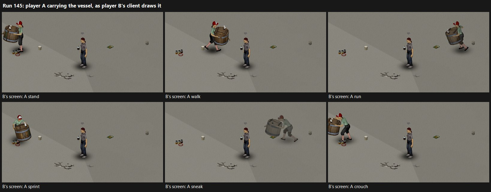
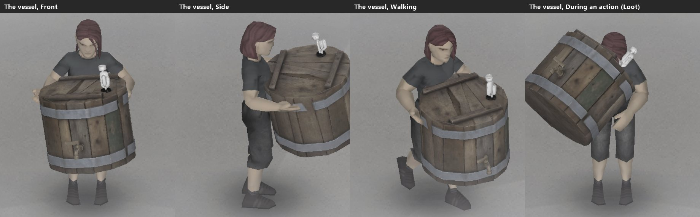
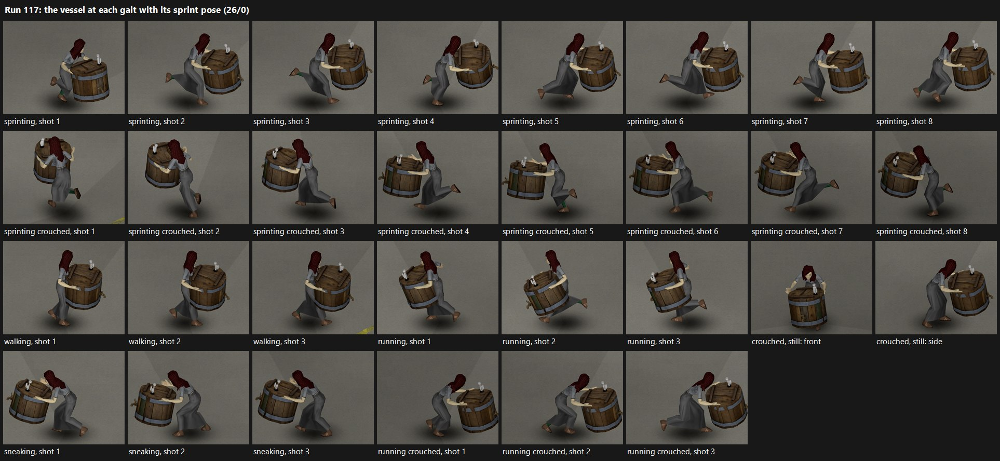
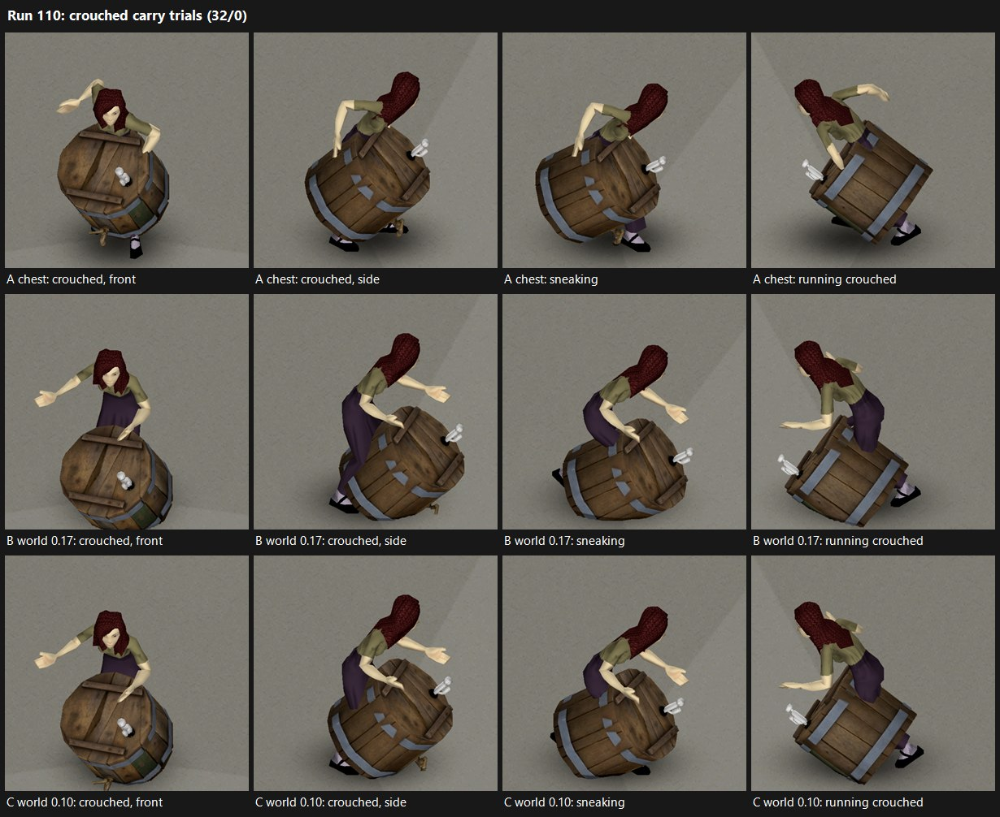
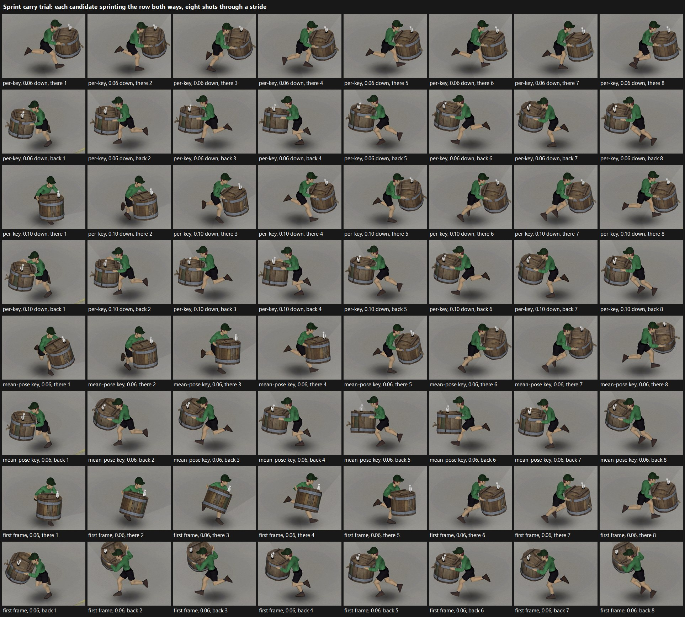

# Engine capabilities and verification gates

What Project Zomboid does where The Last Gallon relies on it, each fact
with its evidence. Build: Project Zomboid **42.21.0** (`4a0e9546ec`). The
gate summary gives each gate's status; the sections after it hold the
facts, by gate and by topic. Each run's command and full result are in
`docs/test-results.md`.

Evidence types:

* **SRC** – shipped Lua/script source in `<game>/media` (path:line).
* **BC** – `javap` of `projectzomboid.jar` (method signatures/bytecode).
* **RT-DS** – runtime experiment on the isolated dedicated server
  (`tests/ingame/TheLastGallonHarness`, result file `TLG_harness_server.txt`).
* **RT-SP** – runtime experiment in a single-player client
  (`tools/run-sp-harness.ps1`, result file `TLG_harness_sp.txt`; runs of
  2026-10-31 in `docs/evidence/2026-10-31_rt-sp_harness_run*.txt`).
* **RT-MP** – runtime experiment with a dedicated server and one or two
  clients on this computer (`tools/run-mp-harness.ps1`).

Status values: **PASS** (verified at runtime), **SRC-ONLY** (source evidence,
runtime NOT RUN), **PARTIAL**, **FAIL** (capability unavailable; see
alternative), **NOT RUN**.

## Gate summary

| Gate | Question | Status | Evidence / result |
| --- | --- | --- | --- |
| G01 Packaging | What structure loads? | **PASS (DS + SP)** | `common/` + `42/` layout loads; all TLG items, 7 craft recipes, fluids and custom sandbox options load (boot 4); translations resolve on the client (RT-SP), in English and in Italian (runs 43–44), not on the DS |
| G02 Fluids | Type, mixtures, metadata | **PASS (DS + SP)** | Mod fluids register and blend; transfers proportional; condition carried through the wrapped `FluidContainer.Transfer` (RT-DS) and every vanilla fuel action (RT-SP); the **Transfer Liquid** window loses water and sediment under about 1 % (run 213); a can on the ground keeps its fluid on the world object after reload |
| G03 Vehicle consumption | Where does driving/idling change quantity? | **PASS (SP + MP)** idle, start gate, stall, power and wear; driving SP | Vanilla burns the fuel, idling and driving, and the mod reconciles it proportionally; the mod never subtracts. Refuel, siphon, start gate, stall and poor fuel's power and wear (D-031): SP runs 3–6 and 179, MP runs 160, 165, 169 and 188. Driving burn (0.778 L over 352 tiles at 25 km/h) and a stall on the move: SP run 176. See G03 below |
| G04 Generator consumption | Extend fuel/burn? | **PASS (SP + MP)** burn and start gate | Native burn reconciled proportionally; `ISActivateGenerator` activates on petrol and is refused on E100 (SP runs 3–6; MP runs 160, 162) |
| G05 Generator lifecycle | State survives pickup? | **PASS (SP + MP)** with adapter | Pickup, the drop action, `forceDropHeavyItems`, the menus' unequip and a drag to the floor carry the record (SP runs 3–6 and 85); taken and put back on a server (MP run 160) |
| G06 Stations | Per-pump or shared? | **PASS (SP + MP)** | Per-object piped units; TLG corrects both vanilla paths to 1 L/unit (10 L = −10 units, 59 L = −59 units; SP runs 3–5); pump to can and pump to car on a server (MP run 160) |
| G07 Action authority | Which stage mutates on the server? | **PASS (MP)** for the mod's requests and the vessel's pickup; vanilla's heavy pickup FAIL | B42 actions mutate in `complete()`, which the server runs at the action's end (BC); the server answers the mod's requests (RT-MP runs 139–162). Vanilla cannot take a heavy item off the floor on a server (run 144); the mod takes the vessel there itself (D-030, runs 146–147). See G07 below |
| G08 Persistence | Reliable stores/IDs | **PASS (DS + SP + MP)** | Global ModData (DS, SP); item, world item, vehicle part, generator object and pump object modData, fluids and TLG records survive save and reload (RT-SP runs 4–5), as do machine records and conversion projects (runs 7–8). MP: a client's rejoin (RT-MP runs 145–147) and a server restart (run 161) kept the floor, a can's record and a running batch |
| G09 Per-instance vehicles | Modify one vehicle independently | **PASS (SP)** | Part modData and `setEngineFeature` change one of two identical `Base.CarNormal` only |
| G10 Electricity | Independent consumer control | NOT RUN | Only aggregate `getTotalPowerUsing`/`setTotalPowerUsing` and `getItemsPowered` found |
| G11 Vehicle visuals | Extra parts/model variants | NOT RUN | — |
| G12 Unloaded machines | What simulates unloaded? | **PASS (SP)** for TLG machines, once | Nothing runs while the chunk is unloaded; the process record catches up on the next access. A fermentation vessel whose chunk was unloaded for 24 game hours had done exactly 24 h more on return (RT-SP runs 13–14). Vanilla generators: `IsoGenerator.chunkLoaded(IsoChunk)` suggests catch-up on load (BC), not instrumented |
| G13 Assets | Which props/sounds exist? Can an original model be imported? | PARTIAL: catalogue from scripts; original item models **PASS (SP)** | `asset-audit.csv`. Models load from the mod's folders and are drawn: an original static test model (text `.x` mesh, PNG texture, 32×32 icon; RT-SP runs 64–67), the five supplied FBX models (runs 68–69, 120–122) and the mod's own four (runs 132–133). Held items: a non-weapon without a pose mask is drawn only during actions, as in vanilla (runs 73–74); the vessel has the mod's own carry pose (D-025). See "G13: one original model imported" below. NOT RUN: animation, sounds, the stills' and the drying column's models on another client's screen (the vessel and the five small items: RT-MP run 145); vehicle parts are G11 |
| G14 Compatibility | What bypasses adapters? | SRC-ONLY | Java-side fluid moves and any code not calling `FluidContainer.Transfer` |

## Lua runtime

Domain tests run on the game's own Kahlua VM (`tools/kahlua-runner`), using
`J2SEPlatform` with the install-dir `stdlib.lua`, exactly as loaded by the game.
Probe: `tests/support/runtime_probe.lua` (runner) and
`TLGHarness/LuaProbe.lua` (RT-DS). Both agree on every shared item:

| Feature | Result | Consequence for the codebase |
| --- | --- | --- |
| `a % b` | Java remainder: `-7 % 3 == -1` | Use `TLG.Num.mod` (floored) |
| `next` | **nil** (runner and RT-DS) | Emptiness via `pairs` loop (`TLG.Tables.isEmpty`) |
| `math.random` | **nil** | Deterministic `TLG.Rng` (Park–Miller) |
| `table.unpack` | nil (`unpack` exists) | Use `unpack` |
| `error(table)` | arrives as a **string** | No structured errors; return result tables |
| `string.format("%s", nil)` | error | Always `tostring` |
| Recursion | overflow below 3000 frames (RT-DS); 5000 in runner | No deep recursion; iterative merge sort |
| `table.sort` | `stdlib.lua` recursive left-pivot quicksort, unstable | `TLG.Tables.sort` (iterative, stable) for state |
| `tostring(1e20)` | `1.0E20` (Java formatting) | Never round-trip numbers through strings |
| `goto`, `//`, bitwise ops, `bit32` | not available | Lua 5.1 subset only |
| `require` | returns the module's return value (RT-DS) | Modules also register under `TLG.*` |
| `loadstring`, `getfenv`, `os.time` | available | Not used by domain code |
| `io`, `debug`, `load`, `dofile` | nil | — |

Kahlua's `%` computes `a - int(a / b) * b` with the quotient cast to a
32-bit int: `x % 1` for x near 1e15 returns x - 2147483647 (Kahlua run,
2026-11-05). It is the exact modulo only for quotients below 2^31. The
mod uses `math.floor` (Java's, exact for doubles) or keeps quotients
small (the vault's digests: below 2^26).

## G01 Packaging — PASS (dedicated server and client)

* **BC** `ZomboidFileSystem.getAllModFolders`: scan order `workshop,steam,mods`;
  `mods` = `getCacheDirSub("mods")` only. `workshop` (staged items,
  `getStagedItemModsFolders`) and `steam` (subscribed items,
  `getInstalledItemModsFolders`) are scanned only when
  `SteamUtils.isSteamModeEnabled()`. With `-nosteam` a client sees
  `<cachedir>/mods` alone, so the manual install from the release zip is
  the path a launch without Steam can rehearse
  (`tools/rehearse-install.ps1`). `getAllModFoldersAux` skips a folder
  named `examplemod` and accepts a mod when `common/mod.info` or
  `<versionDir>/mod.info` exists. `getModVersionDirName` picks the highest
  folder whose `getGameVersionIntFromName` (`major*1000 + min(minor, 999)`) is
  between `ChooseGameInfo.getMinRequiredVersion()` and the current version, so
  `42/` (= 42000) is selected on 42.21.
* **BC** `ChooseGameInfo.readModInfoAux` keys: `name= id= author= description=
  poster= url= modversion= icon= category= require= incompatible=
  loadModAfter= loadModBefore= versionMin= versionMax= pack= tiledef=`;
  `require=`/`incompatible=` strip `\`. Each line is matched with
  `String.contains` and the key removed with `replace`, key by key in
  this order: `name=` first, then `poster=`, then `description=`. A value
  holding another key's text, such as a description with `name=` in it,
  is therefore read as that key; the mod's description holds no `=`.
  `poster=` and `icon=` name a file in the version folder (`42/`) if it
  exists there, otherwise in `common/`; several `poster=` lines make
  several posters.
* **SRC** mod list (`OptionScreens/ModSelector`): `ModInfoPanelDesc`
  draws the first poster at 200×200 beside the description;
  `ModListBox` draws the icon in a square as tall as a button, and a mod
  with no `icon=` gets its `category=`'s item icon (`map` Item_Map,
  `vehicle` Item_CarTire, `features` Item_ElectronicsScrap, `modpack`
  Item_SewingBox; `ModSelectorModel`). The mod sets `category=features`,
  `poster=poster.png` (256×256) and `icon=icon.png` (32×32), both in
  `42/`.
* **BC/SRC** Workshop uploader (`SteamWorkshopItem`, `WorkshopSubmitScreen`,
  `UI.json`): `preview.png` beside `Contents/` must be exactly 256×256 and
  no larger than 1000 KB; `Contents/` may hold only `buildings/`,
  `creative/` and `mods/`, and `mods/` only folders; the constant
  `*.exe *.dll *.bat *.app *.dylib *.sh *.so *.zip` lists the refused file
  types. `workshop.txt` keys: `version=`, `id=`, `title=`, `description=`
  (one line each, joined with line breaks), `tags=` (`;`-separated, from
  `media/WorkshopTags.txt`) and `visibility=` (`public`, `friendsOnly`,
  `private`, `unlisted`). The upload screen offers the title, description,
  tags and visibility for editing before anything is sent.
* **BC** first-run copy: `Core.loadOptions()` → `initOptionsINI()` →
  `copyPasteFolders("mods")` when `<cachedir>/options.ini` is missing (caused
  the 2026-10-30 incident, `environment.md`).
* **RT-DS** (2 boots): `TLG` namespace loaded; `instanceItem("TLG.FuelSampleKit")`
  returns `TLG.FuelSampleKit`; activated mods `TheLastGallon;TheLastGallonHarness`.
* Boot 4 on the dedicated server
  (`docs/evidence/2026-10-30_rt-ds_harness_boot4.txt`): all TLG items
  instantiate (`FuelStabilizer`, `FuelFilter`, `ManualFuelSystems`,
  `YeastStarter`, `FermenterVessel`, `PotStill`, `RefluxStill`,
  `DryingColumn`); `getScriptManager():getCraftRecipe("TLG_Make…")` returns all
  seven recipes with the expected input/output counts and categories (on
  the client, run 191 found none this way: see "The crafting window");
  custom sandbox options from `media/sandbox-options.txt` appear as
  `SandboxVars.TheLastGallon.*` with their defaults on an existing world;
  the vehicle, generator and station adapters install their wrappers
  without errors on the server. Crafting through the UI and the rendering
  of icons and models need a client: NOT RUN on the server (the client
  runs are under "Crafting, menus and timed actions" and G13).
* **RT-DS** translations: `getText("IGUI_TLG_ModName")`, item display name and
  `Fluid_Name_TLG_Ethanol` all returned their keys on the dedicated server.
  **BC** `Translator` loads `%s/media/lua/shared/Translate/%s/%s.json`.
  Whether a dedicated server loads mod translations at all is unverified.
* **RT-SP** (runs 3–5): on the client `IGUI_TLG_ModName`, `Fluid_Name_TLG_Ethanol`,
  `ContextMenu_TLG_Fuel` and the `TLG.FuelSampleKit` display name all resolve
  to their English text. Mod and harness load from `<cachedir>/mods` once
  `mods/default.txt` lists them (see "Unattended client launches").
* **RT-SP** Italian (runs 43–44): with `language=IT` in `options.ini`,
  `Translator.getLanguage():name()` is `IT`. The mod's Italian JSON files
  (UTF-8 without a byte-order mark) load with their accents intact: all
  237 strings, item display names included. The game stores a placeholder
  `%N` as `%N$s`, so `getText(key)` without arguments returns `"Avvia:
  %1$s"` for a shipped `"Avvia: %1"`, while `getText(key, ...)` fills it.

## G02 Fluids — PASS (DS + SP)

RT-DS results (`TLG_harness_server.txt`):

* Mod fluids defined in `module TLG { fluid TLG_Ethanol {...} }` register with
  type `Modded` and are found by `Fluid.Get("TLG_Ethanol")`;
  `Fluid.Get("TLG.TLG_Ethanol")` returns nil (lookup key is the bare name).
* `Categories { Fuel }` + `BlendWhiteList { Fuel }`: Petrol and TLG_Ethanol
  blend both ways; Petrol does **not** blend with Water and
  `canAddFluid(Water)` on a petrol container is false.
* Spawned `Base.PetrolCan` has capacity 10 and starts full of Petrol (10 L).
  `Base.JerryCan` capacity 20 (SRC `items/normal.txt`).
* `FluidContainer.Transfer(a, b, 4)` from 6 Petrol + 2 Ethanol moved 3 + 1
  (proportional); `adjustAmount(2)` scaled 3+1 to 1.5+0.5 (proportional);
  transfers clamp to destination capacity.
* 1000 × 0.001 L there and back: total stayed 13.0000000 (no visible drift at
  1e-7). Native amounts are Java floats; reconciliation tolerance must allow
  float precision (~1e-6 relative).
* Item modData nested tables round-trip in memory.
* **`FluidContainer.Transfer` can be replaced from Lua**: a wrapper installed
  on the `FluidContainer` class table was called and the transfer executed.
  SRC `ISFluidTransferAction.lua:29,73` calls `FluidContainer.Transfer`
  incrementally in `update()` (when not client) and in `complete()`.
* `Base.PropaneTank` is a drainable with 5000 uses and no FluidContainer
  (`getCurrentUses()` = 5000).
* RT-DS boot 3 (`docs/evidence/2026-10-30_rt-ds_harness_boot3.txt`), TLG
  container adapter on real native containers:
  * `fc:adjustSpecificFluidAmount(fluid, x)` **sets** that fluid to `x`
    (5 → 3), it does not add.
  * `TLG_FuelWater` and `TLG_FuelSediment` (category Fuel) share a container
    with Petrol natively; `Native.writeComposition` round-trips
    gasoline/ethanol/water/sediment exactly.
  * Through the wrapped `FluidContainer.Transfer`, 4 L from a can with
    deg 1.2/0.3 and stabilizer 0.5 arrived with the same deg, stabilizer and
    proportional composition; source revision 5 → 6, destination 0 → 1,
    provenance recorded.
  * 200 hooked transfers of 0.01 L: sidecar composition stayed consistent
    (rev 200, deg unchanged). Native total drifted 10 → 9.99995 L (Java float
    rounding destroys ~2.5e-7 L per transfer; never creates). Reconciliation
    tolerance is therefore 1e-4 L.
  * A water bottle is ignored (`foreign_fluid`).
* Small amounts and full containers (BC 42.21 `FluidContainer`, read with
  `javap`; RT-SP run 58). `getAmount()` reads as the capacity when the
  fluids are within 0.001 L of it (`recalculateCaches`), and `isFull()` is
  the amount within 1e-4 L of capacity (`PZMath.equal`, strict). `addFluid`
  does nothing on a full container and clips to the room left;
  `adjustSpecificFluidAmount` returns on an empty container, clamps to
  [0, capacity] and has no fullness check. A fluid holding less than
  1e-4 L is removed as empty (`removeFluidInstanceIfEmpty`, called after
  an adjust). Reading has no threshold (`createFluidSample` copies every
  fluid). Run 58: a full 10 L petrol can lowered to 9.9998884 L of Petrol
  read `amount 10.0000000`, `full=true`, and refused 1.117e-4 L of
  `TLG_FuelWater`; a 5 L can took the same water. The mod writes its
  compositions around both rules (D-007 amendment; run 59).
* RT-SP (runs 4–5): fluids and modData of a can in the inventory and of a
  can on the ground survive save and reload. **After reload a can on the
  ground has no item FluidContainer: the fluid sits on its
  `IsoWorldInventoryObject`** (`itemOwnContainer=false
  ownerIsWorldObject=true`); `InventoryItem.getFluidContainerFromSelfOrWorldItem()`
  (BC) returns it, while `item:getFluidContainer()` is nil there (run 39).
  The container adapter reads the fluid through
  `getFluidContainerFromSelfOrWorldItem()` and keeps the record on the
  item: run 5 found the ground can's TLG record after reload
  (`status=ok`). This is the container-ownership fix of 2026-10-31;
  before it, the adapter took such a container for a world object
  (storage `drum_steel`) and wrote the record there (run 4).
* RT-SP run 213: the game's **Transfer Liquid** window, driven as a player
  drives it. `ISFluidTransferAction` poured 3.79 L in 189 ticks through
  190 calls of `FluidContainer.Transfer` (one per update and one in
  `complete()`), about 0.02 L each, and the wrapper followed each one.
  The window's preview (SRC `ISFluidTransferUI.lua:410`) calls the same
  function into a copy of the target that has no owner, so the wrapper
  leaves it alone: no record was written before **Pour**. Ageing,
  stabilizer and the blend followed; a small share of water and sediment
  did not (`support-matrix.md`, transfer paths).
* NOT RUN: world-object containers (rain barrels, FuelPump entity).

## G03 Vehicle fuel — PASS (SP + MP); driving SP only

RT-SP (runs 3–5, `Base.CarNormal`, 59 L tank):

* Can → tank (`ISAddGasolineToVehicle`) and tank → can (`ISTakeGasolineFromVehicle`)
  move exactly the litres taken and carry composition, contaminants and
  degradation (largest deviation 2e-8); an E25 blend (6 L petrol + 2 L
  ethanol) arrives as 6 + 2 in the tank record.
* Phase A's vehicle steps also pass on a `Base.PickUpTruck` (run 62,
  **29/0**).
* A station can with `TLG_FuelWater`/`TLG_FuelSediment` still satisfies the
  vanilla menu predicate `contains(Fluid.Petrol)`.
* Idle on station fuel (profile `engine_si_stock`, grade good, compatible):
  0.0148 L burned in 0.5 game hours at game speed 4; the next read reported
  `reconciled`, totals equal to the native amount and unchanged proportions.
  Driving consumption: see "Driving" below (runs 174–176).
* Start gate (run 6, player as driver, hotwired, vanilla
  `ISStartVehicleEngine`): on a 36 % ethanol blend (`compatible=false`,
  reason `too_much_ethanol`) the gate called `engineDoStartingFailed` and the
  engine stayed `Idle`; on station fuel the start went through to `Running`.
  That station fuel rated `startFactor=0.5` (reason `water`), so the allowed
  start depended on the 50 % roll; the deterministic evidence is the refusal.
* Stall (run 6): the same blend, started directly to bypass the gate, was
  stalled by the per-minute effect handler 0.6 game minutes later
  (`Stalling`).
* Station water (D-017): about 9 in 10 stations start at 0–0.15 % and
  about 1 in 10 at 0.2–0.4 % (domain-tested; not re-run in game), while
  `engine_si_stock` tolerates 0.2 % free water. Runs 5–6 came before
  D-017, when station water was drawn uniformly from 0–0.4 % and about
  half of all stations halved the start chance of stock cars from the
  first day: 0.216 % and 0.229 % water at the Gas2Go pump.
* `IsoCell.getVehicles()` returns a `java.util.HashSet` on 42.21 (BC), so
  `getVehicles():get(i)` raises "tried to call nil". The vehicle adapter,
  the fuel menu and the workshop menu iterate `ipairs(set:toArray())`, the
  pattern vanilla uses for Sets (SRC `server/Vehicles/Vehicles.lua:1037`).
* Multiplayer (RT-MP): a car started on station fuel with its key, and a
  status read reconciled its idle burn (run 160). A car was siphoned
  (run 165), and one converted to flex fuel started on ethanol (run 169).
  Poor fuel's power, wear and stall on a server: "Engine power and wear
  in multiplayer" below (run 188).

Source evidence:

* SRC `ISAddGasolineToVehicle.lua`: tank = `part:setContainerContentAmount`
  (floored litres during `update()`, exact target in `complete()`); the can is
  reduced with `fluidCont:adjustAmount` (proportional, so mixtures leave in
  proportion); `serverStop` only syncs (a cancelled pour keeps the partial
  amounts already applied).
* SRC predicates (`ISVehiclePartMenu.lua:9-22`, `ISVehicleMenu.lua:9-18`):
  vanilla offers refuelling only from containers that `contains(Fluid.Petrol)`.
  A pure `TLG_Ethanol` can is not offered; an E10 blend is.
* BC `VehiclePart`: `getContainerContentAmount/setContainerContentAmount(float)`,
  `getContainerCapacity`, `getContainerContentType`, `getModData`;
  `BaseVehicle.transmitPartModData(part)`.
* BC `BaseVehicle`: engine state methods (`tryStartEngine`,
  `engineDoStartingFailed(reason)`, `engineDoStalling`, `isEngineRunning`) and
  per-instance `setEngineFeature(quality, loudness, power)`.
* Consumption is the game's own: Java calls vanilla's Lua part updates
  (driving and idling: SRC `server/Vehicles/Vehicles.lua:450`,
  `Vehicles.Update.GasTank`); the adapter design never subtracts fuel itself.

### Driving (RT-SP runs 174–176, 2026-11-04)

`tools/run-sp-harness.ps1 -Mode driving` (request `sp-rtd`). Run 176:
**26/0**.

* Burn: `Vehicles.Update.GasTank` runs about once a game minute while the
  engine runs and ends in `part:setContainerContentAmount(amount, false,
  true)`. The engine resolves that function by name once and caches it
  (BC `LuaManager.getFunctionObject`, `luaFunctionMap`), so wrapping the
  global later has no effect. The harness counts writes in VehiclePart's
  method table instead (`getmetatable(part).__index`): three arguments
  are vanilla's burn, one is anyone else's.
* Run 176, a `Base.CarNormal` on E10 (9 L petrol + 1 L ethanol through
  `ISAddGasolineToVehicle`), 352 tiles at 25 km/h in 14.1 game minutes:
  the tank lost 0.778136 L in 14 burns of exactly that sum, and nothing
  else wrote the tank. The next read was `reconciled`, the total equal to
  the native amount and the blend unchanged (worst 5.6e-16). Vanilla's
  rate there: 0.055 L per game minute, 0.22 L per 100 tiles (3500 rpm).
  Run 175 burned 0.778017 L over the same 352 tiles, also all vanilla's.
* Stall on the move: a car on a 37.5 % ethanol blend (`compatible=false`,
  `too_much_ethanol`) was started past the gate, and the mod's per-minute
  effects were held back until 25 km/h and one burn. The next effects call
  stalled the engine at 24.7 km/h (`Stalling`, 0.78 game minute later).
  Nothing burned after the stall, and the car rolled 16 tiles to a stop.
  Run 175 stalled one at 15.8 km/h the same way.
* No collision in any run: no speed lost while not braking, and every part
  but brakes, tires, suspension and muffler (vanilla wears those while
  driving) unchanged at 100.
* Driving from Lua (BC): `BaseVehicle.setRegulator(true)` with
  `setRegulatorSpeed(kmh)` is the game's cruise control. With no key
  held, `CarController.update` gives throttle 0.5 while the car is under
  that speed, and steering stays 0, so the car runs straight.
  `setForceBrake()` brakes for one second (`CarController.updateControls`),
  and braking ends the cruise (`updateRegulator`). While any control is on,
  the game holds game speed 1. `CarController` and its `clientControls`
  are not exposed to Lua.
* Heading: `addVehicleDebug(..., IsoDirections.S, ...)` faces south but a
  few degrees off (−5 to +10 in runs 174–176), enough for a car to leave
  its lane within ten tiles (run 174, where the harness's lane guard
  braked them). The angle `setAngles(x, y, z)` sets (degrees,
  `Quaternionf.rotationXYZ`) is ignored when its whole degrees equal the
  current ones (BC: an `f2i` compare). Two measurements of
  `getForwardVector(Vector3f.new())` (x, height, z; +z is world +y), one
  correction between them, put the car on the line (0.000 degrees to
  three decimals), and it held within 0.04 tiles over 352 tiles.
* Not covered: other chassis, a flex-converted car on the move, driving
  off-road, heater on, towing.

### Engine power and wear (RT-SP runs 177–179, 2026-11-04; D-031)

`tools/run-sp-harness.ps1 -Mode engine-effects` (request `sp-rte`). Run
179: **36/0**; the driving mode repeated 26/0 on the same code (run 178).

* BC `BaseVehicle.setEngineFeature(int quality, int loudness, int power)`
  calls `VehicleEngine.setFeatures`, which clamps quality to 0–100 and
  stores `(int)(loudness × 0.37037036f)`; `getEngineLoudness` returns what
  it stored. Setting the power alone therefore needs the stored loudness
  passed back divided by that factor (the adapter reads it back). The
  engine object (`getVehicleEngine`) is private and `VehicleEngine` is not
  exposed to Lua. `CarController.update` takes its force from the power:
  `engineForce = power × (0.5 + engineSpeed / 24000)`.
* `transmitEngine()` only sets an update flag on a server (BC). The
  network field `zombie.network.fields.vehicle.VehicleEngine` writes the
  state, quality, loudness and power, and the receiving side applies them
  through `setEngineFeature`, so a client scales the stored loudness again.
  That is vanilla's own: the server's `BaseVehicle.onEngineStateChanged`
  calls `transmitEngine` on every state change too. Multiplayer: see the
  next subsection.
* BC `VehiclePart.repair()` on the Engine sets quality 100, loudness from
  the script (× the zombie attraction multiplier) and power from the
  script's engine force. The debug-spawned, repaired `Base.CarNormal` had
  power 4000 and loudness 32 to 48.
* Vanilla's Lua never lowers a car engine's condition for running
  (`Vehicles.Update.Engine` only keeps a temperature).
* Generators: each running hour `IsoGenerator.update` takes 1–2 condition
  (`Rand.Next(2) + 1`) with a chance of 1 in the item's
  `ConditionLowerChanceOneIn` (default 30; Base.Generator 30, _Old 25,
  _Yellow 36, _Blue 24), catching up the hours a chunk was away. Fuel per
  hour is the power drawn × `GeneratorFuelConsumption`; the power
  constants are 0.02 (`GeneratorBasePowerConsumption`), 0.13 a
  fridge-freezer, 0.002 a light switch. `getScriptManager():FindItem(
  gen:getGeneratorItemType()):getConditionLowerChance()` gave 30 in game.
  `IsoGenerator.setCondition` clamps 0–100 and syncs. Lua has no list of
  generators (`AllGenerators` is private, `IsoCell` has no getter for the
  objects it processes).
* How the base enters the hourly burn was not traced. Run 179's
  generator, with nothing plugged in, burned 0.002 L an hour; on a
  dedicated server on the shortest day (RT-MP run 188) one burned
  0.0348 L in 6 game hours, 0.0058 L an hour. Why they differ (a server,
  the day's length, or run 179's ×40 game speed) was not traced either.
  The wear is charged on the litres burned, so it holds either way.
* Run 179, cars driven with the stall option off (so a random stall at
  1.2 % a game minute could not cut a leg):
  * on petrol aged to 2.6: power 4000 → 3406 (factor 0.851429) 0.12 game
    minutes after the cruise began, held for 352 tiles, quality 100 and
    loudness 40 kept, and 4000 again two game minutes after the stop with
    no state left;
  * with the car rate at 100 times its value (a fixture), the 0.778050 L
    burned in 14 game minutes owed 8.669705 points: 8 came off the Engine
    part and 0.669705 was carried;
  * a blend no stock engine takes (factor 0) ran 5.27 game minutes at
    2000 without a stall, and got 4000 back;
  * to 24 km/h: 0.55 game minutes at full power (run 178), 0.63 at 85 %
    and 0.76 at half.
* Run 179, a `Base.Generator` put down by the road (`IsoGenerator.new`),
  8 L through `ISAddFuel`, its record aged to 3.0, switched on and run 6
  game hours at x40: it burned 0.012 L (0.002 L an hour, nothing plugged
  in) and vanilla took no condition. The fuel at the charge had aged to
  3.0093 (wear factor 1.752328). The next `ISAddFuel` charged, at 100
  times the rate, 3 points with 0.009094 carried: exactly the 3.009094 due.
  `chargeWear` called again at once took nothing.

### Engine power and wear in multiplayer (RT-MP run 188, 2026-11-04; D-031)

`tools/run-mp-harness.ps1 -Clients 2 -Only effects` (the shortest day; A
drives, B watches). Run 188: A **22/0**, B **9/0**.

* BC: `VehicleEngine.update` returns at once on a client (`GameClient.client`),
  so the server runs a car's engine: its state, auto shut-down and stalls, and
  the world sound that draws zombies, which reads the server's loudness.
  A client applies each engine packet (`VehicleUpdatePacket` flag 4) by
  calling the state's `engineDo…` and then `setEngineFeature(q, l, p)`.
* On the server the mod's minute pass lowered a car on petrol aged to 2.6
  from 4000 to 3406 at the first pass that saw it run, and held it for 100
  game minutes of idling. Quality 97 and loudness 40 stayed as they were.
  Both clients showed 3406 30 and 31 ticks after they saw the engine run
  (A and B); the server's `transmitEngine` is how it gets there.
* Each client's loudness was 14, the server's 40 × 0.37037036, from the
  first engine packet (the engine still starting, before the mod set any
  power). It stayed 14 through every change the mod made. The scaling is
  vanilla's, and it does not reach what zombies hear, which the server
  emits.
* Wear on the server, the car rate × 1000 (a fixture: idling burned
  0.00056 L a game minute, 0.0503 L in 90 minutes): 5 points off and
  0.608324 carried, exactly the 5.608324 due. Both clients showed the
  Engine part's condition as the server's (`transmitPartCondition`).
* The power came back (4000, no state left) at the first minute pass after
  the shut-off, on the server and on both clients.
* A blend no stock engine takes (written over the record): with stalls on,
  the server's start gate refused the start (`ISStartVehicleEngine.complete`
  runs on the server); with stalls off it ran 29 game minutes at 2000, the
  floor, without a stall; stalls on again, it stalled at the next minute
  pass and had 4000 back one pass later. Each client showed the state and
  power the server had.
* A generator (8 L, record aged to 3.0, switched on by the server) burned
  0.0348 L in 6 game hours. A's 2 L refuel through the world menu charged,
  in `ISAddFuel.new` on the server, 8 points with 0.718012 carried: the
  8.718012 due at 100 times the rate. Charged again at once: nothing. A's
  client showed condition 92, as the server.
* The mod's minute pass on the server cost 0.015 ms a vehicle on average
  (4290 calls, about 22 vehicles in the server's cell; whole-ms clock, max
  2 ms).
* Not run in multiplayer: driving, so the lowered power's effect on the
  car's speed there is not measured (`CarController` reads
  `getEnginePower`, and both clients held the server's power; which side
  runs it for a driven car was not traced), flex-converted engines, other
  chassis.

## G04/G05 Generators — PASS (SP + MP)

RT-SP (runs 3–6, `Base.Generator`, max fuel 10 L):

* Can → generator (`ISAddFuel`) moves exactly the litres and carries the
  record; native burn (0.015 L; connected with no appliance drawing,
  `getTotalPowerUsing` 0.015; `GeneratorFuelConsumption`
  0.1) is reconciled proportionally on the next read.
* Start gate (run 6, vanilla `ISActivateGenerator`): a generator on petrol
  (grade good) activated; a generator holding 3 L of E100, filled through the
  confirmed TLG pour, was refused (`too_much_ethanol`, `failToStart`) and
  stayed off.
* Pickup carries the record to the new item (found in the primary hand,
  where vanilla equips it). The drop action, `forceDropHeavyItems`
  (taking a second generator while carrying one) and dragging the item to
  the floor all carry it to the converted object, with vanilla fuel equal;
  a second generator taken in the same action gets its own record. The
  menus' unequip puts the carried generator down when a second one is
  taken from the world menu or a bat is equipped, and each record reaches
  its new object (run 85).
* Multiplayer (RT-MP runs 160, 162): the burn is reconciled and the start
  gate works the same on a server, and a flex-converted generator started
  on ethanol (run 162). A generator taken (once unplugged) and put back
  with the place action carried its record both ways (run 160).

Source evidence:

* BC `IsoGenerator`: `getFuel/setFuel/getMaxFuel/getFuelPercentage`,
  `isActivated/setActivated`, `failToStart()`, `getCondition`,
  `getGeneratorItemType()`, `getItemsPowered()`, `getTotalPowerUsing()`.
  `update()` reads `SandboxOptions.generatorFuelConsumption` and writes `fuel`.
* SRC `ISAddFuel.lua:54-58`: litres from the can map 1:1 to generator fuel up
  to `getMaxFuel()`; the can is reduced with `adjustAmount`.
* SRC `ISTakeGenerator.lua:41-53`: pickup creates the item, copies condition
  and `modData.fuel`, then `generator:remove()`. Other generator modData is
  **not** carried.
* BC `IsoGenerator.setInfoFromItem`: placement copies item condition and
  `modData.fuel`, and sets object `modData.generatorFullType`.
* SRC placement: `IsoGenerator.new(item, cell, square)` in
  `ISMoveableSpriteProps.lua:2173-2194` and `MOGenerator.lua:18`.
* BC `IsoGridSquare.AddWorldInventoryItem` constructs `IsoGenerator(item, …)`
  itself when a generator item is dropped, bypassing Lua's `IsoGenerator.new`.
* Implemented (D-013): the adapter carries the TLG sidecar, device identity
  and conversion project by wrapping `ISTakeGenerator.complete` (object →
  item), the Lua drop paths `ISDropWorldItemAction.complete`,
  `ISUnequipAction.complete` (the menus' unequip, G14; run 85),
  `forceDropHeavyItems` and `ISTransferAction:transferItem` to the floor,
  and `IsoGenerator.new` (wrapping verified RT-SP). Drops done by Java alone
  are not seen.

## G06 Stations — PASS (SP + MP)

RT-SP (runs 3–5, Muldraugh Gas2Go, 8 pump objects, contamination on):

* With the TLG station adapter installed, pump → can took 10 L and the pump
  lost exactly 10 units; pump → vehicle (run 5) put 59 L in the tank and the
  pump lost exactly 59 units, so both vanilla conventions (1 L and 1.25 L per
  unit) are corrected to 1 L per unit and the remaining fraction is kept in
  the record (|frac| < 1e-11 after whole-litre draws).
* The reservoir record (pre-aged, with water and sediment) is created on
  first contact; the delivered parcel carries its composition and
  degradation; record and unit count survive save and reload.
* Multiplayer (RT-MP run 160): pump to can and pump to car on a server,
  the station's record carried. The mod's hooks on the vanilla actions'
  constructors keep vanilla's parameters, which the server needs to build
  the action (RT-MP run 156; see "RT-MP: a client's timed action on the
  server").
* Not verified at runtime: the vanilla defects themselves (the adapter
  overrides the pump amount after both actions, so the uncorrected values
  were not observed), infinite-fuel sandbox, the TLG "pour into the station
  reservoir" command.

Source evidence:

* BC `IsoObject.getPipedFuelAmount()/setPipedFuelAmount(int)`: an integer per
  pump object, **stored in the object's modData** under
  `IsoPropertyType.FUEL_AMOUNT` and initialised from sandbox
  (`FuelStationGasMin/Max/EmptyChance/Infinite`) when absent; the setter calls
  `transmitModData()`. TLG's station sidecar can therefore live in the same
  modData table.
* SRC `media/scripts/entities/entity_fuelpump.txt`: B42.21 also defines an
  entity `FuelPump` with a FluidContainer (capacity 22000, 5–15 % Petrol).
  Whether map pumps use this entity, the piped amount, or both is NOT RUN
  (the SP harness logs both).
* SRC `ISRefuelFromGasPump.lua:96-102`: comment "Pumps start with 100 units";
  1 unit = `Vehicles.JerryCanLitres / 8` = 10/8 = **1.25 L** (SRC
  `server/Vehicles/Vehicles.lua:18`).
* SRC `ISTakeFuel.lua:24-29,106`: pump → can treats **1 unit = 1 L**.
  The two vanilla paths disagree.
* SRC `ISTakeFuel.lua:64-70`: `complete()` adds the remaining litres to the can
  and **adds** the same number to the pump (`pumpCurrent + (itemTarget -
  itemCurrent)`), so the final increment is duplicated. Runtime confirmation
  NOT RUN.
* BC `SandboxOptions` has `FuelStationGasMin`/`FuelStationGasMax` (initial pump
  fuel); infinite-fuel behaviour NOT RUN.
* Design consequence: the station adapter owns dispensing for TLG-managed
  pumps (one unit convention, conservation enforced) and must replace both
  vanilla paths for managed pumps.

## G07 Action authority — PASS (MP); vanilla's heavy pickup FAIL

* B42 actions mutate in `complete()`, which the server runs at the
  action's end. The server never calls a client's action's Lua `update`
  or `isValid`, and `NetTimedAction` forwards `animEvent` to the Lua
  action (BC). How the server rebuilds and runs a client's action: "RT-MP:
  a client's timed action on the server" below.
* A dedicated server with two clients on this machine (RT-MP runs
  139–162; plain players, not admins, in run 154) answers the mod's
  sample, stabilize and machine-status requests. Of two players' loads of
  one fermentation vessel, one is taken and the other refused
  (`machine_busy`); a repeated request is answered from the server's
  ledger; an item's record reads the same on client and server.
* Vanilla's `ISEquipHeavyItem` cannot take a heavy item off the floor on a
  server, with or without the mod (run 144). For the vessel the mod
  does the take on the server (D-030, runs 146–147), and refuses the
  second of two players taking it at once. See "RT-MP: two clients on a
  dedicated server".
* From the shipped source: B42 timed actions run `update()` on the
  client in SP; on MP the server drives `serverStart`/`animEvent` via
  `emulateAnimEvent(netAction, ...)` and executes `complete()`.
  `isClient()` guards prevent client mutation in most fuel actions
  (`ISAddGasolineToVehicle.lua:33`, `ISTakeFuel.lua:17`, `ISFluidTransferAction.lua:24`);
  `ISRefuelFromGasPump:update()` has **no** `isClient()` guard
  (`ISRefuelFromGasPump.lua:14-46`). The guards are SRC-ONLY.
* Every multiplayer run here used one machine. Two clients on a real
  network: NOT RUN.

## G08 Persistence — PASS (DS + SP + MP)

* RT-DS: `ModData.getOrCreate("TLGHarness")` counter incremented across a hard
  restart after `saveGame()` (boot 1 → 2). Clean `quit` via console saves and
  exits ("Shutdown handling finished").
* World time does not advance on an empty server with `PauseEmpty=true`
  (`getWorldAgeHours()` stayed 2.0 across boots).
* RT-SP (runs 4–5; `saveGame()`, exit to menu, continue): global ModData,
  inventory item fluids + modData, the TLG record of a can in the inventory
  and of a can on the ground, a mod item (`TLG.FermenterVessel`) lying on the
  ground with its modData, vehicle tank records (vehicle 1 in run 4, the E25
  blend of vehicle 2 in run 5), generator object records (both generators
  across runs 4–5), the pump record and unit count, and the TLG world record
  all came back unchanged.
* Item mod data is saved with the item (`InventoryItem.save` calls
  `KahluaTable.save`), which keeps string and number keys and string,
  number, boolean and table values (BC `KahluaTableImpl.save`/`load`), so
  a `false` in a record survives a save (run 25: save, exit to menu and
  continue). Machine items in the player's inventory keep their mod data
  through a save, exit to the menu and continue, exactly (run 48: every
  field and number as saved). In that run the harness's first step after
  the continue read world hour 103.8495, 0.0232 h after the hour the save
  was taken at (103.8263).
* Multiplayer: a client's rejoin (RT-MP runs 145–147) and a server restart
  (run 161) kept the floor, a can's record and a running batch.
* Debug-scenario worlds: the scenario launcher gives the new world no
  mods, so its `mods.txt` is empty and continuing it loads none. The
  harness copies the active mods into `currentGame` before `createWorld`,
  as the Solo path does (SRC `MainScreen.lua:1400`).

### A mod added to a save or removed from it (RT-SP runs 39–41, 54–55)

* A mod added to an existing save (runs 39–40). The load screen's Choose
  Mods... rewrites the save's `mods.txt` (SRC `ModSelectorModel.lua`:
  `manipulateSavefile(folder, "WriteModsDotTxt")`), and continuing a save
  loads the mods its `mods.txt` lists (SRC
  `MainScreen.continueLatestSaveAux`). The load screen offers no sandbox
  settings. On the first load with the mod, `OnInitGlobalModData` reports
  `isNewGame = false` and `SandboxVars.TheLastGallon` holds the options'
  defaults (ExistingSavePolicy 1, TransitionDays 30, the rest default).
  `getActivatedMods()` and the `TLG` global confirmed the mod absent in the
  world played before. Run 39 passed 3/0, 7/1 and 3/0: its one failure
  was the harness reading the ground can's fluid from the item (see G02).
* Fuel the mod has not recorded gets a record at the first **Look and
  smell**, so **What I know about it** shows what the look found (D-024,
  run 41).
* A transition baseline takes the world-age supply's quantities, which can
  include water breathed in over the world's age that the native fluid
  does not hold. Run 41's look recorded 9.999969 L petrol and 0.0000307 L
  water for a can holding 10 L of petrol; run 40's pour-written records
  had the same shape. By the code, a difference under
  `C.FLOAT_TOLERANCE` (1e-4 L) is adopted from the native composition at
  the next read; larger ones (older worlds, bigger containers) go through
  reconciliation. Not observed beyond that.
* A save continued without the mod (runs 54 and 55, alike): the game
  skips items whose type no longer exists when it loads them
  ("InventoryItemFactory.CreateItem() cannot create item …
  TLG.FermenterVessel", "InventoryItem.loadItem() item == null, skipped
  bytes"), and they are gone when the mod comes back. A container's fluid
  of a type no longer registered (TLG_Ethanol) was empty after the load,
  with nothing in the console. The mod data on vanilla items (`tlg`) came
  back unchanged through a launch without the mod (every field compared
  to three levels), and the global mod data kept the world record
  (`TLG_World`: seed, start, policy, epoch and next id compared).
* Fuel that came in while the mod was away mixes in when the mod finds
  it, and is aged from that moment, not over the time away (D-006
  amendment, run 55).

### Records on a server (BC 42.21, security audit 2026-11-05)

* Global ModData is not private on a server:
  `GlobalModData.receiveRequest` reads the key a client names and sends
  that whole table back, for any key; a table a client transmits only
  fires `OnReceiveGlobalModData` on the server and is not stored (audit
  run 2). `GameTime.getModData()` is not private either:
  `GameTime.saveToPacket` sends it (all but the keys `camping`, `farming`,
  `trapping`).
* A server-side global object system's mod data is private: the engine
  saves the keys named in `setModDataKeys` to `gos_<name>.bin` in the save
  and sends a client only what its Lua `getInitialStateForClient` returns
  (`CGlobalObjects.loadInitialState` keeps nothing for a system the client
  does not have). Systems load in `SGlobalObjects.initSystems`, after
  `IsoWorld.init` (and so after `OnInitGlobalModData`) on a dedicated server
  (`GameServer.main`) and in single player (`GameLoadingState`). The mod
  keeps its world record's private fields there (docs/migrations.md, world
  server store).
* A client can still rewrite, on the server, an item's mod data
  (`SyncItemFieldsPacket`, `SyncItemModDataPacket`: the item is found by
  its id and its mod data loaded in `parse`) and a world object's
  (`ObjectModDataPacket`), with no capability checked (V-01). A vehicle
  part's goes only from the server (`BaseVehicle.transmitPartModData` acts
  when `GameServer.server`). The mod keeps its records a second time on
  the server, in the vault (`TLG/Authority/Vault.lua`, docs/migrations.md).
* The vault names an item by its id: `InventoryItem.save` writes the `id`
  field and `load` reads it back (BC 42.21), so the id survives saves.
  `IsoWorldInventoryObject.swapItem` also calls `setID` on an item (which
  id it sets not read). The one path found that copies an item's mod data
  to a new id is the debug menu's Clone (`createCloneItem`, debug builds;
  `copyModData` callers not searched).
* A packet never edits a table already in the mod data:
  `KahluaTableImpl.load(ByteBuffer, int)` wipes the table and builds a new
  one for every value that is a table (BC 42.21), and the three packets
  above load the mod data that way (or wipe it). So a table the server
  wrote stays as written until server Lua changes it, and the vault holds
  that table rather than a copy.
* A dedicated server saves the world with no Lua event first:
  `ServerMap.QueuedSaveAll` calls `SaveAll`, then the players, the chunks,
  `SGlobalObjects.save` (each system's file through the shared 10 MB
  `SliceY.SliceBuffer`, the file opened and so truncated before the buffer
  is filled), `GlobalModData.save` and the rest (BC 42.21). `OnSave` fires
  only in `GameWindow.save` (single player and the host's own save). So
  what a global object system saves has to be right at every moment; the
  vault keeps a machine's digests current on every write
  (`TLG/Authority/Vault.lua`).
* The vault's digests keep their quotients below 2^26 because of how
  Kahlua computes `%` (see "Lua runtime").

NOT RUN: a chunk unload and reload for these records; only the machines'
process records were checked across an unload (G12, RT-SP runs 13–14).

## Production machines and conversions (RT-SP runs 7–8)

* Machines are mod items lying on the ground (D-015). A placed
  `TLG.FermenterVessel`, `TLG.RefluxStill` and `TLG.DryingColumn` each ran a
  batch through the authority commands with real inventory items: Sugar,
  Yeast and bucket water in; Logs into the firebox; quicklime taken by the
  dryer; outputs written into jerry cans as native fluids plus a TLG record.
  Quantities matched the domain model (6 kg sugar → 3.30 L ethanol in the
  wash → 3.036 L at 94 % → dried to 0.5 % water).
* Time fixture: runs 7–8 advanced the mod clock (`TLG.World.now`), not the
  game clock. How the machines behave while the game clock runs, or while
  their chunk is unloaded, comes from runs 13–14 (G12).
* The three machine records survived save and reload (phase B).
* Conversions (run 8): a `Base.Generator` (`flex_generator`) and a
  `Base.CarNormal` (`flex_car_normal`) went through begin, parts delivery
  and work reports to `Commissioned`, took exactly the listed parts from the
  inventory, and then resolved to the flex profiles. Both accepted the dried
  ethanol without confirmation; the generator activated
  (`ISActivateGenerator`) and the car started (`ISStartVehicleEngine`) on it.
  The projects (generator object modData, Engine part modData) survived
  save and reload.
* The actor for `conversion.begin` counts the character's tools before
  any project exists (`ConversionDevices.actor`), so a first conversion
  does not fail with `missing_tool`; regression cases are in
  `tests/integration/test_conversion_devices.lua` (run 8).
* Work as a timed action (run 9, D-018): `ISTLGConversionWork` has no fixed
  duration (`maxTime = -1`), reports every 15 minutes of world time and
  ends itself with `forceComplete()` when the project is commissioned. When
  the character was moved out of reach, the game polled `isValid()` and
  called the action's `stop()`; nothing was credited for the time away.
* Player path (run 12): the four machines crafted through the inventory
  craft menu, placed with `ISDropWorldItemAction`, the batch run from the
  machine context menu, both conversions done from the workshop menu (the
  car's "Work on it" walked into the engine area first).
* Game clock (run 13, request `sp-rt`): the same loop with the game's own
  time running and no mod-clock offset, 136 game hours in all: fermentation
  97.2 h, distillation 3.78 h, drying 12.09 h, the generator conversion
  7.71 h from the click and the car 13.11 h at vanilla's x40. Game time can
  be sped up from Lua with `getGameTime():setMultiplier(x)` (the debug
  panel's Game Speed slider, SRC `ISGameDebugPanel.lua:42`): about 135
  frames per game hour at x100.
  `UIManager.getSpeedControls():SetCurrentGameSpeed(4)`, which the waits
  in runs 3–12 used, took about 13 400 frames per game hour: little or no
  speed-up.

### Moving a machine on the ground (RT-SP runs 26–27, 45)

Four single-player paths move an item on the ground, and each keeps the
item's mod data (SRC 42.21; run 26 used them on running fermentation
vessels):
- The world menu's **Grab** (`ISWorldObjectContextMenu.onGrabWItem`)
  queues `ISGrabItemAction`, whose single-player `transferItem` removes
  the world object and moves the same item into the inventory.
- The loot window's **Grab** (`ISInventoryPaneContextMenu.onGrabItems`,
  the item listed in the floor container by
  `ISInventoryPage:refreshBackpacks`) and the inventory menu's **Drop**
  (`onDropItems`) queue `ISInventoryTransferAction`, which calls
  `ISTransferAction:transferItem`. Its floor branches remove the world
  object, or call `AddWorldInventoryItem` on the character's tile (a
  neighbour if that one is full).
- The place cursor queues `ISDropWorldItemAction`, whose `complete()`
  calls `AddWorldInventoryItem`. In the form the cursor queues
  (`isPlaceItem = true`), `isValid` also requires a tile next to the
  character; it refuses more than 50 weight on the tile either way (SRC
  `shared/TimedActions/ISDropWorldItemAction.lua`).

TLG wraps `ISGrabItemAction.transferItem`, `ISTransferAction.transferItem`
and `ISDropWorldItemAction.complete` (D-015). The four single-player paths
reach the wraps (run 27). Run 45 used the place action in the cursor's
form too: it put a machine onto a tile already holding one and reached
the wrap, and the same paths with the stills and a drying column reached
the wraps as well. An item lifted with
`ISGrabItemAction`'s own calls outside the action reaches none of them, as
a multiplayer grab would (run 27). In multiplayer the client asks the
server for an item transaction instead (`createItemTransaction`). The
server's Lua `TransactionProcessor` handles only moveables and
`dropOnFloor`, so no Lua sees a grab there (RT-MP run 155: the world
menu's **Grab** of the vessel; see "RT-MP: a client's timed action on the
server").

## Crafting, menus and timed actions (RT-SP runs 10–12)

* Recipe listing: the crafting window queries
  `"InHandCraft;AnySurfaceCraft"` (SRC `ISHandcraftWindow.lua:53`) and the
  inventory "craft" menu takes only recipes with one of those tags (BC
  `CraftRecipeManager.getUniqueRecipeItems`); untagged recipes load but are
  offered nowhere. `AnySurfaceCraft` needs an object with
  `isGenericCraftingSurface()` reachable within two tiles
  (BC `HandcraftLogic.findCraftSurface`).
* `canPerformCurrentRecipe` (BC `BaseCraftingLogic`) checks the recipe for
  the character (skills, `NeedToBeLearn`), whether inputs can be consumed
  and outputs created, and the workbench range. Consuming the inputs also
  needs light unless the recipe `canBeDoneInDark()` (BC
  `CraftRecipeData.consumeInputsInternal`): `IsoPlayer.tooDarkToRead()` is
  true when no lit light is in hand or on the belt and (L / m + L) / 2 <
  0.43, L the light level of the character's square and m the worn items'
  vision modifier (so L < 0.43 without such items); in a vehicle only with
  a flat battery. At the workbench run 12 used, the light level read 0.15
  at 10:37 (run 38): every machine craft was refused there (runs 36–37),
  and a torch switched on in hand, the player's way out, let all four
  crafts through (run 38).
* Container inputs (pots, jars) are kept unless the input says
  `mode:destroy` (vanilla pasta/rice recipes); outputs go through
  `Actions.addOrDropItem` and land on the floor when the inventory is full.
* `FluidContainer.CanTransfer` refuses item-to-item transfers while the
  player's inventory is full (BC), so a Lua `FluidContainer.Transfer` moves
  nothing then.
* Timed actions: `BaseAction.setJobDelta(d)` sets `currentTime = maxTime × d`
  (BC); on an open-ended action (`maxTime = -1`) that is negative,
  `hasStalled()` becomes true and `ISTimedActionQueue:tick()` removes the
  action from the Lua queue without stopping it in Java. The game then
  treats the character as idle while the action runs. Open-ended actions
  must not set a job delta. `isValid()` is polled; a `false` calls the
  action's `stop()` (run 9, run 12).
* Context menus can be driven from Lua the way `ISContextMenu` does it:
  `option.onSelect(option.target, option.param1, …)`
  (SRC `ISContextMenu.lua:70`).

### The crafting window (RT-SP runs 191–194, 2026-11-04)

* A recipe's name is its key in `Translate/<LANG>/Recipes.json`
  (`"TLG_MakeFermenterVessel": "Make Fermentation Vessel"`); a mod's file
  of that name is merged like vanilla's. BC `Translator.getRecipeName`
  returns the id itself when there is none, and
  `CraftRecipe.getTranslationName()` (the window's row text, SRC
  `ISRecipeScrollingListBox.addGroup`) gives the same. The inventory craft
  menu labels its options with `Translator.getRecipeName` too (SRC
  `ISInventoryPaneContextMenu.lua:1238`). Without a name the window lists
  the id (`TLG_MakeFermenterVessel`), and its search does not find the
  recipe by the machine's name (runs 191–192). The mod ships its
  `Recipes.json` (runs 193–194), and `tools/check-translations.ps1`
  requires a name for every `craftRecipe` in the mod's scripts.
* The crafting button beside the equipped items (`ISEquippedItem`,
  `internal = "CRAFTING"`) opens `ISHandcraftWindow` through
  `ISEntityUI.OpenHandcraftWindow(player, nil)`, query
  `"InHandCraft;AnySurfaceCraft"` (678 recipes in run 193), with a surface
  found within one tile (the run's title read "Crafting on Barrel" beside
  the workbench). It opens in list view. Its parts:
  `handCraftPanel.recipesPanel.recipeFilterPanel.searchEntryBox` (typing
  calls `ISWidgetRecipeFilterPanel.onTextChange`), the list
  `handCraftPanel.recipesPanel.recipeListPanel.recipeListPanel` (rows with
  `item` = the recipe; a click calls `onmousedown(target, recipe)` →
  `logic:setRecipe`, a double-click `ISHandCraftPanel.onDoubleClick`),
  and the **Craft** button `handCraftPanel.recipePanel.craftControl.buttonCraft`,
  whose `enable` is set every frame from
  `logic:cachedCanPerformCurrentRecipe()`. `ISButton.forceClick` does
  nothing on a disabled button, as a click does not.
* The window refreshes after an inventory change through
  `Events.OnContainerUpdate` (→ `ISInventoryPage.dirtyUI` →
  `refreshBackpacks` → `ISHandCraftPanel.drawDirty`). With that event
  fired after items were added from Lua, the **Craft** button was enabled
  2–30 ticks later.
* After a craft the window's selection moves to another recipe when the
  current one can no longer be made (`ISHandCraftPanel.onStopCraft`): to
  `AddACigarette` and `BreakGlass` in these runs.
* On the client, `getScriptManager():getCraftRecipe("TLG_MakePotStill")`
  found nothing in run 191; the objects from
  `CraftRecipeManager.queryRecipes` did. (On the dedicated server, boot 4
  found all seven recipes with `getCraftRecipe`: G01.)

## Death and a successor (RT-SP runs 196–202, RT-MP runs 209–210)

* `IsoGameCharacter.Kill(nil)` kills the player (god mode off). The body
  (an `IsoDeadBody`, its container `inventoryfemale` or `inventorymale`)
  appears some moments later: none was found 30 ticks after the death in
  run 197. It holds the inventory: the petrol can and its record. A heavy
  item carried in both arms is dropped on the floor at the feet instead:
  the vessel in runs 198–199. No Lua hook runs for that drop.
* SRC `ISPostDeathUI`: its **Respawn** button shows 3 seconds after the
  death in single player (any game mode but the tutorial). It calls
  `CoopCharacterCreation:newPlayerMouse()`, the in-game character
  creation, in the same game session. In the harness's world the
  spawn-region screen was skipped (`CoopMapSpawnSelect:hasChoices()`
  false: in single player respawning beside oneself needs a second local
  player). The screens are the occupation's **Next**, then the
  character's **Play** (`CoopCharacterCreation:accept`). The new survivor
  appeared at a spawn point of the region, far from the body (10770,10271
  and 10819,9437, about 400–1200 tiles away).
* The new survivor is a new `IsoPlayer` with its own, empty player
  modData: the mod's `tlgKnowledge` starts empty. `getPlayer()` returns
  it.
* `Events.OnNewGame` fires again for the new survivor. The debug
  scenario's `onStart` hangs on it (SRC `DebugScenarios.lua:100`), and in
  run 196 it started the harness's steps a second time. The mod uses no
  `OnNewGame`; its hooks install once per Lua state (`Boot.install`).
* The world's global modData (the mod's world record) is untouched by
  the death and the respawn.
* `Events.OnPlayerDeath(player)` fires after the heavy item has left the
  hands: in run 202 the mod's handler found both hands empty and the
  vessel already on the floor at the feet ("0 machine(s) in the hands, 1
  already at the feet"). The mod handles both orders (`Machines.onDeath`,
  D-015 amendment).
* On a dedicated server (RT-MP run 209, 2026-11-06), a client's player
  was killed while carrying the vessel. The vessel fell on the floor on
  the square where the player died, keeping its item id. Neither
  `Events.OnPlayerDeath` nor `Events.OnCharacterDeath` fired in the
  server's Lua (the server's harness listened for both and logged
  nothing), so nothing on the server saw the death or the drop. The
  client's `OnPlayerDeath` fires (vanilla's post-death screen hangs on
  it). Vanilla's own Lua uses `OnPlayerDeath` only on clients
  (`ISPerkLog.lua` registers it when `isClient()`).
* Why, in the game's code (BC 42.21, read 2026-11-06):
  * `IsoPlayer.OnDeath` returns right after `IsoLivingCharacter.OnDeath`
    when `GameServer.server`: no `dropHandItems` there. Elsewhere it fires
    `OnPlayerDeath` only for a local player.
  * The server's `IsoGameCharacter.die` drops what the hands hold with
    `dropHeldItems(x, y, z, false, false)`, then makes the body
    (`becomeCorpse`). The primary hand is emptied
    (`setPrimaryHandItem(nil)`). Its item leaves the inventory
    (`DoRemoveItem`, `sendRemoveItemFromContainer`) and is put on the
    floor as the same item object (`AddWorldInventoryItem`). Then the
    secondary hand is emptied, and its item dropped too unless it is the
    same one. No Lua event names the drop.
  * The body's constructor fires `OnContainerUpdate` and `OnDeadBodySpawn`
    only when not `GameServer.server`.
  * A client's own drop of a heavy item (climbing over a wall, through a
    window or frame, on a sheet rope; a fall: `dropHeavyItems`) empties its
    hands and sends `PlayerDropHeldItems`. The server's
    `PlayerDropHeldItemsPacket.processServer` calls the same
    `dropHeldItems`, for heavy items only. In single player
    `dropHeavyItems` drops the item itself and fires `OnContainerUpdate`
    and `onItemFall`.
  * `setPrimaryHandItem` and `setSecondaryHandItem` fire `OnEquipPrimary`
    and `OnEquipSecondary` (the character, the new item) whenever the hand
    changes, with no server or client guard. `removeFromHands` (vanilla's
    `forceDropHeavyItems`) and the server's `EquipPacket` go through them.
    Only `IsoGameCharacter.load` and `IsoPlayer.load` set the hands
    directly, so a player who joins or continues holding an item fires no
    equip event.
  * `LuaEventManager.triggerEvent` queues an event raised off the main
    thread and fires it on the main thread later.
  * A dedicated server runs `IngameState.update` on every pass of its main
    loop until it shuts down (`GameServer.main`), and `updateInternal`
    fires `OnTick` with no server guard. Seen in RT-MP run 210: 300
    `OnTick` events in 78.8 s from the server's start, before anyone
    joined (about 3.8 a second, against a client's 60).

  The mod follows the hands for that reason (`Machines.onHands`, D-015
  amendment).

## Player mod data in multiplayer (RT-MP runs 203–204 and 208, 2026-11-06)

* A server's write to `player:getModData()` (its own `IsoPlayer` for a
  connected client) does not reach that client's `IsoPlayer`. After a kit
  sample and a look answered by the server, the client's copy of the
  player's mod data holds no `tlgKnowledge` (runs 203–204). **What I know
  about it** therefore asks the server (`known`, D-034), and the server's
  answer arrives with nested tables intact
  (`tests[i].observation.composition`).
* What the server writes there is saved by the server (RT-MP run 208):
  after the player left to the main menu and the server was saved,
  stopped and started again on the same world, the player joined again
  ("saved player: true") and the server still held both tests in its
  copy, as written. The client's copy, which never had them, did not
  overwrite it.

## Climate and heat sources (RT-SP runs 15–35, RT-MP run 189)

* `ClimateManager.getDayMeanTemperature()` is the season curve: it returns
  `currentDay.season.getDayMeanTemperature()` (BC). In run 15 eleven
  January days all read 0.5–0.6 °C. `getTemperature()` is the air
  temperature with the weather: −7.2 to 3.0 °C over the days of run 16.
  TLG records each day as the running mean of the hourly
  `getTemperature()` readings (`World.recordClimate`, D-020); the recorded
  mean matched the harness's own hourly readings within 0.01 °C on two full
  days.
* Request `sp-rtw` (`-Mode winter`): the real-clock scenario from 15
  January, one fermentation compared hour by hour with the stage rules fed
  the recorded day mean. Run 15 (season curve): 0.4 rate all through, done
  after 241.7 game h (97 h at full rate), 229 hours exact. Run 16 (weather):
  day means −0.8, −2.7, −2.4 and −4.7 °C, paused "too cold" after the 1 h
  preparation, 68 hours exact, faulted `batch_spoiled` 73.2 game h after
  loading at `pausedFor` 72.00.
* Air at a tile (BC 42.21): `ClimateManager.getAirTemperatureForSquare(sq)`
  calls the three-argument form with no vehicle and no wind chill.
  Outdoors it is `getTemperature()`. In a room (`IsoGridSquare.isInARoom()`:
  a map room, or `IWorldRegion.isPlayerRoom()` for a player-built one) it is
  22 °C while `IsoWorld.isHydroPowerOn()`; otherwise the air moves a share
  k = 0.4 + 0.2 × lagged daylight of the way to 22 °C on the ground floor
  and 0.85 k above it (above 22 °C: 0.85 k on the ground floor, k + 0.2 ×
  the lagged night upstairs; 42.21 fills the night value from
  `getDayLightLagged()` as well).

  Then `IsoCell.getHeatSourceHighestTemperature` raises it to the hottest
  `IsoHeatSource` on the same floor within its radius R and in clear line
  of sight (`LosUtil.lineClear`; an open door counts):
  T + (1 − d/R) × (T_source + clamp(T − 30, −7, 7) − T), clamped to −15..5
  instead when the source stands outdoors (`ClimateManager.lerp(t, a, b)` =
  a + t (b − a)). The game's heat sources are `IsoFire` (35 °C, its light
  radius), `IsoFireplace` (35 °C; radius `calcLightRadius()` =
  `GameTime.Lerp(1, 8, min(fuel, 60) / 60)`, fuel in minutes, so 8 tiles
  with an hour of fuel) and `IsoBarbecue` (25 °C, radius 3);
  `IsoHeatSource` is exposed to Lua, and `IsoCell.updateHeatSources` drops
  sources that are out of bounds. The lagged daylight is readable from Lua
  as `getClimateValuesCopy():getDayLightLagged()`; vanilla formats
  temperatures in the player's units with
  `Temperature.getTemperatureString` (SRC `server/radio/ISWeatherChannel.lua:209`).
  With the grid on, the four room-tile readings run 26 compared were
  22.0000 °C, and **Status** gave 71.6 °F (22 °C) as the day temperature
  at all three of its tiles.
* Runs 17–19 (request `sp-rtw` since D-021, grid off): the room formula
  above matched the game's own value at a room tile to 0.00000 °C over
  94–96 hours per run; the outdoor tile equalled `getTemperature()`; a
  tile with a 35 °C, radius 1 `IsoHeatSource` added from Lua read 28.0 °C
  every hour (35 + clamp(T − 30, −7, 7) in a cold room). In run 19 the
  readings the mod filed, the day temperatures it reported and every
  machine's hourly work matched the harness exactly; nothing was filed
  while the tiles were unloaded and the readings resumed on return.
* Fireplaces (BC 42.21 `IsoFireplace`): the map loader makes one from a
  tile whose `container` property is `fireplace`, `campfire`, `brazier` or
  `woodstove` (`CellLoader`); the only one vanilla Lua builds itself is the
  barrel oven (SRC `server/BuildRecipeCode/buildRecipeCode.lua:603-608`).
  * Fuel is whole minutes: a lit fire burns one per game minute in
    `update()` and goes out at 0 (put out with fuel left, it smoulders for
    10 minutes). `fuelAmountMinutes`, `lit` and `lastUpdateTime` are saved
    with the object, and `update()` burns every minute since
    `lastUpdateTime` in one step, so after a chunk reload a fire has used
    its fuel as if it had burned while nobody was near. Its heat source
    exists only while it is loaded and lit.
  * `addFuel` has no cap; the cap is in Lua: the menu offers no fuel past
    `getCampingFuelMax()` = sandbox `MaximumFireFuelHours` × 60 (8 h in the
    Apocalypse preset), and an item gives
    `ISCampingMenu.getFuelDurationForItem` minutes (the smaller of its
    table value and its weight × 2/3 hours: a log 6 h). Vanilla's actions
    add fuel with `addFuel` and `sendObjectChange(STATE)` and light with
    `turnOn()` (SRC `shared/TimedActions/ISBBQAddFuel.lua:72-87`,
    `ISBBQLightFromLiterature.lua:60-75`).
  * `IsoBarbecue` keeps its fuel the same way (minutes, `lastUpdateTime`
    saved and caught up on reload, `MaxFuelAmount` 1200) with a fixed heat
    source of 25 °C, radius 3; both classes are exposed to Lua (vanilla
    tests them with `instanceof`).
  * In `newtiledefinitions.tiles` only `fixtures_fireplaces_01_0`–`_5`
    carry `container=fireplace` (the other 74 tiles of that set are
    chimney and wall pieces); woodstoves are `appliances_cooking_01_16`–`_19`
    and `crafted_05_4`–`_7`, campfires `camping_01_4`–`_6` and
    `camping_03_16`–`_21`, braziers `crafted_02_42`–`_44`.
  * A map cell's `.lotheader` lists the tiles it uses: none of the start's
    cell 41_41 and its eight neighbours lists a working fireplace except
    41_40 (to the north); 41_39, 42_39, 41_38, 42_38 and 41_37 do. Run 20
    (RT-SP 2026-11-01) scanned 49 windows of 97 × 97 tiles up to 288 tiles
    around the Muldraugh Gas2Go: two campfires and two braziers (fire
    objects of the map), no fireplace.
* Run 21 (request `sp-rtf`, a map fireplace, `fixtures_fireplaces_01_5`
  at 10677,10296, grid off, January): the heat formula above matched the
  game's air on every floor tile within 9 of the fire at four fuel levels
  (no tile off; 34 tiles warmed at 360 min, 19 at 40, 11 at 20, none at
  5: the radius follows `calcLightRadius`), and unlit all 360 tiles had
  the unwarmed value. Tiles in range but out of its line of sight stayed
  unwarmed. At the fermentation vessel 2.24 tiles away the formula matched
  every hour of a 114 hour batch (worst 0.00000 °C). Left with 365 minutes
  of fuel for a 12 hour trip that unloaded its chunk, the fire was out
  with 0 on the return: the reload burns the absence away, as the
  bytecode says. A log is 360 minutes and the cap 480 (sandbox default).
* While a fire's chunk is unloaded, the mod keeps crediting its warmth to
  a machine for as long as the fire's fuel lasts (D-022; beside this
  fireplace in run 23).
* Campfires come in two kinds (SRC/BC 42.21). The map's campfire tiles
  `camping_03_16`–`_21` carry `container=campfire` and load as
  `IsoFireplace`. The campfire a player builds is a Lua global object of
  `SCampfireSystem`. The build menu's Campfire entity
  (`BuildRecipeCode.campfire.OnCreate`) and `campingCampfire:create`
  (`SCampfireSystem.instance:addCampfire`) both make one. So do the map's
  `camping_01_4`–`_6`, which `MOCampfire` replaces on load. Its parts:
  * A plain `IsoObject` named "Campfire" with a container.
  * Its fuel in minutes (`fuelAmt`), `isLit` and `exterior` (=
    `square:isOutside()`), held in the global object and copied into the
    object's mod data at every change (`saveData`).
  * While lit, a permanent `IsoFire` on its tile. Its heat source is 35 °C
    with the fire's light radius (`IsoFire.update`).
  * `SCampfireGlobalObject:fireRadius()` = max(2, R × min(fuel, 360) /
    360), with R = 10 outdoors and 18 inside, handed to
    `setLightRadius(int)`, which truncates it (run 34: 46 of 46 readings).

  Every `EveryOneMinute` event takes one minute off every lit campfire,
  loaded or not (`SCampfireSystem:lowerFuelAmount`). `GameTime` fires that
  event at most once per tick, so a tick that spans several game minutes
  burns only one. Run 34 counted 721 events in 721 game minutes at ×100
  (DayLength 4), run 35 720 in 721. Vanilla's campfire menu
  (`ISCampingMenu.doCampingMenu`) works from the client's copy
  (`CCampfireSystem`); in single player the copy was there 60 ticks after
  `addCampfire`. Add fuel offers a log as one entry while two would not
  fit under the cap. `IsoFire` has no fuel of its own; the campfire's fuel
  is only in that Lua object and its mod data.
* Run 34 (request `sp-rtof`, January, grid off, outdoors at the Muldraugh
  Gas2Go): a campfire made with `addCampfire` and a charcoal barbecue
  (`IsoBarbecue.new` with `appliances_cooking_01_35` and `AddTileObject`,
  as SRC `client/Tests/TimedActionsTests.lua` does) were fed and lit from
  their own menus. The heat formula above matched the game's air on every
  floor tile around them:
  * the campfire at four fuel levels: 528 tiles each, 282 warmed at radius
    10 (22 out of line of sight), radius 5 at 199 minutes and 2 at 100 and
    30;
  * the barbecue: 24 tiles warmed at radius 3.

  At a fermentation vessel one tile from each, the formula matched all 42
  hours read. Both fires burned out during a 12 hour trip that unloaded
  them: the campfire one minute per event, the barbecue by game time
  (`lastUpdateTime` is saved, BC `IsoBarbecue.save`). The mod notes a
  campfire the player builds, so its warmth is credited while away as a
  fireplace's is (D-022, run 35).
* Heat sources on a dedicated server (BC 42.21): `IsoBarbecue.update`
  returns before `updateHeatSource` when `GameServer.server` is set, so
  there a barbecue warms no tile (not run in multiplayer).
  `IsoFireplace.update` calls `updateHeatSource` on the server too, and an
  `IsoFire` adds its permanent heat source with no server check. RT-MP run
  189 ran the campfire on a server: built through
  `SCampfireSystem.instance:addCampfire`, given 480 minutes of fuel and
  lit through its global object (`setFuel`, `lightFire`). At the first
  note the server's `getAirTemperatureForSquare` read 20.15 °C on the
  square beside it against 15.65 °C unwarmed, and all four squares beside
  it read warmer than unwarmed in each pass logged. None of 28 machines 13
  squares or more away was warmed. Its fuel fell by one a
  game minute (480 → 300 in three game hours), as in single player.
* Grid power: `IsoWorld.hydroPowerOn` starts from
  `SandboxOptions.doesPowerGridExist()`, true while the world's age in days
  is at most `ElecShutModifier` (so −1: never);
  `randomElectricityShut(ElecShut)` picks that day for presets 2–9 (14–30
  days for 2).

## G10, G12 and G14

* G10: no per-appliance enable/priority API found on `IsoGenerator`; electrical
  priorities will be offered only for mod-owned consumers (decision D-011).
* G12: TLG machines keep their process in item modData and advance lazily
  on access (`Process.advance` from the record's time to now). Runs 13–14 moved
  the character 400 tiles away for 24 game hours: the machines' square was
  no longer loaded (`getGridSquare` nil), and the first status read after
  return credited the full 24 h at the rate the climate allowed (July, at
  full rate). Today's climate record moves until midnight (D-020), so in
  weather that changes the rate, a catch-up and a machine read through the
  day can differ slightly; not measured.
  `IsoGenerator.chunkLoaded(IsoChunk)` (BC) indicates load-time catch-up for
  vanilla generators; not instrumented.
* G14: anything that moves fluid in Java, or Lua code that writes fluid
  containers without `FluidContainer.Transfer`, bypasses the container
  adapter; reconciliation handles the result (D-006).

### G14: heavy items (RT-SP runs 77–85, 99)

* An item tagged `base:heavyitem` taken off the floor the loot window's
  double-click way (`ISInventoryPaneContextMenu.equipHeavyItem` →
  `ISEquipHeavyItem`) ends up in both hands and in the inventory with its
  world object still on the square, in single player:
  `ISEquipHeavyItem.complete` removes it from the loot window's floor
  container only, and `sendRemoveItemFromContainer` acts only in
  multiplayer (BC), where `ISTransferAction` removes a floor item's world
  object itself. Vanilla's `Base.LargeMeteorite` stays behind the same way
  (runs 77–78). The mod takes its own machines off the ground after that
  take (D-015). On a server the take itself fails, and the mod takes the
  vessel there (D-030; see "RT-MP: a client's timed action on the
  server").
* A heavy hand item also goes down at the feet through
  `ISUnequipAction.complete` (SRC `ISUnequipAction.lua:134`) whenever it
  is unequipped for any reason but drop or place. The menus unequip the
  hands before another heavy item or a generator is taken, a corpse
  grabbed or a weapon equipped (`equipHeavyItem`, `onTakeGenerator`,
  `onGrabCorpseItem`, `equipWeapon`), so `forceDropHeavyItems`, which the
  take calls afterwards, finds the hands empty. The mod follows that drop
  for its machines (run 81: the menus queued `ISUnequipAction` then
  `ISEquipHeavyItem`), and so does the generator adapter (run 85: a
  second generator taken from the world menu, a bat equipped from the
  inventory menu).
* The game treats the vessel as it treats a generator on every path:
  `InventoryItem.isForceDropHeavyItem` is true for a human corpse, an item
  of type Generator and the `heavyitem` tag, and
  `IsoGameCharacter.isHeavyItem` for that tag, corpses, animals and type
  Generator (BC); `Base.Generator` is tagged `base:heavyitem` (42.21
  scripts).
* The Lua drops (`forceDropHeavyItems`) come with a vehicle entered, a
  weapon equipped, another heavy item or a generator taken, a corpse
  grabbed, an animal picked up, petted or milked, and a trap set (SRC).
* The Java side drops heavy items (`IsoGameCharacter.dropHeavyItems`, BC)
  when the character climbs over a wall, through a window or window
  frame, or up or down a sheet rope, and drops held items on death (see
  "Death and a successor"). The mod follows these drops through the hands
  (`Machines.onHands`, D-015 amendment). A climb's drop is NOT RUN, in
  single player and in multiplayer.
* Nothing else drops one: the transfer action (looting) plays "Loot" and
  sets its hand models to none (SRC `ISInventoryTransferAction.lua:193-195`),
  and eating, drinking, dressing, reading and crafting call no drop. A
  carried generator therefore stays in both hands through them, undrawn
  (run 99: through a loot from a bag on the floor). The mod's vessel goes
  down at the feet when one of them starts (D-025 amendment, run 99).

## G13: one original model imported (RT-SP runs 64–67, 2026-11-02)

Spec §21 asks for one representative machine to be imported before the
full set is authored. The test model is original:
`tools/make-test-model.ps1` draws a barrel with lid, airlock and tap
(151 vertices; a 256×256 texture whose marks show orientation, texture
direction and transparency; a 32×32 icon) into the dev-only harness mod,
which is never packaged. Its model scripts are `TLGHarness.FermenterTest`
(the floor), `FermenterTestHand` (the same mesh with a `Bip01_Prop1`
attachment block) and `FermenterTestTrue` (with `undoCoreScale`). The
harness wires them to `TLG.FermenterVessel`, and the smaller copy to
`TLG.FuelSampleKit`, with `Item.DoParam` before any vessel exists, and
only in the model-import requests (`run-sp-harness.ps1 -Mode
model-import`).

From the bytecode (BC):

* `mesh = A/B` is looked up as `media/models_X/A/B` with `.fbx`, `.glb`,
  `.x`, then `.txt`, each through `ZomboidFileSystem.getString`, which maps
  the path to the active mods' files (`FileTask_AbstractLoadModel`). `.x`,
  `.fbx` and `.glb` go through Assimp (jassimp), `.x` with
  `MAKE_LEFT_HANDED`, `TRIANGULATE` and `JOIN_IDENTICAL_VERTICES` among
  others. The `.fbx` path also passes a 0.01 scale and a −90° rotation for
  animation bones (`ProcessedAiSceneParams`); whether they touch a static
  mesh was not checked.
* Model script keys: `mesh`, `texture`, `scale` (default 1.0), `static`,
  `shader`, `invertX`, `cullFace`, `postProcess`, `undoCoreScale` (`scale`
  times 2/3), `boneWeight`, `animationsMesh`, `attachment`.
* A model name without a module is looked for in the item's own module
  first, then in every module (`ScriptManager.resolveModelScript`).
* `Icon = X` loads the texture `Item_X` (`Texture.trygetTexture`), else
  `media/inventory/Question_On.png`.
* `Item.DoParam("key = value")` splits at `=` and runs the per-key handler
  that loading a script uses.
* `Core.TakeFullScreenshot(name)` writes the frame to
  `<cachedir>/Screenshots/<name>`; no extension is added.

At runtime (RT-SP; screenshots in `docs/evidence/2026-11-02_run6*`):

| §21 check | Result |
| --- | --- |
| Runtime format | the text `.x` mesh, its PNG texture and the `Item_` icon loaded from the harness mod's own `media` folders (the icon's texture is the mod's file); the icon showed in the inventory list and the equipped-item button. The supplied binary FBX and its PNG texture loaded from the mod's own folders too (runs 68–69, below) |
| Orientation | Y up. At `worldZRotation` 0 the mesh's +X faced east (+x, the screen's lower right) and +Z north (−y, the upper right); 90 turned +X to the south (lower left): degrees run clockwise seen from above |
| Scale | at scale 1.0 a mesh in metres drew 1.5 times the size of the same mesh with `undoCoreScale` (150 against 100 px wide, run 66). With `undoCoreScale` the 0.56 m barrel measured about 0.53 m against the character's shoulders: about true size, as far as a screenshot can measure. Vanilla's water bottle drew close to life size |
| Texture conventions | V runs down the image, as in DirectX: row 0 at the top of the barrel (the window 48–68 % down the body, where rows 90–127 put it; "TOP" upright with its arrow up). The texture is the one the model script names; the `.x` file's `TextureFilename` is not used (vanilla `CubePuzzle.x` names `Cube.png`) |
| Footprint, interaction side | a world item on one square. The machine menu answered from 1.4 tiles ("Ready") and refused from 2.8 ("You cannot reach it": the mod's 2.5-tile reach); tried from one side only |
| Collision, placement | none added: the square stayed free and not solid (`isFree`, `isSolid`, `isSolidTrans` unchanged); put down at the square's centre |
| Rotation | turns of 0, 90, 180 and 270 degrees drew as turned and came back after a save, exit and continue |
| In-hand attachment | a held non-weapon is drawn only during an action or with a pose mask (runs 65–67, 73–75), at the hand as its model's attachment block sets it (run 74). The vessel is carried with the mod's own pose (D-025). See "Held items and hand poses" below |
| Animation | not applicable to a static item model; NOT RUN |
| Shadows, transparency | fully transparent texels are cut out: the window is a hole, and the far wall's inside shows through it, so back faces are drawn. 40 % alpha drew translucent (the lid's line shows through the airlock). No shadow on the ground under the barrel or the vanilla bottle; the character's shows |
| Save/load | the model, the wiring, every item's square and turn, and the vessel's machine record (its id) came back |
| Multiplayer rendering | the vessel, carried and on the floor, and the five small items' floor models drawn on both clients (RT-MP run 145); the stills' and the drying column's models on another client's screen: NOT RUN |

Run 66 also showed the vanilla placeholders the machines had then: the
drying column drawn as a car fuel tank and the pot still as a cooking pot,
both small beside vanilla's water bottle, whose `WaterTank` model the
vessel used. All three have the mod's own models now (runs 68–69 and
120–122). In the same screenshots `DisplayCategory = Tools` showed as the
raw key `IGUI_ItemCat_Tools`; vanilla's category is `Tool`
(`Translate/EN/IG_UI.json:293`), which the four machine scripts use
(runs 68–69). In run 65 the camera's zoom drifted outward after the
equip, from 0.25 to 0.75; the cause was not found.

### Held items and hand poses (RT-SP runs 73–75, 86–90)

* An idle character draws a held weapon (a baseball bat) but no
  non-weapon item: not vanilla's water bottles, not the vessel, in one
  hand or both (runs 65–67, 73; the hide flags false, the hand bones where
  they belong), and not vanilla's heavy items carried in both hands (a
  meteorite, an anvil; run 75).
* Vanilla shows such an item only during an action, through the action's
  `setOverrideHandModels` (`ISAddCompost`, `ISDrinkFluidAction`). A
  do-nothing action holding the vessel drew its `StaticModel` (vanilla's
  `WaterTank`) at the hand with that model's tuned grip; the supplied
  `TLG.Fermenter` named instead hung on its side at the hand bone, with no
  attachment block (run 74).
* Why (BC `ModelManager.DoCharacterModelEquipped`,
  `addEquippedModelInstance`): a hand item is drawn when it is a weapon,
  when its script gives that hand a pose mask
  (`primaryAnimMask`/`secondaryAnimMask`,
  `ReplaceInPrimaryHand`/`ReplaceInSecondHand`: lanterns, torches,
  umbrellas, held bags), or while the current action or the character
  overrides the hand models; otherwise not. The masks are one-armed
  (AnimSets `maskingright`, `maskingleft`: torches, lanterns, umbrellas,
  bags), and an item in both hands is drawn once, from the primary hand:
  no vanilla pose carries an item in both arms.
* A mask makes a carried item visible. With vanilla's held-bag pose
  (`primaryAnimMask = holdingbagright`, the hurricane lanterns' pose) a
  stand-in for the vessel, carried in both hands, was drawn at the right
  hand standing and walking (runs 86–87, a trial; the mod does not use
  it). The barrel stood upright under the hand with the lantern's
  `Bip01_Prop1` turn, and the attachment offset moved it 1.5 m per unit
  whatever the model's scale.
* A mod can add its own pose: an anim node in
  `AnimSets/player/maskingright/` was loaded and played (runs 89–90; the
  animator's own log names the node and its clip), and with both
  clavicles in its bone weights one right-hand pose moved both arms.
  `m_SpeedScale` 0.00 holds its clip still. None of the game's clips tried
  (`Bob_IdleHolding`, the box-packing and ammo-box clips) carries an item
  in both arms. The clip and pose the mod ships: "The carry pose (D-025)".

Run 89: one right-hand pose file moves both arms; the game's clips keep
the arms down or move them on while the character walks.

### The supplied fermenter, an FBX (runs 68–69)

The fermentation vessel's own model, supplied on 2026-11-02
(`art-src/fermenter/PROVENANCE.md`), ships as `TLG.Fermenter`
(`TLG_models.txt`): a Blender-exported binary FBX 7400, Y up, metres
(`UnitScaleFactor` 100), 949 triangles, 1.0 tall with its base at the
origin, and a 512×512 texture saved as PNG. `run-sp-harness.ps1 -Mode
fermenter-model` puts it down turned four ways beside the `undoCoreScale`
test barrel, saves, continues and photographs it again.

How the game sizes an FBX: its vertices times the model node's own
scaling, times the script's `scale`, times 1.5; the file's
`UnitScaleFactor` is not applied. Vanilla's 3ds Max exports carry the
unit in the node (`WaterTank` 1/12 with `scale` 0.14: 0.51 m tall;
`CookingPot` 1/36 with 0.4: 0.36 m wide; both as measured in run 66). The
supplied FBX has no node scaling, so `scale = 0.5` stands it about 0.75 m
tall; beside the 0.56 m test barrel it measured about 15 % wider, as its
proportions give (run 68). Its texture drew the right way up: Blender's
FBX UVs need no flip. Its turns and its place came back after the save.
It is also the model carried in both arms (`TLG.FermenterHeld`, D-025;
run 96). The icon is the mod's own: `Item_TLG_Fermenter.png`, drawn by
`tools/make-icons.ps1`, loaded from the mod's `media/textures` and seen
in the equipped-item button (run 71).

### Four more supplied models (runs 120–122)

The pot still's, the reflux still's, the drying column's and the fuel
filter's own models, supplied on 2026-11-03 (`PROVENANCE.md` in
`art-src/potstill`, `refluxstill`, `dryingcolumn` and `fuelfilter`), ship
the same way: the FBX byte for byte in `media/models_X/TLG`, the JPEG
texture saved as PNG, which gives the fermenter's shipped PNG byte for
byte. Each is the same kind of file as the fermenter's (Blender 5.0.1,
FBX 7400, Y up, base at the origin, about 1,000 triangles), sized 1.0
along its largest side. Each `scale` sets a true size from the capacity
the machine models: the pot still 0.7 (a 0.44 m pot of 55 L; 1.05 m wide
with its swan neck and hose), the reflux still 0.9 (a 0.55 m boiler of
110 L under its column; 1.35 m tall), the drying column 0.55 (a 0.35 m
receiver jar of 40 L; 0.82 m tall), the filter 0.1 (0.15 m). Standing
beside them on the same row (run 121), the character measured them
within about 10 % of those heights, taking the character as 1.75 m and
each base at the centre of its ground ellipse.

`run-sp-harness.ps1 -Mode machine-models` checks the model scripts and
the items' wiring, puts the four down beside a fermentation vessel, and
photographs the row and then the character between them. The stills
have no hand model (run 122): held during an action at true size through
a second model entry, as the vessel's hand model is, a still covered the
character from feet to head (run 120), and with no hand model the game
draws nothing in the hand (the drying column, run 121).

The four have their own icons too (runs 125–126), rendered from their
models by `tools/make-model-icons.ps1` (`tools/blender/pz_icon.py`): an
orthographic Eevee render (Blender 4.5.15 LTS, in the background), shrunk
to 32×32 with hard edges and twelve colours and given the fermenter
icon's outline. `Icon = TLG_PotStill` loads `Item_TLG_PotStill.png` from
the mod's `media/textures`, as the fermenter's does, and each showed in
the equipped-item button (run 126). Two renders of one model gave
the same icon though the large renders differed in a few pixels. The
four items with no supplied model (the sampling kit, the yeast starter,
the stabilizer, the manual) have icons rendered the same way from simple
shapes built for them (`tools/blender/pz_icon_props.py`, D-028; run 129),
so every item's icon is the mod's own.

### The small items' own floor models (runs 132–133)

`tools/make-prop-models.ps1` builds the floor models of the sampling kit,
the yeast starter, the stabilizer and the manual from the shapes their
icons are rendered from (D-029). It writes them as the supplied models
are, which Blender's FBX exporter does with
`apply_scale_options="FBX_SCALE_UNITS"`: the metre goes into
`UnitScaleFactor` 100 and the node keeps scale 1. The exporter's default,
`FBX_SCALE_NONE`, scales the node 100 and leaves the unit factor 1, so the
game, which sizes by the node, would draw the model 100 times too large.
The default axes (forward −Z, up Y, the space transform not baked) turn
the node −90° about X, as in the supplied files. Drawn on the floor in
run 133, they measured across at the supplied models' scale in frames
from the same run (`test-results.md`). The exporter takes its object ids
from Python's string hash, which Blender seeds anew each run; started
with `PYTHONHASHSEED` set and `--python-use-system-env`, it keeps them.

For its pictures the harness holds the fog at 0 as vanilla's tutorial
does (`Tutorial1.lua`: `getClimateFloat(5)`, `setEnableOverride(true)`,
`setOverride(0, 1)`): run 132's morning fog washed out every model in
the frame. Whether the override keeps a fog away is not shown: in run
133 the fog read 0 before the override as well as after, and the
pictures were clear. An item on the floor is drawn about a row below the
feet of a character standing on its row (run 132), so the close-ups are
taken from a square nearer the camera.

## RT-MP: a dedicated server needs the mods' real path (runs 136–138)

A dedicated server must reach the mod by its real path;
`tools/run-mp-harness.ps1` passes each cache's final path. The reason is
the pose files (`AnimSets`, `actiongroups`), which a dedicated server sums
when it starts (BC `GameServer.doMinimumInit`, `AdvancedAnimator`). It
names each file relative to the mod's folder after resolving that folder
to its canonical path (`loadModMedia`: `getCanonicalFile`, lowercased),
but walks the folder by the path it was given, then looks each name up as
a game file (`ZomboidFileSystem.getRelativeFile`, `getAbsolutePath`).
When the given path is not the canonical one, no name comes out relative
and the lookup fails ("couldn't find …tlgcarryvessel.xml"). The server
then stops before loading any Lua, and world generation fails on a nil
`worldgen`. Two ways to get there:
- a junction to the mod folder;
- in this test session, Windows redirecting `%LOCALAPPDATA%` for the
  Claude app's processes, which the game's Java 25 resolves.

That logic was replayed outside the game with its own Java. Through the
redirected path and through a junction the name stays absolute; through
the real path it is relative. A server started with its cache reached
through a junction stopped the same way ("couldn't find …", "Server
Terminated"); a symbolic link was not tried. Mods without pose files are
not affected; The Last Gallon ships them for the carry pose (D-025).

## RT-MP: two clients on a dedicated server (runs 139–145)

`tools/run-mp-harness.ps1 -Clients 2` (test results, launches 139–145).
What the game does there, as far as this mod meets it:
- A timed action that a client queues runs on the server too (B42's
  `NetTimedAction`), which acts at the character's position as the server
  knows it. After a teleport that lags: run 139's drops landed where the
  server last saw her. A walk keeps it current.
- A heavy item cannot be taken off the floor on a dedicated server
  (42.21). The loot window's double-click and drag call `equipHeavyItem`
  on the item its floor listing holds, and on the server
  `ISEquipHeavyItem.complete` fails, because a world item has no container
  there (next section). This happens for vanilla's meteorite on a server
  without the mod too (run 144), and for the fermentation vessel. Done on
  the server as that `complete` does it (`AddItem`,
  `sendAddItemToContainer`, both hands, `sendEquip`), the vessel comes
  into both hands.
- A remote player's animation variables reach the other clients. B's
  client held the vessel's `RightHandMask` (`tlgcarryvessel`) and the
  vessel in both hands on A's character, and drew the carry pose at every
  gait.
- Reading print media is recorded on the server's character, not on the
  reading client's, for vanilla's flier as for the manual
  (`isPrintMediaRead`, run 140 and 145).
- An item's mod data written by the server reached the owning client
  unchanged (the can's TLG record), and items put down or dropped on the
  floor reached both clients, and a client that left and joined again.

Run 145: B's client draws A carrying the vessel at each gait; sneaking,
A is drawn faded on B's screen.

## RT-MP: a client's timed action on the server, and the heavy pickup (BC)

How a 42.21 server runs a timed action a client queued (`javap` of
`projectzomboid.jar`), as far as the vessel's pickup meets it (D-030):
- The client sends the action's type and, for each parameter of its `new`
  after `self`, the action's field of that name (`NetTimedAction.set`
  reads the names from the function's prototype). An inventory item goes
  as its container (`ContainerID`)
  and its id (`PZNetKahluaTableImpl.saveInventoryItem`). The server finds
  that container, takes the item with that id from it
  (`loadInventoryItem`, `getItemWithID`) and calls `<Type>:new` with the
  arguments (`NetTimedAction.parse`).
- The fields go in the order of `new`'s parameters, and the server passes
  what it receives in that order. A nil goes as a placeholder
  (`PZNetKahluaNull`). A function has no type to send
  (`PZNetKahluaTableImpl.getValueByte`, `canSave`) and is skipped, so the
  fields after it move up a place: in RT-MP run 157 the pour's request id
  took its callback's place.
- So a constructor wrapped as `function(self, ...)` declares no parameter,
  and nothing is sent: the server calls `new` with no arguments. RT-MP
  run 156: `ISTakeFuel.lua:100` "attempted index: getSquare of non-table",
  `ISAddFuel.lua:73` "attempted index: getFluidContainer of non-table",
  "no such vehicle id= nil". The mod's wrapped constructors keep
  vanilla's parameters.
- For a floor container the server builds a container of its own and
  appends the item of each world object on the squares to its list
  (`ContainerID.collectFloorItems`: `getItems().add(
  IsoWorldInventoryObject.getItem())`), not through `AddItem`. The action
  so gets the world object's own item, and that item's container is nil.
- When the action's time is up the server calls its `complete`
  (`ActionManager.update` → `NetTimedAction.perform`). True marks it
  Done; false, or an error, marks it Reject; either is sent to the
  client. `perform` looks `complete` up with `rawget` on the action, and
  PZ's `KahluaTableImpl.rawget` falls back to its metatable's `rawget`.
  So a method replaced in the class table, as the mod's hooks replace
  them, is the one called. The server calls no Lua `isValid` or `update`
  of the action (`NetTimedAction.isValid` returns false, its `update` is
  empty); it calls `serverStart` and `serverStop` if the action has them.
- A multiplayer client never runs the Lua `complete`
  (`LuaTimedActionNew.complete` calls it only when not
  `GameClient.client`); single player does.
- `ISEquipHeavyItem.complete` takes `self.item:getContainer()` and calls
  its `DoRemoveItem` (line 63). For an item off the floor on a server
  that container is nil: "attempted index: DoRemoveItem of non-table"
  (runs 141–145).
- For a floor container `luautils.walkToContainer` returns at once (SRC
  `luautils.lua:307`): the loot window lists only what is within reach,
  so `equipHeavyItem` queues no walk.
- `InventoryItem.syncItemFields` sends the item's fields, mod data
  included (`SyncItemFieldsPacket`), to the player whose inventory holds
  it (the outermost container's parent an `IsoPlayer`); for an item in no
  container it sends nothing. An item sent by `sendAddItemToContainer`
  reaches the client with its mod data (the manual's print media, run
  145).
- The world menu's **Grab** on a client queues an inventory transfer
  (`ISInventoryTransferAction`; SRC `ISWorldObjectContextMenu.lua:1436`,
  its `isClient()` branch), which the server carries out as an item
  transaction. No Lua of the mod sees it (RT-MP run 155). The inventory's
  **Drop** of the same vessel was seen: the record was put down at once.
- `setaccesslevel` takes a role's name (BC `Roles`: banned, user,
  priority, observer, gm, moderator, admin). "none" becomes an empty name
  and is refused ("Access Level '' unknown", run 153). Accounts keep their
  level in the server's database between runs.

In game (RT-MP runs 146–147, D-030): with the mod's own take on the
server, the vessel comes off the floor into the player's arms the loot
window's way. The server holds it in that player's inventory and both
hands, with its batch carried, and the player's client gets the carried
record with the item. When two players take it at once, both actions
reach the server's `complete` with the same item object: the first takes
it, and the second is refused (false, so Reject) and leaves no second
vessel. Vanilla's meteorite stays on the floor there.

## Animation tooling (2026-11-02)

For a two-armed carry clip (runs 88–90 showed the game plays a mod's own
pose, but has no such clip), Blender 4.5.15 LTS is installed portable in
`%LOCALAPPDATA%\Programs\Blender`. It came from the official ZIP
(download.blender.org, SHA-256 checked against the published file), and
nothing went to Program Files or the registry. Blender has no .x
importer, so `tools/blender/pz_x.py` reads the game's text .x frames
itself and builds an armature, each bone keeping its frame's rest
matrix. On `media/models_X/Skinned/MaleBody.x` it read 36 frames
(`Dummy01` turns the Biped's Z up into Y up, `Bip01` to `Bip01_Prop2`,
`Translation_Data`, `Body`). In the file's units the pelvis and the
hands stand at about 0.49 and the head at 0.81.

The game's clips, read with `pz_x.parse_animation`, give the conventions
a writer needs:
- Each bone is one `Animation` block, with `AnimationKey S` (1),
  `R` (0, w x y z) and `T` (2) keys at 4800 ticks per second.
- A clip's stored frame matrices are its first frame. On `Bob_Idle.x`
  and `Bob_Idle_Bag.x` all 45 bones' first rotation keys are the
  transposed rotations of those frames, and the T keys their offsets.
- Bones point along X. An elbow bends about the forearm's and upper
  arm's Y (cross(upper arm, forearm) is +Y), and a hand's palm faces its
  Z.
- The skeleton faces −Z with its left on +X and Y up, mirrored against
  Blender's (left × up points backward).
- In the files the clavicles hang off `Bip01_Neck`, and `Bip01_Prop1`
  and `Bip01_Prop2`, the held items' bones, hang off `Bip01`, so a clip
  places a held item itself.
- A player's animation player reparents bones when it is made (BC
  `IsoPlayer.onAnimPlayerCreated`): both clavicles under `Bip01_Spine1`,
  `Bip01_Prop1` under `Bip01_R_Hand`, `Bip01_Prop2` under `Bip01_L_Hand`
  and both thighs under `Bip01`. A reparented bone keeps the offset to
  its new parent that the playing clip's own pose gives it at the track's
  current time: `AnimationPlayer.getTrackTransform` takes the bone's model
  transform in the track's own pose, relative to the new parent's in that
  pose, and lays it on the new parent's current transform (BC). In run
  110, arms keyed for a crouch, in a clip whose other bones stood
  upright, swung wide. So a player's arms follow the chest, not the neck,
  and a held item stays where the right hand takes it.
- A looping track in a sub-layer runs at the time fraction of its parent
  layer's sync track. Each update, `AnimLayer.updateInternal` moves every
  playing, looping track whose node has `m_SyncTrackingEnabled` (true
  unless a pose file says otherwise; the `AnimNode` constructor sets it)
  to that fraction (`moveCurrentTimeValueToFraction`). `findSyncTrack`
  takes the parent layer's current sync track, or without one the
  heaviest synced track of the layer's heaviest node (BC). The first
  sub-layer's parent is the root layer, and each further one's the one
  before (`AdvancedAnimator.ensureLayerParents`), so the root layer's
  sync track passes down the chain; a layer with no live node clears its
  own, and the layers below it then keep their own time. So a carry clip
  on `[layer][1]` runs in step with the body's clip, as run 116 showed
  (see "The sprint node"). Vanilla's sprint bag clip has its gait's
  length: `Bob_Sprint_Bag.x` has `Bob_Sprint.x`'s 3200 ticks and 21 keys
  (the one vanilla mask clip checked). The mod's standing and crouched
  carry clips last 10 s, so they run through once in each cycle of the
  body's clip (`Bob_Idle.x` and the gait clips are 3200 ticks, 0.67 s);
  their arms move at most 3° over the whole clip.

`tools/blender/pz_arms.py` writes a clip from a Mixamo clip's arms on
those terms. It can also blend in a second clip of the same animation
exported with another arm spacing, and it places the held item from the
hands. The game loaded such clips from the harness mod's `anims_X/Bob`
and played them through the harness's pose files (runs 91–95, the
animator's log naming the track).

## The carry pose (D-025)

The mod's standing carry pose is `Bob_TLG_CarryVessel` with
`AnimSets/player/maskingright/tlgcarryvessel.xml` and the hand model
`TLG.FermenterHeld` (D-025). With the shipped vessel the animator's log
shows the masking layer (`[layer][1]`) play it standing and walking (run
96). Actions use the same layer (`player/actions/Loot` was `[layer][1]`
in the same log), so an action with its own animation replaces the carry
pose while it runs: a harness action that drew the vessel as its hand
model showed it at that animation's `Bip01_Prop1`, tilted up beside the
head (run 96). The game's loot sets its hand models to none, and its
unequip of the vessel draws nothing in the arms (run 99). The mod
therefore puts the vessel down before any Lua action's animation (D-025
amendment): the log shows `RightHandMask` cleared, then
`player/actions/LootLow` on `[layer][1]` (run 99). Whether the game also
reads FBX clips is untested.

Run 96: the shipped carry pose standing and walking, and an action's own
animation moving the vessel to its prop bone.

### At each gait (RT-SP runs 107–108, 113, 117)

The standing node plays at the gaits the crouched and sprint nodes below
do not take: walking and running (runs 107–108). The game's turn
animations take `[layer][1]`, and the pose moves to `[layer][2]` while
they play. The vessel turns with the right hand, and so with the chest.
Walking, the barrel stays upright between the hands; running, it tilts
with the lean and swings through the stride (run 117's pictures). With
the standing clip alone, sprinting tilted and swung it the same way, and
crouched it tipped forward and the torso sank into it (run 108). The
body's clips explain it. At their first frames the crouch clips bend
`Bip01_Spine1`'s direction 55–71° from `Bob_Idle`'s, against 41–45° for
the run and sprint clips and 14° walking. The run and sprint clips also
twist the chest through each stride: their `Bip01_Spine1` turns up to 71°
and 76° from its first frame, the shoulder line's yaw and roll swinging
±18–25° while the lean holds at 41–44°, against under 10° in the crouch
clips. The game's held bag has a node and a clip for each gait instead
(`maskingright/runbagright.xml`, `walksneakbagright.xml`,
`idlesneakbagright.xml` and others).

Run 117: the shipped poses at each gait, with the crouched and sprint
nodes described below.

The run and sprint toggles set the character's forced-run and
forced-sprint flags, which Lua can set too (`setForceRun`,
`setForceSprint`). The game clears each flag every frame while its option
is off (**Toggle to Run** is off by default, **Toggle to Sprint** on;
`CharacterInputComponent.updateToggleToRun`, BC).
`IsoPlayer.updateInternal2` also clears both, after reading them, on any
frame without a movement key. Set again every tick, they make a character
walking a path (`ISWalkToTimedAction`) run or sprint: run 107's running
legs walked with **Toggle to Run** off, and run 108's ran with it on. The
run and sprint input (`IsoPlayer.UpdateInputState`,
`CharacterInputComponent`) checks no held item (BC), and run 108 ran and
sprinted with the vessel, in the harness's god mode with unlimited carry:
what its weight does to a normal character is not measured.

### The crouched nodes (RT-SP runs 109–113)

The mod has two crouched nodes. A state plays the nodes that match with
the most conditions (BC `AnimState.getAnimNodes`, nodes kept sorted by
`AnimNode.compareSelectionConditions`). So `tlgcarryvesselsneak.xml` (the
vessel's `RightHandMask` and `sneaking`) plays instead of the standing
node while crouched, and `tlgcarryvesselsneakidle.xml` (also `isMoving`
false) when crouched and still. Their clips are keyed by
`pz_arms.py --body` for the first frames of `Bob_WalkSneak` and
`Bob_IdleSneak`, whose chests stand 17° apart. Each clip's other bones
hold that crouch frame, as reparenting requires (see "Animation
tooling"): arms keyed for a crouch in a clip whose other bones stand
upright swing wide (run 110). The arms keep their standing directions
from the crouched shoulders, and the vessel stands upright 0.17 file
units in front of the hands and 0.12 down (D-025 second amendment,
run 113). A pose file the game cannot parse is skipped with only a
console line, and its node never plays (run 109: `--` inside an XML
comment); `tools/package.ps1` and `tools/run-sp-harness.ps1` reject such
XML.

Run 110: arms keyed for a crouch, in clips whose other bones stand
upright, swing wide.

### The sprint node (RT-SP runs 116–117)

The sprint node (D-025 third amendment), `tlgcarryvesselsprint.xml` (the
vessel's `RightHandMask`, `isSprinting` and `isMoving` true), has more
conditions than the standing and crouched nodes, so it plays whenever the
character sprints, crouched or not;
`isMoving` keeps it apart from the crouched still node. Crouched and
sprinting, the body plays the standing sprint
(`player/sprint/defaultSprint`, run 117's log), so one clip serves both.
It blends in over 0.15 s, as `defaultSprint.xml` does (the crouched nodes
take 0.30).

A clip keyed for one frame cannot follow a chest that twists through the
stride. Run 116 tried four clips, each sprinting the row both ways and
photographed eight times across 3 to 4 tiles at about 3.2 tiles a second,
just over one stride (`defaultSprint.xml` plays the 0.67 s clip at speed
scales 0.96 and 0.80):
- keyed for `Bob_Sprint`'s first frame, as the crouch clips were: the
  barrel tilted and swung hardest;
- keyed for its key nearest the stride's mean chest (`--body-key 6`, 1.6°
  from the mean): it swung on either side of upright;
- keyed against each of `Bob_Sprint`'s 21 keys (`pz_arms.py --sync`),
  0.06 or 0.10 down: it stayed upright and steady in all 16 shots of
  each.

Only the game's syncing of the hand clip to the body's would keep the
per-key clips steady while the others swing.

Run 116: the per-key clips (the top four rows) keep the barrel upright
through the stride; the mean-pose and first-frame clips let it swing.

The shipped clip `Bob_TLG_CarryVesselSprint` is the per-key one at 0.10
down, which put the lid below the chin (0.06 down put the rim at it).
The arms keep their standing directions from the shoulders of each key,
so the hands move up to 0.013 file units against the vessel through a
stride. In the harness, `WalkSpeed` read 0.8 (the logs of runs 113 and
117), which by `defaultSprint.xml`'s blend points makes the body 60%
`Bob_Sprint` and 40% `Bob_Run`, in phase with it. Their chests differ by
up to 6° of yaw, so the clip, keyed for `Bob_Sprint` alone, is off by
about 3° there.

## Print media and loot lists (RT-SP runs 101–103, 2026-11-02)

A mod item can be read as the game's print media. An item script's
`OnCreate` names a Lua function. `InventoryItem.initialiseItem` looks it
up (`LuaManager.getFunctionObject`, dotted paths allowed) and calls it
with each new item, loot spawns included (BC). The game's own fliers and
newspapers get `modData.printMedia = { id, title, info, text }` and
`literatureTitle` there (BC `RecipeCodeHelper.setPrintMediaInfo`). An
item carrying them is offered **Inspect** in the inventory menu instead of
**Read** (SRC `ISInventoryPaneContextMenu.doPrintMediaMenu`).
`ISReadABook.perform` then opens `PZAPI.UI.PrintMedia`, with
`getText(info)` as the page and `getText(text)` behind its notebook
button, and `complete` calls `addReadPrintMedia(id)` (SRC). A pageless
literature item reads in 5 pages' worth of minutes (10 game minutes by
default).

The page markup is `<type:parent|texture|text, key:value, ...>`
elements. A texture element without `texture` draws a coloured
rectangle. Text breaks lines at `^` and wraps at `autoWidth`, in
unscaled units, so the width on the page is `autoWidth × scaleX`. Text
must not contain `<` or `>`. Map buttons appear only for ids in
`PrintMediaDefinitions.MiscDetails`. The window shrinks a page taller
than 80 % of the screen and zooms with the mouse wheel. Accented
letters and `°` draw in the `SdfOld*` fonts (runs 101–102).

The world fires `OnPreDistributionMerge`, `OnDistributionMerge`,
`OnPostDistributionMerge`, then `ItemPickerJava.Parse` (BC
`IsoWorld.init`). A mod adds to `ProceduralDistributions.list[name].items`
(name/weight pairs; mod items with their module) on the first event.
Lua can roll a parsed list as vanilla's loot stress test does:
`ItemPickerJava.getItemContainer(room, container, list, false)`, then
`doRollItem(dist, ItemContainer.new(...), density, player, true, nil)`.
The runs rolled the manual from 7 of its 11 lists, 500 fills each
(D-026).

## Clocks and frame times from Lua (RT-SP runs 181–182, 2026-11-04)

Used by the performance mode (`docs/performance.md`):
- `getTimestampMs()` and `getTimeInMillis()` are
  `System.currentTimeMillis()`, in whole milliseconds (BC
  `LuaManager$GlobalObject`). Lua gets no finer clock, so short calls are
  timed in batches.
- `getCPUTime()` returns the last frame's main-thread step,
  `GameWindow.updateTime`. That is `System.nanoTime` taken around
  `frameStep`'s logic, render preparation and queued Lua events.
  `getGPUTime()` returns the render thread's `RenderThread.renderTime`.
  Both are divided by 1,000,000, so they come in whole milliseconds (BC).
  Run 181 divided them again and read 0.
- `getPerformance():getFramerate()` gives the frame-rate cap: 60 in the
  harness's client, with vsync off. At the cap, the render thread's time
  is about the whole frame (16 ms), so it does not show load.
- A floor item is in its square's objects as well as its world objects:
  `IsoGridSquare.AddWorldInventoryItem` adds the `IsoWorldInventoryObject`
  to both lists (BC). A scan of `getObjects()` therefore walks the items on
  the floor too.
- The loaded area reaches about 55 tiles from the player (run 176's route
  scan found the first unloaded square there). Lua references to cars and
  items in a chunk that unloads go stale, so the performance workloads stay
  within 45 tiles while the player moves among them.

## Unattended client launches

`tools/run-sp-harness.ps1` starts the client with
`-debug -nosteam -nosound -cachedir=<devcache>`. A launch needs no input
(since run 3), and the full run (both phases) takes about 12 minutes.
What the game does that an unattended launch has to answer:

1. The Windows session must be unlocked.
2. On its first launch the client empties `mods/default.txt` because
   `mods/reset-mods-42_00.txt` does not exist yet, and the main menu saves
   the empty list back, so **no mod is active**. `setup-devenv.ps1` writes
   the marker and the list before every launch.
3. **"Click to Start"**: after every world load `GameLoadingState.update()`
   returns `Remain` until `Mouse.isButtonDown(0)` or a joypad A press (BC,
   offsets 290–361); no option or Lua call skips it. The launcher posts a
   left click to the game window (`WM_LBUTTONDOWN/UP`) while a load has
   finished (`game loading took`) and the state has not exited.
4. The **Survival Guide** window (Core option `showSurvivalGuide`) and the
   tutorial prompt (`tutorialDone`, SRC `MainScreen.lua:943-979`) are
   switched off in the dev cache options and by the harness.
5. In debug mode a Lua error in an event handler **halts the game in the
   Lua debugger** while **Break On Error** is ticked (the toggle calls
   `UIManager.setShowLuaDebuggerOnError`, SRC
   `DebugUIs/DebugToolstrip.lua:28-29`). The harness switches it off, so
   errors are logged and the run continues. The error that showed it was
   the `getVehicles()` one under G03.
6. The debug-scenario launcher saves the new world with an empty
   `mods.txt`, so a continued save loads no mod and phase B never runs
   (run 3); the harness copies the active mods into the world first
   (G08).
7. `teleportTo(x, y, 0)` resolves to `teleportTo(int, int, int)` (BC
   overloads), so the player lands on the tile corner, outside the
   vehicle's fuel-cap area, and `ISRefuelFromGasPump` (valid only in that
   area) never starts (runs 3–4). The harness uses
   `setPosition(float, float, float)` (run 5).

Each run's command, result and the defects it found are in
`docs/test-results.md`.

## Tooling pitfalls found

* Kahlua rejects Lua files that start with a UTF-8 BOM (compile error
  "Index 65022 out of bounds"); `tests/support/compile_check.lua` flags BOMs.
  Windows PowerShell 5.1 `Set-Content -Encoding utf8` writes a BOM.
* The Windows `java` launcher glob-expands a `*` argument.
* `Compress-Archive` in Windows PowerShell 5.1 (Archive module 1.0.1.0)
  writes zip entry names with backslashes (`Contents\mods\...`; 91 of 92 in
  the 0.1.0-dev zip of 2026-10-31); the ZIP format wants forward slashes.
  `tools/package.ps1` writes the zip with `System.IO.Compression` instead.
* .NET writes a UTF-8 BOM into a redirected process stdin; the server
  console then rejects the first command.

## Next experiments

1. RT-SP, not yet covered: the station-reservoir pour, a winter with mild
   days between cold spells (the code adds paused hours up across
   spells), flex-engine starts in the cold, a campfire built indoors
   (radius up to 18), a propane barbecue, upstairs or in a player-built
   room (with the grid on: runs 26–27), pouring from a can lying on the
   ground, UI rendering checks beyond menu contents.
2. RT-MP: every multiplayer run in this document used one machine. Two
   machines over a real network, for G07 and G08's reconnect: NOT RUN.
