# The Last Gallon: player guide

Version 0.2.0, for Project Zomboid 42.22.2. Each section ends with what
has been checked in a running game. Anything listed as not checked is in
the mod but has not been seen working in game yet.

## Installing

1. Copy the folder `Contents/mods/TheLastGallon` from the zip into the
   `mods` folder of your Project Zomboid user folder:
   `%UserProfile%\Zomboid\mods` on Windows, `~/Zomboid/mods` on Linux and
   macOS.
2. Enable *The Last Gallon* in the game's **Mods** menu.

To add it to a world you already play, select the save on the load screen,
press **Choose Mods...** and add *The Last Gallon*; see
[Existing saves](#existing-saves) for the fuel already in that world. The
mod is not on the Steam Workshop. Before you remove it, read
[Removing the mod](#removing-the-mod): the game drops the mod's machines
and fluids from a save loaded without it.

## How fuel goes bad

Fuel left behind by the old world slowly goes stale. How fast depends on
the fuel, the container, how warm it gets and whether the container is
sealed, so there is no single expiry day: some cans are fine for months,
others are already weathered when you find them. Mixing a little fresh
fuel into a big tank of stale fuel helps only a little.

Fuel has two separate problems:

* **Ageing** (its chemical condition) goes good, weathered, poor,
  unsuitable. Filtering cannot undo it. Stabilizer slows further ageing;
  cool, sealed storage helps most.
* **Contamination** is water, sediment and, in diesel, microbial sludge.
  You can drain or filter it out.

Both go with the fuel when you pour it with the game's own **Transfer
Liquid** window, refuel or siphon: the target gets the fuel's ageing,
stabilizer, water and sediment in proportion.

## The mod's items

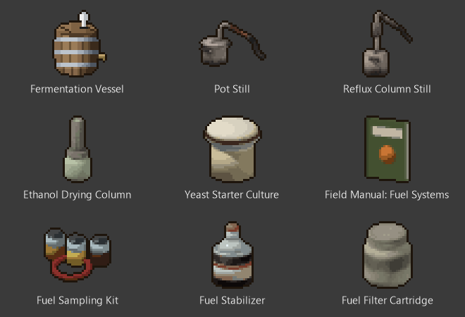

*The ethanol machines and the small items as they appear in the
inventory. The biodiesel machines and the Diesel Generator are pictured
under [Making biodiesel](#making-biodiesel) and [Diesel](#diesel).*

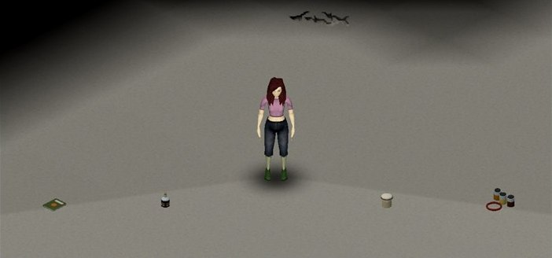

*Dropped on the floor, left to right: the Field Manual: Fuel Systems, the
Fuel Stabilizer, the Yeast Starter Culture and the Fuel Sampling Kit.*

## Inspecting fuel

Right-click a fuel can and open **Fuel (The Last Gallon)**:

* **Look and smell** gives a rough estimate and finds only obvious water.
* **Take a sample (kit)** needs a Fuel Sampling Kit (3 empty jars and a
  rubber hose). It gives a better estimate, finds smaller amounts of water
  and shows the blend. Your Mechanics skill makes it more precise.
* **What I know about it** lists each test you have done on this fuel,
  the more precise first: your latest kit sample and your latest look,
  each with how long ago you did it and what it found. A look does not
  replace what a kit found. Under a test it says whether fuel was poured
  in or out or treated, or the container opened or closed, since then;
  when the container is open, it warns that the fuel may have changed, so
  its actual condition may differ.

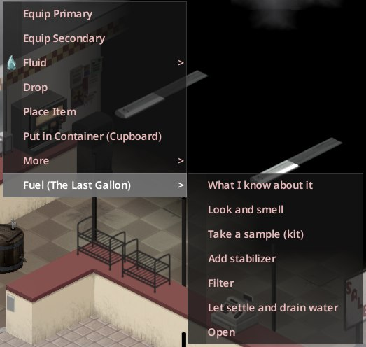

*The menu of a sealed petrol can, with a kit, a stabilizer and a filter cartridge carried.*

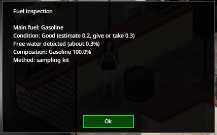

*A kit sample of petrol holding 0.3 % water: the kit finds the water and gives the blend.*

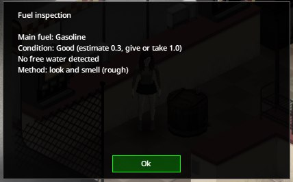

*A look at the same can two game hours later: a rougher estimate, and the water is missed.*

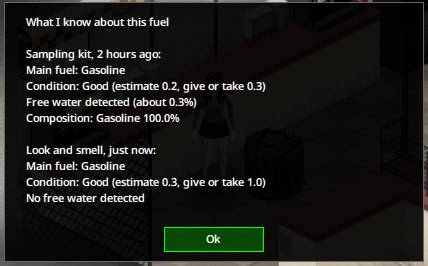

*What I know about it after both tests: the kit's result first, each test with its age.*

"Condition unknown" means the fuel has not been sampled yet, not that it
is bad. What you know belongs to your character: a new survivor starts
knowing nothing.

**Checked in game:** What I know about it, in single player and on a
server.

## Treating fuel

These are in the same **Fuel (The Last Gallon)** menu:

* **Add stabilizer**: one Fuel Stabilizer treats 20 L. More than a full
  dose does nothing extra. You craft it from charcoal and an empty jar.
* **Filter** needs a Fuel Filter Cartridge (rags, charcoal and a jar). It
  removes sediment, sludge and some free water, and a little fuel stays
  in the filter. It does not fix ageing.
* **Let settle and drain water** removes free water. A gasoline and
  ethanol blend with too much water separates, and the drained layer then
  takes ethanol with it.
* **Seal** and **Open**: an open container ages faster and picks up
  moisture.
* **Clean empty container** removes old residue, so it cannot spoil new
  fuel.

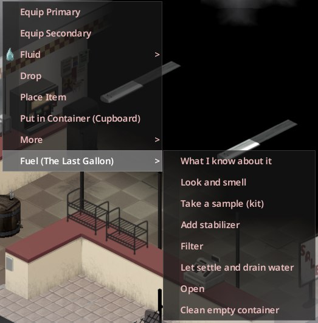

*On an empty can the menu adds Clean empty container.*

## Pouring into engines and tanks

With a fuel can in your inventory, the **Fuel (The Last Gallon)** menu
also offers, depending on what is near you:

* **Pour into this vehicle's tank**, when you stand at the vehicle's fuel
  filler;
* **Pour into the generator**, within two tiles of a generator;
* **Pour into the station reservoir**, within two tiles of a pump;
* **Drain the generator into this can**, within two tiles of a generator
  that holds fuel, when the can has room. The game itself has no way to
  empty a generator, and a conversion needs its fuel system drained.

These pours move any fuel the mod knows, with its condition, not only
petrol. If the result would be a blend the engine cannot use, nothing is
poured and a dialog says why; choose **Yes** in it to pour anyway.

**Checked in game:** in single player, pours into generators and a car:
petrol accepted, a blend the engine cannot use refused (nothing moved)
and poured after **Yes**, dried ethanol accepted without the dialog by a
converted generator and car. On a server, a pour with its result shown to
the player.

**Not checked in game:** **Pour into the station reservoir** and **Drain
the generator into this can**.

## Engines

A stock gasoline engine runs well on up to 15 % ethanol, struggles up to
25 % and will not run on more. A converted (flex) engine runs on any blend
of gasoline and ethanol, but starts poorly on near-pure ethanol in the
cold. Diesel engines run on diesel and biodiesel only; which engines are
diesel, and how much biodiesel each takes, is under [Diesel](#diesel).

Stale, wet or dirty fuel makes an engine harder to start. A car running on
it has less power, never below half, so it picks up speed more slowly; the
power comes back once the engine stops or gets good fuel. The same fuel
wears car and generator engines a little for every litre they burn on it;
a generator's wear shows the next time you refuel, move or switch it. Very
bad fuel will not run at all.

The sandbox option **Bad fuel can stall engines** turned off stops cars
from refusing to start or stalling because of their fuel, but poor fuel
still costs them power.

**Checked in game:** refused starts and stalls on unsuitable fuel, also on
the move (the car rolls to a stop); a converted car and generator running
on home-made ethanol; a car burning fuel at the game's own rate while
driving, the mod taking nothing extra and the tank keeping its blend; on
stale petrol a car running at 85 % of its power, getting it back when
stopped and its engine wearing for the litres it burned; with the option
off, a car on unsuitable fuel running at half power without stalling; a
generator on stale petrol worn when next refuelled.

**Not checked in game:** the mechanics window (it opens while the car
stands still and lists the engine's power) while the power is lowered.

## The field manual

The Field Manual: Fuel Systems turns up in gas station storage, garage and
mechanic shelves, farms, generator crates, bookstores, tool stores and
libraries. Choose **Inspect** to read it: one page sums up how to start
making ethanol, which engines take which fuel and what to do when a
machine or engine stops. The notebook button at the bottom of its window
shows the same text in larger print. It teaches no recipe; everything on
it is also in this guide.

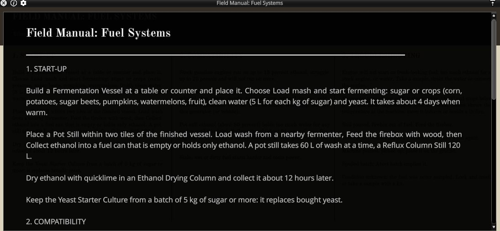

*The field manual's page in the larger-print window.*

**Checked in game,** in English and Italian: manuals rolled from the loot
lists as the game fills containers, and one read through **Inspect**.

## Making ethanol

### Building the machines

Build the machines from the crafting window (the button beside your
equipped items) or from the craft entry of an ingredient's inventory
menu. The crafting window lists them as **Make Fermentation Vessel**,
**Make Pot Still**, **Make Reflux Column Still** and **Make Ethanol
Drying Column**, and its search box finds them by name.

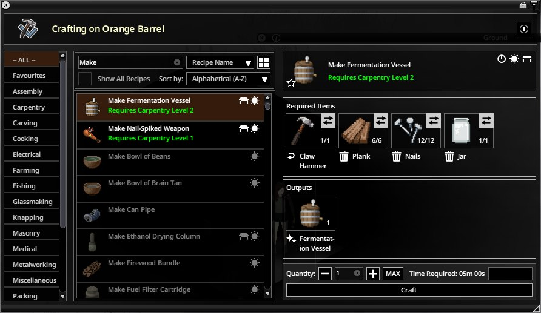

*The crafting window searched for "Make", the vessel picked with its ingredients carried.*

| Machine | Ingredients and tools | Where you make it |
| --- | --- | --- |
| Fermentation Vessel | six planks, twelve nails, an empty jar; a hammer; Carpentry 2 | a table or counter within two tiles |
| Pot Still | a cooking pot, two metal pipes, a rubber hose; a screwdriver | a table or counter within two tiles |
| Reflux Column Still | the Pot Still, two sheets of metal, three metal pipes; a blowtorch and a welding mask | welded in hand |
| Ethanol Drying Column | a metal pipe and an empty jar; a screwdriver | a table or counter within two tiles |

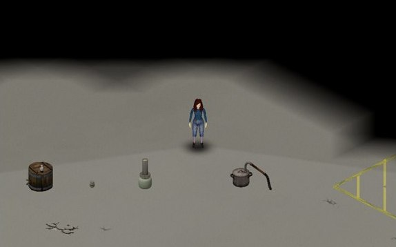

*Placed on the floor, left to right: the Fermentation Vessel, a Fuel
Filter Cartridge, the Ethanol Drying Column, the Pot Still and the Reflux
Column Still.*

Every machine works only while it stands on the ground. Right-click it and
open **Machine (The Last Gallon)** for its options; **Status** shows what
it is doing and the temperature at the machine.

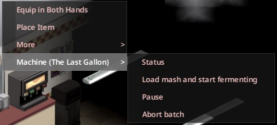

*The menu of a placed vessel with a batch running.*

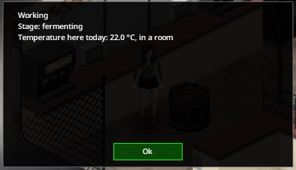

*Its Status: fermenting in a room at 22 °C, with the power grid on.*

**Checked in game:** every recipe of the mod (the machines, the sampling
kit, the filter cartridge and the stabilizer) found by name in the
crafting window and made with its **Craft** button or by double-clicking
it; with an ingredient missing, **Craft** stays disabled. The window was
used in English; the Italian names were checked as the game reads them.

### 1. Ferment a mash

1. Place the Fermentation Vessel on the ground.
2. Carry the feedstock, clean water and yeast. Feedstock is sugar, corn,
   potatoes, sugar beets, pumpkins, watermelons or fruit; the mash takes
   5 L of water per kg of sugar.
3. Choose **Load mash and start fermenting**.

Fermenting takes about 4 days when warm. It slows below 18 °C and stops
below 8 °C, and a batch stopped for 3 days in all spoils.

The vessel is carried in both hands, one heavy item at a time, like a
generator. Double-click it or drag it in the loot window to pick it up. It
goes down at your feet when you get into a vehicle, take another heavy
item or equip a weapon, and before anything with its own animation, such
as looting, eating or dressing. If you die carrying it, it falls at your
feet and its batch goes on there.

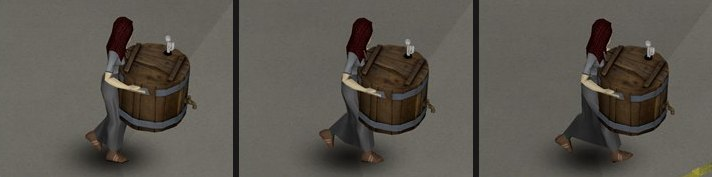

*The Fermentation Vessel carried in both arms while walking.*

### Keeping a batch warm

A machine has the temperature of where it stands, averaged over the day:

* outdoors, the outdoor air;
* in a room, part of the way to 22 °C: in January 10–13 °C above the
  outdoor air, and 22 °C while the power grid is on;
* warmer beside a lit fireplace, wood stove, campfire or barbecue.

In a freezing spell a room alone is not enough: keep a fireplace or fire
well fed near the vessel. The more fuel a fire has, the farther its warmth
reaches, to the tiles it can see: a fireplace up to 8 tiles with an hour
of fuel, a campfire up to 10 with six hours. A barbecue's warmth is milder
and reaches 3 tiles: outdoors in January a vessel one tile away averaged
1–8 °C a day over two tests, too cold to ferment most of the time.

With the default settings a log burns 6 hours and a fire holds at most 8
hours of fuel, so a log fits only once 2 hours or less are left, and a
fire kept going takes about 4 logs a day. The fire burns on while you are
away, and its warmth counts for as long as its fuel lasts, at most 8
hours: feed it a few minutes before you leave. If you stay away longer,
the batch cools and the fire is out when you return. A campfire's reach
shrinks as it burns down (5 tiles with 3 hours left, 2 with under 1¾
hours), and that counts while you are away too, so feed it well before
you go.

### 2. Distil the wash

1. Place the Pot Still within two tiles of a vessel whose fermentation has
   finished.
2. Choose **Load wash from a nearby fermenter**. The pot still takes up to
   60 L of wash at a time.
3. Choose **Feed the firebox**. It burns all the wood you carry that fits
   (firewood, logs, twigs, and planks too), so leave building planks
   behind. The firebox holds 30 kg: three logs (27 kg) distil about 60 L,
   and a fourth log stays in your bag.
4. When it has finished, choose **Collect ethanol into a fuel can** with an
   empty fuel can or one that holds only ethanol. The still never fills a
   can with other fuel in it.
5. If the vessel has more wash, collect the ethanol first, then choose
   **Load wash from a nearby fermenter** again.

A Pot Still gives about 80 % ethanol. A Reflux Column Still takes 120 L of
wash at a time, gives about 94 % and recovers more.

Batches of 5 kg of sugar or more leave a Yeast Starter Culture, which
replaces bought yeast. It comes with the last of the wash, so with a big
batch and a pot still it appears on the second load.

### 3. Dry the ethanol

Pot-still ethanol holds too much water for any engine until you dry it.
Reflux ethanol runs converted engines as it is, but dry it before you
blend it with gasoline: wet ethanol in gasoline separates.

1. Place the Ethanol Drying Column.
2. Carry the can of ethanol and quicklime.
3. Choose **Dry ethanol with quicklime**.
4. After about 12 hours, collect the result into a fuel can.

### Moving a working machine

Picking up a working machine pauses it; put it down to continue. The hours
it stood count, the hours you carried it do not, and a still's firewood
burns only while it stands. In multiplayer, a working machine picked up
with the world menu's **Grab** can lose up to ten minutes of work before
the pickup.

### Pause, Resume and Abort batch

**Pause** holds a batch where it is and **Resume** carries on, but a paused
vessel still counts towards the 3 days that spoil its batch.

**Abort batch** stops a batch and keeps what it made so far: a vessel's
weaker wash for a still, a still's spirit, a drying column's ethanol. The
rest (a still's undistilled wash, spent lime) is thrown away, and the
message lists both. A still makes no spirit while it heats up, during its
first hour, so a still aborted then keeps nothing and its wash is thrown
away. Choose **Abort batch** again to throw the kept part away too; a
spoiled batch is emptied the same way.

### What has been checked

**Checked in game:**

* building the four machines and running one batch through the vessel,
  the Reflux Column Still and the drying column with the menu entries
  above;
* January batches outdoors, in a room and on a tile warmed by a heat
  source added for the test: the first two stopped and spoiled, the
  warmed one finished;
* a January batch beside a house fireplace kept fed with logs: it
  finished, and the fire's warmth counted through the first 6 hours of a
  12-hour absence, as long as its fuel lasted (the test lit and fed the
  fire without its menu);
* January batches outdoors beside a campfire and beside a barbecue, both
  lit and fed from their menus: their warmth counted over a 12-hour
  absence for as long as their fuel lasted;
* working vessels, both stills and the drying column picked up and put
  down again: paused while carried, working again once down, the hours
  they stood counted to the minute and the hours carried not at all, a
  still's firewood burning only while it stood; in multiplayer, a vessel
  moved with the world menu's **Grab**;
* the vessel dropped at its carrier's death, in single player and on a
  server;
* a 12 kg batch through the pot still in two loads: the firebox left to
  run out and fed again, the yeast starter coming with the last of the
  wash, the spirit unfit for any engine until dried and then fit for flex
  engines (by the mod's start check, not an engine start);
* **Pause**, **Resume** and **Abort batch** on vessels, a drying column and
  running stills: a pot still took a stopped vessel's wash, a spoiled
  vessel was emptied and loaded again, a still paused for three hours
  burned no wood meanwhile, and a still aborted while distilling kept only
  the spirit it had made.

**Not checked in game:** a campfire built indoors, a propane barbecue,
machines on upper floors, and stopped days adding up across separate cold
spells.

## Making biodiesel

Biodiesel is made from cooking oil, methanol and lye. You find or press
the oil; you make the methanol and the lye from wood. Five machines do the
work, each handing its product to the next:

| Machine | Takes | Makes |
| --- | --- | --- |
| Wood Retort | wood to distil, and wood in its firebox | methanol, for the reactor |
| Ash Barrel | wood to burn | wood ash, for the leacher |
| Lye Leacher | the barrel's ash, clean water, wood in its firebox | lye, for the reactor |
| Biodiesel Reactor | cooking oil, the retort's methanol, the leacher's lye, wood in its firebox | crude biodiesel, for the wash tank |
| Biodiesel Wash Tank | the reactor's crude biodiesel, clean water, wood in its firebox | biodiesel, for a fuel can |

A machine that takes from another finds it within two tiles, so stand the
barrel by the leacher, the retort and the leacher by the reactor, and the
reactor by the wash tank. Only the wash tank fills a can: methanol, lye and
crude biodiesel go from machine to machine and nowhere else.

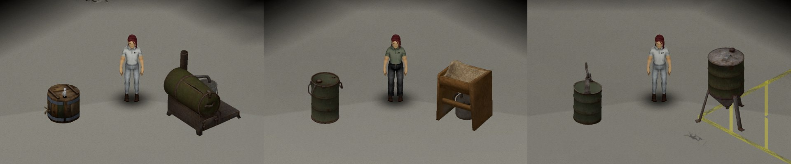

*Left to right: the Fermentation Vessel (for size) and the Wood Retort;
the Ash Barrel and the Lye Leacher; the Biodiesel Reactor and the Biodiesel
Wash Tank.*

### Building the biodiesel machines

The crafting window lists them as **Make Wood Retort**, **Make Ash
Barrel**, **Make Lye Leacher**, **Make Biodiesel Reactor** and **Make
Biodiesel Wash Tank**.

| Machine | Ingredients and tools | Where you make it |
| --- | --- | --- |
| Wood Retort | a metal drum, two sheets of metal, two metal pipes, a bucket; a blowtorch and a welding mask | welded in hand |
| Ash Barrel | a metal drum, two steel rods; a hammer | in hand |
| Lye Leacher | six planks, twelve nails, a cheese cloth, a cooking pot; a hammer; Carpentry 2 | a table or counter within two tiles |
| Biodiesel Reactor | a metal drum, a sheet of metal, two steel rods, a metal pipe; a blowtorch and a welding mask | welded in hand |
| Biodiesel Wash Tank | a metal drum, two sheets of metal, three steel rods, a metal pipe; a blowtorch and a welding mask | welded in hand |

Like the ethanol machines, each works only while it stands on the ground,
and its options are under **Machine (The Last Gallon)**.

### How much of each

A litre of oil takes 0.15 L of methanol and 12.5 g of lye, and gives a
little under a litre of biodiesel. The lye limits a batch:

* a full Ash Barrel (99 kg of wood, eleven logs) gives 1.5 kg of ash, which
  the leacher turns into 0.22 kg of lye: enough for about 17 L of oil;
* a full Wood Retort (the same 99 kg, and about 25 kg more in its firebox)
  gives 5 L of methanol: enough for about 33 L of oil.

A log counts as 9 kg of wood, a piece of firewood as 2 kg, a plank as
1.5 kg and a bundle of twigs as 0.3 kg.

Loading wood and **Feed the firebox** both take all the wood you carry
that fits. Where a machine has both, carry the firebox's wood and feed it,
then fetch the wood for the load.

### 1. Distil wood into methanol

1. Place the Wood Retort.
2. Carry about three logs and choose **Feed the firebox**. The firebox
   holds 40 kg; a full load burns about 25 kg.
3. Carry the wood to distil, 10 to 100 kg, and choose **Load firewood to
   distil**.

The retort heats up for an hour and a half, distils 10 kg an hour (two
hours at least) and cools for six hours. A full load is done after about
17 hours and holds 5 L of methanol. The methanol stays in the retort until
a reactor takes it.

### 2. Burn wood to ash

1. Place the Ash Barrel within two tiles of where the Lye Leacher will
   stand.
2. Carry 5 to 100 kg of wood and choose **Load firewood and burn it to
   ash**.

The barrel burns 20 kg an hour (an hour at least) and cools for 12 hours.
A full barrel is done after about 17 hours and holds 1.5 kg of ash. It has
no firebox. It can burn while the retort works.

### 3. Leach the ash into lye

1. Place the Lye Leacher within two tiles of the finished barrel.
2. Carry one log and choose **Feed the firebox** (it burns about 7 kg).
3. Carry clean water, 2 L for each kilogram of ash (3 L for a full
   barrel's ash), and choose **Load ash from a nearby ash barrel, and
   water**. With less water than that, the leacher takes less ash and the
   rest stays in the barrel.

Leaching takes 24 hours and boiling the lye down 4 more. A kilogram of ash
gives 0.15 kg of lye, which stays in the leacher until a reactor takes it.

### 4. React the oil

1. Place the Biodiesel Reactor within two tiles of the finished retort and
   the finished leacher.
2. Carry one log and choose **Feed the firebox** (it burns about 3 kg).
3. Carry the oil and choose **Load oil, with methanol and lye from nearby
   machines**. A bottle of Vegetable Oil or Olive Oil counts as 0.9 L and
   a piece of Lard as 0.4 L. The reactor takes 5 to 100 L, in whole
   bottles, as many as the methanol and the lye at hand allow, and draws
   the methanol and the lye for them itself. Bottles it cannot use stay
   with you.

Mixing takes half an hour, the reaction 2 hours and settling 8 hours.
Settling slows below 10 °C and stops below 0 °C. The crude biodiesel stays
in the reactor until a wash tank takes it.

### 5. Wash and dry the biodiesel

1. Place the Biodiesel Wash Tank within two tiles of the finished reactor.
2. Carry one log and choose **Feed the firebox** (it burns about 2 kg).
3. Carry clean water, 0.3 L for each litre of biodiesel (about 5 L for a
   17 L batch), and choose **Load crude biodiesel from a nearby reactor,
   and wash water**. The tank takes the reactor's whole batch; the
   reactor's glycerin is thrown away.
4. After the wash (an hour), the settling (24 hours) and the drying
   (3 hours), choose **Collect biodiesel into a fuel can** with an empty
   fuel can or one that holds only biodiesel.

From logs to a can, a batch takes about three and a half days when each
machine is loaded as soon as the one before it has finished. The biodiesel
keeps about 1 % of unreacted oil and a trace of methanol, which diesel
engines tolerate.

### What has been checked

**Checked in game:**

* the five machines made in the crafting window with its **Craft** button;
* in single player, one batch through the menu entries above, from 22 logs
  (and 6 more in the fireboxes), 8 L of water and 19 bottles of Vegetable
  Oil to 17 L of biodiesel in one jerry can, with the hours, the firebox
  wood and the amounts given above; the loads that need a finished machine
  refused while there was none, and the retort's methanol refused to a
  can;
* on a server, each of the five loads, the collection into a can and the
  retort's refusal, on machines the test server had set up finished.

**Not checked in game:** Olive Oil, Lard and a part-used bottle; a batch
limited by the methanol; the charcoal a retort gives back when its last
methanol is taken; a firebox running out during a batch; **Pause**,
**Resume** and **Abort batch** on these machines; one picked up while it
works; a save with a batch running; settling in the cold; a batch running
through its hours on a server; the machines' menus read in Italian (their
Italian texts load as shipped).

## Diesel

In a world started with this version some vehicles and some station pumps
are diesel. A world started earlier keeps every vehicle and pump on petrol
([Existing saves](#existing-saves)).

### Diesel vehicles

These have a diesel engine and are found with diesel in the tank:

* the Dash Bulldriver in all its liveries (fire department, police,
  ranger, Fossoil and the trade ones);
* the six-seat Franklin Valuline in all its versions, the Prisoner
  Transport and Airport ones included;
* the LBMW Radio Van and the Triple-N Van;
* the Ambulance.

Every other vehicle is petrol, the two-seat Franklin Valuline trade vans,
the Chevalier D6 and the Chevalier Step Van included. The game shows no
sign of the engine type: go by the model.

A diesel vehicle runs on diesel and on biodiesel. Up to 20 % biodiesel in
its diesel costs nothing; with more it starts less reliably, has less
power and wears faster. Petrol or ethanol in its tank stops it from
starting, and diesel does the same to a petrol engine. **Pour into this
vehicle's tank** refuses such a pour and says why. The game's own
refuelling, from a can or at a pump, does not check: if a vehicle will not
start after it, siphon the tank with the game's **Siphon Gasoline** and
fill it with the right fuel.

### The Diesel Generator

The Diesel Generator is found where the game's generators are: in the
generator crates of electronics stores, where about one generator in
fifteen is a diesel one, and in some truck beds. It is the green one, and
it works like the others: carried in both hands, put down, connected and
switched on the same way.

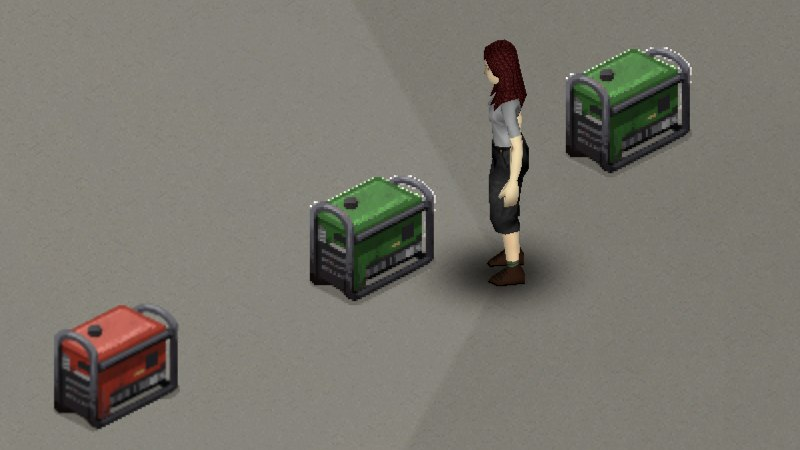

*Two Diesel Generators and, on the left, the game's red petrol generator.*

It burns diesel or biodiesel in any blend, pure biodiesel included. Fill
it with **Pour into the generator**. The game's own **Add Fuel** takes
petrol cans only, and petrol stops the Diesel Generator from starting.

### Diesel pumps

About one pump in four gives diesel instead of petrol. Each pump is drawn
on its own, so a station may have several diesel pumps or none. Right-click
a pump and choose **Read what this pump gives** before you fill up.

The game's own **Take Fuel** and **Refuel from Gas Pump** deliver what the
pump holds, with its water and sediment. The game offers **Take Fuel** for
an empty can or one that already holds petrol, so a can holding diesel
cannot be topped up at a pump: bring empty cans.

### What has been checked

**Checked in game:**

* in a new world, a six-seat Franklin Valuline, an LBMW Radio Van, an
  Ambulance and a Fire Department Dash Bulldriver read as diesel, and a
  Chevalier D6 and a Franklin Valuline trade van as petrol; the Ambulance
  started on the diesel it was found with and took 5 L of biodiesel; a
  petrol pour into the Dash Bulldriver was refused;
* the Diesel Generator fuelled with biodiesel, started and run for two
  hours; petrol put in with **Add Fuel** stopped another from starting;
  one picked up and put down again, and one left on the ground through a
  save and a reload, each still a Diesel Generator with its fuel; rolled
  from the generator crates' loot list as the game fills a container;
* a pump's **Read what this pump gives**; an empty can and an Ambulance's
  empty tank filled with diesel at a diesel pump with the game's own
  actions, the Ambulance then starting; a Dash Bulldriver filled at a
  petrol pump refused to start;
* on a server: the Diesel Generator seen, fuelled, started, picked up and
  put down; the Ambulance read as diesel and started; a diesel pump read
  and a can filled at it.

The pumps in these tests were set to diesel or petrol by the test; a pump
left to the world's own draw was read, not filled from.

**Not checked in game:** driving on diesel or biodiesel; a diesel vehicle
on pure biodiesel; biodiesel in the cold; siphoning a diesel tank; a
Diesel Generator found in a crate on the map or in a truck bed, or
powering anything; **Pour into the station reservoir** at a diesel pump;
a vehicle refuelled at a pump on a server.

## Converting an engine

A flex conversion lets an engine run on any blend of gasoline and
ethanol. Right-click the generator or car and choose **Workshop: convert
this generator** (or **Workshop: convert this vehicle**):

1. **Start: …** starts the project. It needs the skills and recipe below
   and a screwdriver, and the engine must be off.
2. **Hand over parts** takes the listed parts from your inventory.
3. **Work on it**: your character walks to the engine or the generator and
   works there until the conversion is finished or something is missing;
   a message then says what. Every stage needs its tools (screwdriver,
   wrench, pliers), and the fuel tank must be empty while you drain the
   fuel system and install the parts. Walking away stops the work, and the
   time away never counts: choose **Work on it** again to carry on. A
   helper can work alongside you.
4. There is no progress bar: **Project status** shows which stage the work
   has reached. When it reads **Converted and commissioned**, the engine
   is flex.

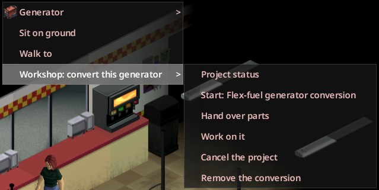

*A basic generator's menu; this guide covers its flex-fuel conversion.*

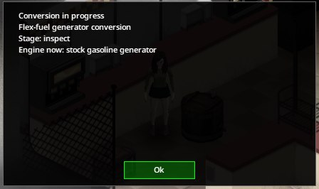

*Project status after Start and Hand over parts: the work is at its first stage.*

| | Generator | Standard car |
| --- | --- | --- |
| Skills | Mechanics 2, Electrical 2 | Mechanics 4 |
| Recipe (magazine) | Generator ("How to Use Generators") | Basic Mechanics ("Laines Standard Auto Manual") |
| Parts | 1 rubber hose, 4 screws, 1 electric wire | 2 rubber hoses, 2 engine parts, 6 screws, 2 electric wires |
| Work | 7.5 hours | 13 hours |

**Cancel the project** returns three quarters of the parts handed over;
**Remove the conversion** returns half of them from a finished one. Small
cars, pickup trucks, step vans and the other generator models have their
own conversions. Diesel vehicles and the Diesel Generator have none.

**Checked in game:** a standard car and the basic generator converted
from this menu, with the walk to the engine, the work stopping once the
character was out of reach and ending when a tool was missing; both then
ran on ethanol. **Project status** read on a generator with a project
started.

**Not checked in game:** cancelling, removing, and the other models.

## Stations

Pumps hold old fuel that ages underground, slowly. Most stations hold only
a trace of water, but about one in ten is contaminated: its fuel makes a
stock car hard to start until you drain the water or dilute it with
cleaner fuel. Sample before you fill up at a station you do not know.
Every litre you take leaves the station's reservoir exactly once. In a
world started with this version, about one pump in four gives diesel
([Diesel pumps](#diesel-pumps)).

**Checked in game:** the reservoir accounting.

## Troubleshooting

| Symptom | Cause | What to do |
| --- | --- | --- |
| "Condition unknown" | the fuel has not been sampled | Choose **Look and smell**, or **Take a sample (kit)** with a sampling kit |
| An engine will not start on fresh-looking fuel | too much ethanol for a stock engine, or water | Take a sample; drain the water; use gasoline or convert the engine |
| A car is slow to pick up speed | stale, wet or dirty fuel lowers its power while the engine runs; it comes back when the engine stops | Take a sample; drain the water or filter the fuel; use better fuel |
| A vessel is paused: "Reason: too cold here" | below 8 °C at the machine today; **Status** shows the temperature | Move it into a room, or beside a lit fireplace, wood stove or campfire (a barbecue is too weak outdoors on a frosty day). While you are away a fire keeps it warm only as long as its fuel lasts. After 3 days paused in all, the batch spoils |
| A still is paused: "Reason: the firebox is out of fuel" | the wood ran out | Choose **Feed the firebox** |
| A vessel says "Wash is left: load it again when the still is free" | the still takes 60 L (pot) or 120 L (reflux) at a time | Collect the still's ethanol, then choose **Load wash from a nearby fermenter** again |
| A machine is paused: "Reason: it was picked up; place it to continue" | it was carried | Place it on the ground |
| A biodiesel machine says "No finished ash barrel within two tiles." (or wood retort, lye leacher, reactor) | the machine it takes from has not finished, or stands more than two tiles away | Read that machine's **Status**; wait for it, or move the two together |
| The reactor says "The leacher holds too little lye for a batch." or "The retort holds too little methanol for a batch." | the smallest batch is 5 L of oil, which takes 63 g of lye and 0.75 L of methanol | Run another barrel and leacher, or another retort load |
| "This goes to the next machine, not into a can." | methanol, lye and crude biodiesel are never collected | Load the next machine in the chain |
| A vehicle or the Diesel Generator will not start after refuelling | petrol in a diesel tank, or diesel in a petrol one | Choose **Read what this pump gives** before filling. Siphon a vehicle's tank, or empty the generator with **Drain the generator into this can** (not checked in game), and refill with the right fuel |
| A vessel is **Faulted**: "Reason: the batch spoiled while stalled" | it was stopped for 3 days in all, pauses by hand included | **Abort batch** empties it; then load a new mash |

## Existing saves

When you add the mod to a save with the load screen's **Choose Mods...**,
the fuel already in that world is eased in over 30 days:

* fuel the mod first records in the first days (when you first look at it,
  pour it or refuel with it) starts almost fresh;
* fuel you first touch later starts more aged;
* from 30 days after installation, fuel starts as aged as the world.

Once recorded, that fuel ages like any other. A single-player save takes
the mod's default for this: the sandbox option **Existing saves** set to
**Transition period**. The load screen has no setting for it.

Diesel vehicles and diesel pumps exist only in a world started as a new
game with version 0.2.0 or later: in an older save every vehicle and pump
stays petrol. The biodiesel machines work in any save.

A save made with an earlier version of the mod continues with this one.
Replace the mod's folder and load the save: the fuel the mod had recorded
stays as it was.

**Checked in game:**

* a world played 10 days without the mod, then with this version. A can
  first looked at and a station pump recorded at installation were fresh,
  and the look was remembered; a can first used 6 days later was a fifth
  of the way to the world's age; an Ambulance read as petrol and all eight
  pumps of the station gave petrol;
* a world started with version 0.1.2, then continued with this version.
  Its cans, a pump, an Ambulance, a car and a generator read as 0.1.2 had
  recorded them; a vessel's batch was still running; the Ambulance started
  on its petrol and the pump still gave petrol; this version's machines
  and fuels exist in that save, and a Diesel Generator put down there had
  its picture.

**Not checked in game:** the other two settings (**Age from world start**
and **Start ageing at installation**), servers, and a save from version
0.1.0 or 0.1.1.

## Removing the mod

When the game loads a save without the mod, it drops, without a warning,
everything it no longer knows: the mod's items (the machines with their
batches, empty or not) and the mod's fluids in any container. Before you
remove the mod, use up what you want to keep: ethanol, diesel, biodiesel,
and contaminated fuel, whose water and sediment are the mod's fluids too.
The machines cannot be kept. Stop every car running on poor fuel before
your last save with the mod: a car saved while running keeps its lowered
power without the mod, until a repair.

A Diesel Generator standing on the ground stays in the save, but its
picture is the mod's: once the save has been loaded without the mod the
generator has no picture, and putting the mod back does not bring it
back. Use up its fuel before you remove the mod.

Petrol stays, and so does what the mod recorded about it. If you put the
mod back later, it finds that record as it was; the world's fuel history
does not start again, so nothing comes back fresh. Petrol poured out of a
can meanwhile leaves the rest as it was. Petrol added meanwhile counts as
fuel of unknown origin from the next time the mod sees the can.

**Checked in game:** the mod taken off a save with the load screen's
**Choose Mods...**, a day played, and the mod put back. A vessel with a
batch running, a Wood Retort and a can of ethanol were gone; a petrol can
poured from and one topped up read as described above; a Diesel Generator
on the ground was left without its picture, its fuel record kept; the
station's pumps gave the same fuel as before.

**Not checked in game:** the mod's other fluids and items, diesel in a
vehicle's tank or a can, how a Diesel Generator without its picture looks
and what can be done with it, converted engines, and a save whose mod was
uninstalled,
where the game asks about missing mods.

The technical details are in `docs/migrations.md`.
